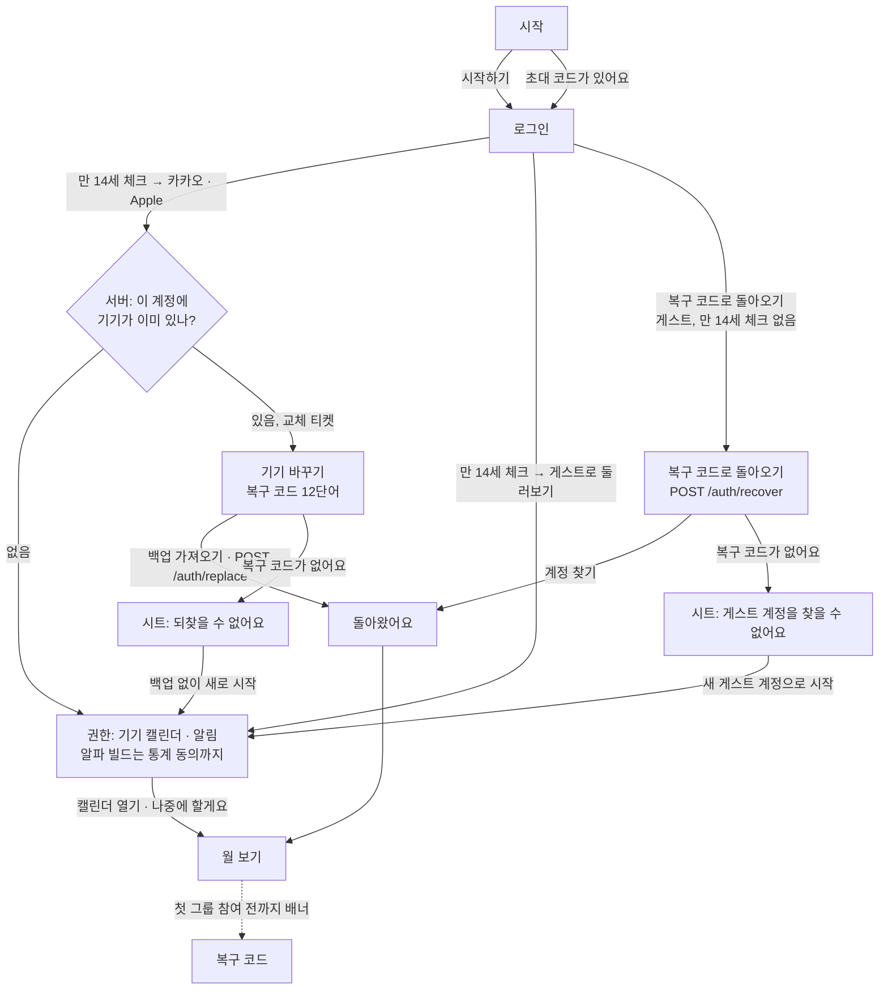
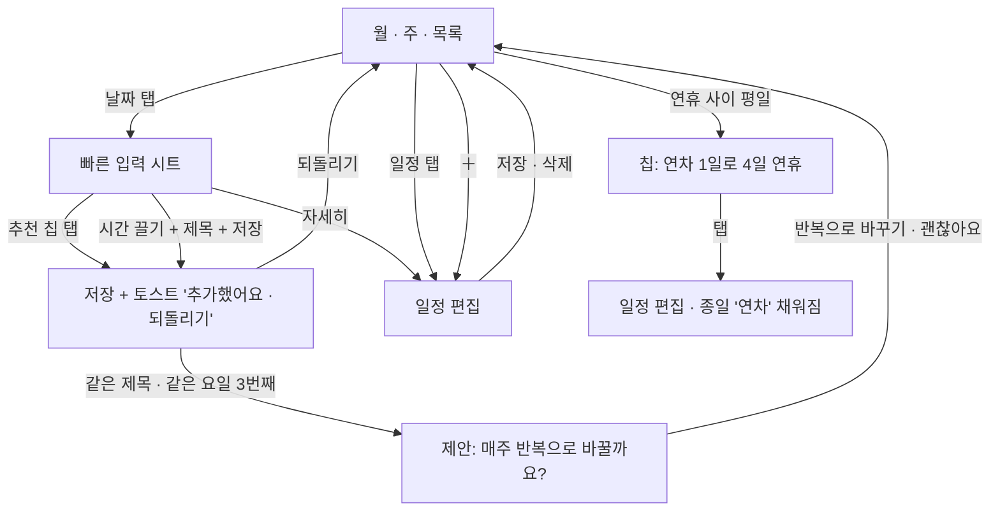
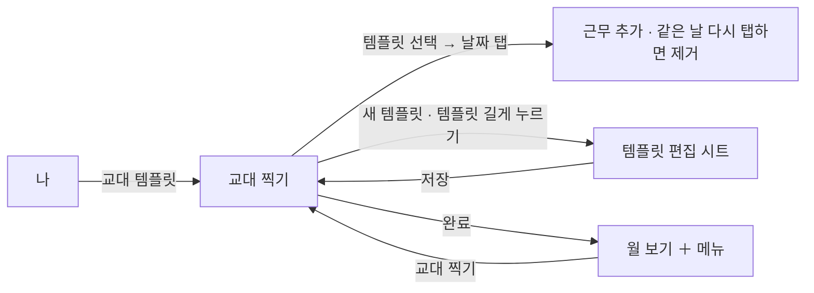
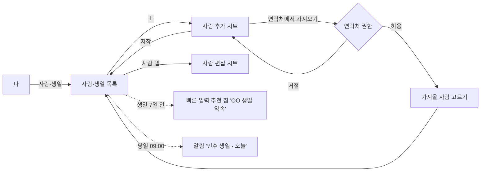
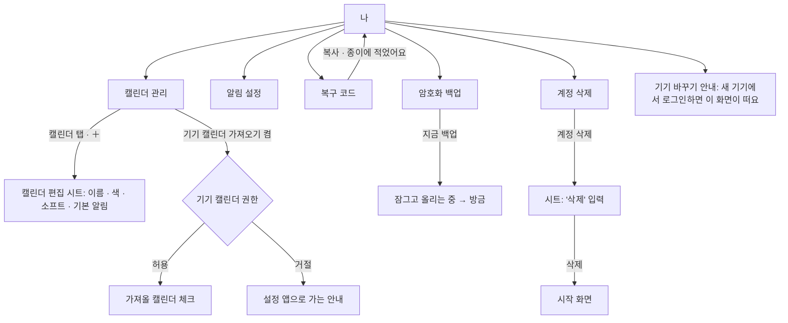

# M1 화면 흐름도와 와이어프레임

M1 캘린더 알파에 들어가는 화면 전부입니다. 흐름도는 화면이 어떻게 이어지는지, 와이어프레임 표는 화면마다 무엇이 있고 어떤 상태가 있는지 적습니다. 그림은 [화면 시안](screens.md)의 PNG이고, 값은 [`tokens.json`](tokens.json)과 [컴포넌트](components.md), 문구는 [문구와 톤](tone.md)을 따릅니다. 기능 규칙은 [개요](../kickoff.md) 5.1·5.2장입니다.

M1에는 그룹이 없습니다. 그룹·채팅 탭은 M2·M3에서 더하고, M1의 탭 막대는 **캘린더 · 나** 두 개입니다. 다음 할 일 막대는 M1부터 있습니다(내 일정과 생일만).

## 1. 화면 목록

| 번호 | 화면 | 종류 | 시안 |
| --- | --- | --- | --- |
| 1 | 시작 | 전체 화면 | [01-welcome](screens/m1/01-welcome@2x.png) |
| 2 | 로그인 | 전체 화면 | [02-sign-in](screens/m1/02-sign-in@2x.png) |
| 3 | 권한 | 전체 화면 | [03-permissions](screens/m1/03-permissions@2x.png) |
| 4 | 월 보기(홈) | 탭 첫 화면 | [04-month](screens/m1/04-month@2x.png) |
| 5 | 빠른 입력 시트 | 시트 | [05-quick-entry](screens/m1/05-quick-entry@2x.png) |
| 6 | 추가한 뒤(토스트) | 상태 | [06-added](screens/m1/06-added@2x.png) |
| 7 | 주 보기 | 탭 첫 화면 | [07-week](screens/m1/07-week@2x.png) |
| 8 | 목록 보기 | 탭 첫 화면 | [08-list](screens/m1/08-list@2x.png) |
| 9 | 일정 편집 | 전체 화면(모달) | [09-editor](screens/m1/09-editor@2x.png) |
| 10 | 교대 찍기 | 전체 화면(모달) | [10-shift](screens/m1/10-shift@2x.png) |
| 11 | 사람·생일 | 밀어 들어가는 화면 | [11-people](screens/m1/11-people@2x.png) |
| 12 | 나 | 탭 첫 화면 | [12-me](screens/m1/12-me@2x.png) |
| 13 | 복구 코드 | 밀어 들어가는 화면 | [13-recovery](screens/m1/13-recovery@2x.png) |
| 14 | 위젯 | 홈 화면 | [14-widgets](screens/m1/14-widgets@2x.png) |
| 15 | 캘린더 관리 | 밀어 들어가는 화면 | [15-calendars](screens/m1/15-calendars@2x.png) |
| 16 | 캘린더 편집 | 시트 | [16-calendar-edit](screens/m1/16-calendar-edit@2x.png) |
| 17 | 사람 추가·편집 | 시트 | [17-person-edit](screens/m1/17-person-edit@2x.png) |
| 18 | 교대 템플릿 편집 | 시트 | [18-template-edit](screens/m1/18-template-edit@2x.png) |
| 19 | 알림 설정 | 밀어 들어가는 화면 | [19-notifications](screens/m1/19-notifications@2x.png) |
| 20 | 암호화 백업 | 밀어 들어가는 화면 | [20-backup](screens/m1/20-backup@2x.png) |
| 21 | 기기 바꾸기 | 전체 화면 | [21-restore](screens/m1/21-restore@2x.png) |
| 22 | 계정 삭제 | 밀어 들어가는 화면 | [22-delete-account](screens/m1/22-delete-account@2x.png) |
| 23 | 기기 로그아웃됨 | 시트 | [23-revoked](screens/m1/23-revoked@2x.png) |
| 24 | 다른 계정의 일정이 남았을 때 | 시트 | [24-keep-local](screens/m1/24-keep-local@2x.png) |

"밀어 들어가는 화면"은 오른쪽에서 들어오고 왼쪽 위 "‹ 이전 화면"으로 돌아갑니다. "모달"은 아래에서 올라오고 왼쪽 위 "취소", 오른쪽 위 "저장·완료"입니다. 시트는 손잡이가 있고 끌어내려 닫습니다.

## 2. 흐름도

### 2.1 처음 시작

- 만 14세 확인을 체크해야 로그인 버튼이 켜집니다. 확인한 시각만 저장합니다.
- 게스트도 로그인 화면에서 만 14세 확인을 체크한 뒤 시작합니다(시작 화면에는 게스트 버튼이 없음). 계정은 `POST /auth/guest`로 만들고, 이름은 기본값 "게스트"로 보냅니다(그룹에서 쓸 이름은 M2의 그룹 프로필에서 정함). 기기를 잃으면 복구 코드로만 돌아올 수 있다고 알리고, 나중에 "나"에서 카카오·Apple에 연결합니다.
- 오프라인에서 게스트로 시작하면 체크한 시각을 기기에 두고 캘린더를 기기에서만 씁니다. 처음 연결될 때 그 시각(`age_confirmed_at`)으로 계정을 만들고, 그때까지 "나"의 프로필 카드는 "게스트 · 연결되면 계정을 만들어요"입니다.
- 계정당 활성 기기는 1대입니다. 두 번째 기기에서 카카오·Apple로 로그인하면 서버가 교체 티켓을 주고 기기 바꾸기로 갑니다. 이전 기기는 복원이 끝나거나 "백업 없이 새로 시작"을 고른 뒤에야 로그아웃됩니다(계약 13장).
- 게스트는 카카오·Apple이 없으므로 로그인 화면의 "복구 코드로 돌아오기"로 들어옵니다. 복구 코드가 곧 자격 증명이라 교체 티켓 없이 바로 이 기기가 활성 기기가 되고, 카카오·Apple에 연결한 계정은 이 길을 쓸 수 없습니다.
- 이전 기기는 다음 요청에서 403 `device_revoked`를 받고 23번 화면을 띄웁니다. 일정은 남고, 세션·기기 키·복구 코드의 `E`·AMK·그룹 상태는 지워집니다(계약 13장).
- 로그인이나 복원이 끝났을 때 이 기기의 저장소가 **다른 계정**의 것이면 합치지 않고 24번 시트로 가져올지 지울지 묻습니다(계약 10장 복원 4단계). 같은 계정이면 합칩니다.
- 권한은 둘 다 거절해도 월 보기로 갑니다. 거절한 것은 "나 › 캘린더 관리", "나 › 알림"에서 다시 켤 수 있습니다.
- 복구 코드는 처음부터 강요하지 않습니다. 월 보기 위에 배너("복구 코드를 저장해 두세요 · 첫 그룹에 들어가기 전까지")로 알리고, M2에서 첫 그룹에 들어갈 때 반드시 거칩니다.

### 2.2 일정 넣기와 고치기

- 빠른 입력은 추천 칩 다섯 개와 끌어서 고르는 시간 범위, 제목 입력 한 칸입니다. 칩은 누르는 즉시 저장되고 시트가 닫힙니다.
- 월·주·목록 사이는 머리글의 세그먼트로 바꿉니다. 마지막으로 본 뷰를 기억합니다.
- 기기 캘린더에서 가져온 일정을 누르면 편집 대신 읽기 전용 상세가 열리고 "이 일정은 기기 캘린더에서 왔어요. 그 앱에서 고칠 수 있어요"를 보여 줍니다.

### 2.3 교대 템플릿

찍은 근무는 템플릿의 캘린더(기본 '알바')에 들어가는 일반 일정입니다. 템플릿을 고치거나 지워도 이미 찍은 근무는 남습니다.

### 2.4 사람·생일

음력 생일은 저장할 때 음력으로 두고, 해마다 그 해의 양력 날짜로 바꿔 캘린더와 알림에 넣습니다.

### 2.5 나: 캘린더 관리 · 알림 · 백업 · 계정

- 기기 바꾸기는 **새 기기**에서 하는 일입니다. 현재 기기의 "나 › 기기 바꾸기"는 절차 안내와 복구 코드 보기로 이어집니다.
- 계정 삭제 뒤에도 이 기기의 일정은 남고, 앱은 그룹 기능 없는 캘린더로 계속 쓸 수 있습니다.

### 2.6 위젯과 알림에서 들어오기

| 출발 | 도착 |
| --- | --- |
| 작은 위젯(오늘) | 월 보기, 오늘 |
| 중간 위젯의 일정 | 일정 편집(읽기) |
| 중간 위젯의 다음 약속 | 약속 상세(M2). M1에서는 내 일정이면 일정 편집 |
| 일정 알림 | 일정 편집(읽기) |
| 생일 알림 | 사람·생일, 그 사람 |
| 연차 제안 알림 | 월 보기, 그 주 |

## 3. 와이어프레임

화면마다 위에서 아래 순서로 적습니다. 크기는 pt이고, 높이가 적힌 것은 고정 높이입니다. "코어"는 Rust 코어에서 받아야 하는 데이터와 부르는 동작입니다.

### 1. 시작

| 항목 | 내용 |
| --- | --- |
| 목적 | 앱이 무엇인지 띠 하나로 보여 주고 시작하게 합니다 |
| 구성 | 앱 이름(17 · 600) → 미리보기 카드: 날짜, 그룹 세 개의 0–24시 띠(그룹 색 1~5단계) → 큰 제목 "일정은 쉽게,\n약속은 빠르게"(32) → 본문 두 문장 → 안심 한 줄(자물쇠 아이콘) → 주요 버튼 "시작하기" → 글자 버튼 "초대 코드가 있어요" |
| 상태 | 초대 링크로 설치했으면 카드 대신 "'주말모임'에 초대받았어요" 카드와 버튼 "참여하기"(M2) |
| 코어 | 없음(정적 데이터) |

### 2. 로그인

| 항목 | 내용 |
| --- | --- |
| 구성 | 뒤로 → 제목 "그날어때 시작하기" → 설명 "계정은 로그인과 멤버 목록에만 써요…" → (아래쪽) 체크박스 "만 14세 이상이에요 · 확인한 시각만 저장해요" → 카카오 버튼("카카오로 시작하기", 노랑 `#FEE500`, 글자 `#191919`, 카카오 규정) → Apple 버튼("Apple로 계속하기", 검정 바탕에 Apple 로고, HIG) → 글자 버튼 두 개 "게스트로 둘러보기 · 복구 코드로 돌아오기" → 약관 두 줄 |
| 상태 | 체크 전: 카카오·Apple 버튼은 브랜드 규정상 색을 바꿀 수 없어 불투명도 0.4로 흐리게 하고([컴포넌트](components.md)의 유일한 예외), 게스트 글자 버튼은 `tertiaryText`로 끕니다. "복구 코드로 돌아오기"는 기존 계정으로 돌아오는 길이라 체크와 상관없이 켜져 있음(만 14세 확인은 계정을 만들 때만). 로그인 실패: 토스트 "로그인이 안 됐어요. 다시 시도해 주세요". 네트워크 없음: 카카오·Apple 버튼 꺼짐, 토스트 "연결이 없어요. 게스트로 시작하고 나중에 연결할 수 있어요". 이때 게스트는 체크한 시각만 기기에 두고 들어가며, 처음 연결될 때 계정을 만듭니다 |
| 코어 | `auth.kakao(token)`, `auth.apple(token)`, `auth.guest({ ageConfirmedAt, displayName: "게스트" })` → `registered` / `replace_required`(교체 티켓). 게스트 복귀는 21번 화면에서 `auth.recover(words)` |
| 플랫폼 | iOS는 Sign in with Apple 버튼을 카카오보다 아래에 둬도 되지만 같은 크기여야 합니다(지침 4.8). 안드로이드는 Apple 로그인을 웹 흐름으로 엽니다 |

### 3. 권한

| 항목 | 내용 |
| --- | --- |
| 구성 | 제목 "두 가지만\n허락해 주세요" → 설명 → 카드 1: 기기 캘린더 가져오기(아이콘, 제목, 설명 3줄, 버튼 "가져오기" → 허용 뒤 "가져왔어요 · 캘린더 3개") → 카드 2: 알림 받기(버튼 "허용") → 알파 빌드만 카드 3: 테스트 통계 보내기(설명: 하루 한 번 숫자 네 개 — 앱을 연 횟수, 만든 일정 수, 그중 추천으로 만든 수, 비정상 종료 수 — 제목·시간·이름은 가지 않음, 버튼 "보낼게요" → "보내요 · 나에서 끌 수 있어요") → 주요 버튼 "캘린더 열기" → 글자 버튼 "나중에 할게요" |
| 상태 | 각 카드는 대기 / 허용됨 / 거절됨(버튼이 "설정에서 켜기"). 둘 다 끝나면 "캘린더 열기"가 켜지고, "나중에 할게요"는 언제나 켜져 있음. 공개 빌드는 제목이 "두 가지만"이고 카드 3이 없음. 통계 동의는 기본 꺼짐이고, 누르지 않으면 보내지 않음 |
| 코어 | 허용 뒤 `calendars.importDevice(ids)`. 알림 권한은 앱이 처리. 통계 동의는 `settings.alphaStats(bool)`, 보내기는 코어가 하루 한 번 `POST /me/alpha-stats`(계약 14장) |
| 플랫폼 | iOS 17: `requestFullAccessToEvents`. 안드로이드: `READ_CALENDAR`, 13 이상은 `POST_NOTIFICATIONS` |

### 4. 월 보기(홈)

| 항목 | 내용 |
| --- | --- |
| 구성 | 머리글: 연도(13) + 월(32), 오른쪽 세그먼트 월·주·목록 + ＋ → 요일 줄(일 빨강, 토 파랑) → 5~6주 격자(칸 88, 날짜 13 · 600, 오늘은 먹색 원) → 칸 안: 공휴일 이름(빨강 11), 일정 막대 최대 3개 + "+N", 생일 아이콘 + 이름 → 다음 할 일 막대(56) → 탭 막대(64, 캘린더 · 나) |
| 동작 | 날짜 탭 → 빠른 입력 시트. 일정 막대 탭 → 일정 편집. 좌우 밀기 → 이전·다음 달. 머리글 월 탭 → 오늘로 |
| 상태 | 첫 실행(일정 0): 격자는 그대로, 오늘 칸 아래 말풍선 "날짜를 누르면 추천이 떠요". 복구 코드 배너: 첫 그룹 참여 전까지 머리글 아래 흰 카드. 기기 캘린더 권한 거절: 표시 없음(캘린더 관리에서만 안내) |
| 코어 | `calendar.month(year, month)` → 날짜별 일정(제목, 캘린더 색, 종일, 시간), 공휴일, 생일, 연차 제안. `nextUp(from: now, count: 12)` |
| 접근성 | 날짜 칸은 하나의 버튼: "10월 30일 금요일, 일정 2개, 민수 생일". 일정 막대는 칸 안에서 개별로 읽지 않고 시트에서 읽음 |

### 5. 빠른 입력 시트

| 항목 | 내용 |
| --- | --- |
| 구성 | 손잡이 → 제목 "10월 30일 금요일" + 보조(생일·공휴일 있으면) + 닫기 → "추천 · 누르면 바로 저장돼요" → 추천 칩 5개(44, 가로 줄바꿈) → "직접 입력" → 제목 입력(52) → 시간 띠(0–24시, 끌어서 범위, 눈금 0·6·12·18·24) → 아래 줄: 캘린더 칩(색 점 + 이름) · "반복 안 함" 칩 · 글자 버튼 "자세히" · 주요 버튼 "저장" |
| 동작 | 칩 탭 → 즉시 저장, 시트 닫힘, 토스트. 띠에서 끌기 → 30분 단위, 손잡이 양 끝. 제목 비어 있고 범위만 고르면 저장 버튼 꺼짐("제목을 적어 주세요"). "자세히" → 일정 편집으로 값 넘김 |
| 상태 | 추천이 5개 미만(기록 없음): 있는 만큼만. 그날 일정과 겹치는 칩은 빠짐. 종일 선택 토글은 "자세히"에서만 |
| 코어 | `suggest(date)` → 칩 5개(제목, 시작·끝, 캘린더, 출처). `events.add(...)` → id. 되돌리기는 `events.delete(id)` |
| 높이 | 552. 글자가 커지면 칩이 줄바꿈되며 시트가 늘고, 90%를 넘으면 안에서 스크롤 |

### 6. 추가한 뒤

| 항목 | 내용 |
| --- | --- |
| 구성 | 다음 할 일 막대 자리에 토스트 "카페 마감을 추가했어요 · 되돌리기"(5초). 같은 제목·같은 요일 3번째면 토스트 아래 카드 "매주 금요일 반복으로 바꿀까요?" + 버튼 "괜찮아요" · "반복으로 바꾸기" |
| 동작 | 되돌리기 → 삭제, 토스트 "되돌렸어요". 반복으로 바꾸기 → 그 일정에 `weekly` 반복 적용, 토스트 "매주 금요일로 바꿨어요" |
| 코어 | `events.add` 결과의 `repeatHint`(요일, 횟수) |

### 7. 주 보기

| 항목 | 내용 |
| --- | --- |
| 구성 | 머리글: 연·월(13) + "25–31일"(32) + 세그먼트 → 요일 줄(날짜 원) → 종일 줄(생일, 종일 일정) → 시간 축 8시부터(1시간 48, 스크롤해서 0–24시) → 일정 블록(모서리 8, 캘린더 색 2단계, 왼쪽 2pt 진한 선, 제목 12 · 600 + 시각 11) → 다음 할 일 막대, 탭 막대 |
| 동작 | 빈 칸 길게 누르기 → 그 시각으로 빠른 입력. 블록 탭 → 편집. 좌우 밀기 → 주 이동 |
| 상태 | 현재 시각 빨간 선 + 왼쪽 점. 겹치는 일정은 나란히 나눠 그림(최대 3열, 넘으면 "+N") |
| 코어 | `calendar.week(start)` |

### 8. 목록 보기

| 항목 | 내용 |
| --- | --- |
| 구성 | 머리글 "다가오는 일정" + 세그먼트 → 날짜 머리글(13 · 600, 오늘은 빨강 "오늘 · 10월 25일 일요일") → 일정 줄(48: 캘린더 색 점 8, 제목 17, 설명 14 "학교 · 매주 월·수", 오른쪽 시각 17 고정폭) → 끝없이 아래로 |
| 상태 | 일정 없음: "앞으로 4주 동안 일정이 없어요" + 버튼 "오늘 일정 넣기". 지난 일정은 위로 스크롤하면 회색으로 |
| 코어 | `calendar.list(from, limit)` 페이지 단위 |

### 9. 일정 편집

| 항목 | 내용 |
| --- | --- |
| 구성 | 머리글 "취소 · 일정 편집 · 저장(먹색 알약)" → 제목 입력(흰 카드 56) → 캘린더 줄(색 점 + 이름 ›) → 묶음: 종일 스위치 / 시작(날짜 칩 + 시각 칩) / 끝(시각) → 묶음: 반복 칩(안 함 · 매주 금요일 · 매주 화·목 · 매일 · 직접 정하기) / 알림(1시간 전 ›) → 묶음: 사진·파일(M3 표시, 3개 · 10MB 안내) → 안내 한 줄(이 캘린더를 공유하는 그룹에는 일정 있음으로만 보여요) → 빨간 글자 "일정 삭제" |
| 동작 | 시작 시각을 바꾸면 끝은 길이를 유지하며 따라감. 반복 일정을 고칠 때 시트 "이 일정만 · 이후 모두" |
| 상태 | 새 일정: 제목 "새 일정", 삭제 없음. 기기 캘린더 일정: 모든 칸 읽기 전용, 위에 안내 카드. 종일: 시각 칩 숨김 |
| 코어 | `events.get(id)`, `events.update(id, scope: one|following)`, `events.delete(id, scope)`, `calendars.list()` |

### 10. 교대 찍기

| 항목 | 내용 |
| --- | --- |
| 구성 | 머리글 "취소 · 교대 찍기 · 완료" → 월 넘기기(‹ 11월 ›) → 요일 줄 → 날짜 격자(칸 56: 날짜 + 찍힌 템플릿 칩 "미들"(템플릿 색)) → 아래 패널: "템플릿을 고르고 날짜를 누르세요" + 이번 달 횟수 → 템플릿 2열(선택된 것은 먹색 테두리와 체크, 색 막대 + 이름 + 시간) + "새 템플릿"(점선) → 설명 |
| 동작 | 날짜 탭 → 선택한 템플릿으로 근무 추가(햅틱). 이미 그 템플릿이 있으면 제거. 다른 템플릿이 있으면 바꿈. 템플릿 길게 누르기 → 편집 시트 |
| 상태 | 템플릿 0개: 패널에 "첫 템플릿을 만들어요" + 버튼. 완료는 바뀐 것이 있을 때만 켜짐 |
| 코어 | `shifts.templates()`, `shifts.stamp(date, templateId)`, `shifts.unstamp(date, templateId)`. 결과는 일반 일정 |

### 11. 사람·생일

| 항목 | 내용 |
| --- | --- |
| 구성 | 머리글 "‹ 나 · ＋" → 제목 "사람·생일" → 검색(44, 이름) → "다가오는 생일"(3명: 아바타, 이름, 날짜(음력이면 음력 + 올해 양력), 오른쪽 D-day 먹색 알약 + 출처 "주말모임에서 공개 · 직접 등록") → "모든 사람 · 12명"(이름, 생일) → 버튼 "연락처에서 생일 가져오기" → 설명 |
| 상태 | 0명: "아직 아무도 없어요" + 설명 + 두 버튼(직접 추가 · 연락처에서). 그룹에서 공개된 생일은 편집 불가(출처 표시) |
| 코어 | `people.list()`, `people.upcoming(days: 30)`, `people.importContacts(items)` |

### 12. 나

| 항목 | 내용 |
| --- | --- |
| 구성 | 제목 "나" → 프로필 카드(아바타, 이름, "카카오 계정 · 기기 1대" ›) → 플러스 카드(M4) → 묶음 "캘린더": 캘린더 관리 5개 › / 교대 템플릿 3개 › / 사람·생일 12명 › / 기기 캘린더 가져오기 "읽기만 · 켜짐" › → 묶음 "보안과 백업": 복구 코드 "✓ 저장함" › / 암호화 백업 "오늘 03:12" › / 기기 바꾸기 › → 묶음 "계정": 알림 › / 서버가 아는 것 · 보안 안내 › / 알파 빌드만: 테스트 통계 보내기 스위치("알파 빌드 · 하루 한 번 숫자 네 개만") / 계정 삭제(빨강) › → 다음 할 일 막대, 탭 막대 |
| 상태 | 게스트: 프로필 카드가 "게스트 · 기기를 잃으면 복구 코드로만 돌아올 수 있어요" + 버튼 "카카오·Apple 연결". 복구 코드 미저장: 값이 빨간 "저장 안 함". 로그아웃됨(23번 뒤): 프로필 카드가 "로그아웃됨 · 캘린더만 쓸 수 있어요" + 버튼 "로그인", 보안과 백업 묶음은 흐림 |
| 코어 | `account.me()`, `backup.status()`, `calendars.count()` 등 요약 값 |

### 13. 복구 코드

| 항목 | 내용 |
| --- | --- |
| 구성 | 제목 + 설명("이 12단어는 그날어때도 모릅니다") → 12단어 격자(3열, 번호 + 단어 16 · 600. 단어는 BIP39 한국어 목록, NFC로 표시) → 경고 카드(빨간 삼각형 아이콘: 코드와 기기를 함께 잃으면…) → 백업 상태 한 줄 → 버튼 "복사"(보조) · "종이에 적었어요"(주요) |
| 동작 | 복사는 60초 뒤 클립보드에서 지움(iOS `expirationDate`, 안드로이드 `ClipDescription` 민감 표시). "종이에 적었어요" → 저장함으로 기록, 배너 사라짐 |
| 상태 | 화면 캡처 막기(안드로이드 `FLAG_SECURE`, iOS는 캡처 감지 뒤 토스트 "캡처 대신 종이에 적어 두세요") |
| 코어 | `recovery.words()`(처음 한 번 생성, 이후 같은 값), `recovery.markSaved()` |

### 14. 위젯

| 항목 | 내용 |
| --- | --- |
| 구성 | 작은(2×2): 요일(빨강/파랑/먹색) + 큰 날짜 + 오늘 일정 두 줄(색 점, 제목, 시각). 중간(4×2): 왼쪽 오늘 일정 3줄, 오른쪽 "다음 약속" 카드(그룹 이름, 날짜, 띠). 밝은·어두운 모드 |
| 상태 | 오늘 일정 없음: "오늘은 비어 있어요". 로그인 전: "그날어때를 열어 시작하세요". 다음 약속 없음(M1): 오른쪽에 내일 일정 |
| 코어 | 앱이 써 둔 스냅샷 JSON만 읽음. 위젯은 코어를 열지 않음 |

### 15. 캘린더 관리

| 항목 | 내용 |
| --- | --- |
| 구성 | 머리글 "‹ 나 · ＋" → 제목 + 설명(색은 내 화면용, 그룹에는 비어 있는지만) → 묶음 "내 캘린더 · 4개": 줄마다 색 네모 14(소프트는 빗금) + 이름 + 설명(색 이름 · 일정 수 · 소프트 안내) + 표시 스위치, 마지막 줄 "＋ 새 캘린더" → 묶음 "기기 캘린더": 가져오기 스위치(설명: 읽기만) + 기기 캘린더마다 체크박스(이름, 일정 수) + 안내 |
| 동작 | 줄 탭 → 캘린더 편집 시트. 표시 끔 → 월·주·목록에서 숨김(그룹에는 그대로 보임). 가져오기 켬 → 권한 요청 → 체크 목록 켜짐. 끔 → 체크 목록 흐림(0.4) |
| 상태 | 기기 캘린더 권한 거절: 스위치 대신 버튼 "설정에서 켜기". 기기 캘린더 0개: "기기에 캘린더가 없어요" |
| 기본값 | 처음에는 '개인'(귤) 하나입니다. 시안의 학교·알바·운동은 예시입니다. '알바'(민트)는 교대 템플릿에서 캘린더를 고르지 않았을 때 코어가 처음 한 번 만듭니다. 기기 캘린더에서 가져온 일정은 출처와 상관없이 모두 '기기 캘린더' 색(코코아 2단계 `#d5b9aa`) 한 가지이고, 코어가 `color`를 비워 주면 앱이 이 색을 씁니다 |
| 코어 | `calendars.list()`, `calendars.setVisible(id, bool)`, `calendars.deviceSources()`, `calendars.importDevice(ids)` |

### 16. 캘린더 편집

| 항목 | 내용 |
| --- | --- |
| 구성 | 시트(188부터) → 제목(캘린더 이름) + 보조(소프트 · 색 이름) + 닫기 → 이름 입력 → 색 12개(6열, 선택은 흰 링 + 먹색 링, 체크) → 묶음: 소프트 캘린더 스위치(설명 3줄) / 기본 알림(10분 전 ›) → 주요 버튼 "저장" → 빨간 글자 "캘린더 삭제 · 일정 7개도 지워져요" |
| 상태 | 새 캘린더: 제목 "새 캘린더", 이름 비어 있으면 저장 꺼짐, 삭제 없음. 마지막 남은 캘린더는 삭제 불가(글자 흐림 + "캘린더는 하나 이상 있어야 해요") |
| 코어 | `calendars.save(id?, name, color, soft, defaultAlert)`, `calendars.delete(id)` → 삭제될 일정 수 미리 받기 |

### 17. 사람 추가·편집

| 항목 | 내용 |
| --- | --- |
| 구성 | 시트(168부터) → 제목 "사람 추가" + 안심 한 줄 → 이름 입력 → 세그먼트 양력·음력 → 묶음: 생일(날짜 ›) / 태어난 해(선택 ›) + 안내(음력이면 "올해는 11월 11일 수요일이에요") → 묶음: 알림(당일 09:00 ›) / 날짜 잡기 추천에 쓰기 스위치 → 작은 알약 "연락처에서 가져오기" → 주요 버튼 "저장" |
| 상태 | 편집: 제목은 이름, 아래에 빨간 글자 "이 사람 지우기". 그룹에서 공개된 사람: 이름·생일 읽기 전용, 알림만 바꿈. 이름 비어 있으면 저장 꺼짐 |
| 코어 | `people.save(...)`, `lunar.toSolar(month, day, year)` |

### 18. 교대 템플릿 편집

| 항목 | 내용 |
| --- | --- |
| 구성 | 시트(168부터) → 제목 "템플릿 편집" + 설명 → 미리보기 카드(색 막대, 이름, 시간 범위 · 길이) → 이름 입력 → 묶음: 시작 / 끝 / 캘린더(알바 · 민트 ›) / 알림 + 안내(자정 넘김) → 묶음: 근무 시간 집계(플러스 표시) → 주요 버튼 "저장" → 빨간 글자 "템플릿 삭제 · 이미 찍은 근무는 남아요" |
| 상태 | 새 템플릿: 시작 09:00, 끝 18:00 기본값, 캘린더는 '알바'(없으면 코어가 만듦). 끝이 시작보다 이르면 자동으로 다음 날로 보고 안내 줄 강조 |
| 색 | 템플릿은 색을 따로 고르지 않습니다. 캘린더 색의 명도 단계 `tint`(1–5, 코어가 템플릿 순서대로 정함)로 구분하고, 미리보기 막대·찍기 화면의 칩·날짜 칸의 근무 칩이 모두 그 단계를 씁니다. 시안의 오픈·미들·마감이 민트 2·3·5단계인 것이 그 예입니다 |
| 코어 | `shifts.saveTemplate(...)`, `shifts.deleteTemplate(id)` |

### 19. 알림 설정

| 항목 | 내용 |
| --- | --- |
| 구성 | 제목 "알림" + 설명(모두 기기 알림) → 묶음 "일정": 기본 알림(10분 전 ›) / 종일 일정(전날 18:00 ›) / 다음 할 일 막대 스위치 + 안내 → 묶음 "사람·생일": 생일 알림 스위치(당일 09:00) / 연휴·연차 제안 스위치 → 묶음 "그룹": 채팅과 약속(M2 표시, 설명) → 묶음: 시스템 알림 설정 "켜짐 ›" |
| 상태 | 시스템 권한 꺼짐: 맨 위에 카드 "알림이 꺼져 있어요 · 설정에서 켜기", 아래 스위치는 모두 흐림 |
| 코어 | `settings.notifications()`, `settings.update(...)`. 예약은 앱이 함(iOS 가까운 64개) |

### 20. 암호화 백업

| 항목 | 내용 |
| --- | --- |
| 구성 | 제목 + 설명(기기에서 잠근 뒤 올림, 복구 코드로만 풂) → 상태 카드(마지막 백업 시각 20 · 600, 일정·사람 수 · 크기, 버튼 "지금 백업") → 묶음: 자동 백업 스위치(와이파이 하루 한 번) → 묶음 "최근 백업 · 3개까지 보관": 세 줄(시각, 자동/직접 + 내용, 크기) → 두 카드 "들어가는 것 / 안 들어가는 것" |
| 상태 | 백업 중: 카드 제목 "백업하는 중", 버튼 꺼짐 "올리는 중". 끝: "방금". 실패(네트워크): 카드 아래 한 줄 "연결되면 다시 올릴게요", 자동 재시도. 복구 코드 미저장: 카드 위 안내 "복구 코드를 저장해야 백업을 되찾을 수 있어요 ›" |
| 코어 | `backup.status()`, `backup.now()`(진행 콜백), `backup.list()`, `backup.setAuto(bool)` |

### 21. 기기 바꾸기 · 복구 코드로 돌아오기

같은 화면의 두 변형입니다. 카카오·Apple 계정의 두 번째 기기는 "기기 바꾸기"(교체 티켓), 게스트는 로그인 화면에서 들어오는 "복구 코드로 돌아오기"(`POST /auth/recover`)입니다. 시안 보드의 `mode`·`error` 속성으로 변형과 오류 상태를 바꿔 볼 수 있고, 로그인 화면의 입구는 게스트 변형이 기본인 보드(`RestoreGuest`)로 이어집니다.

| 항목 | 내용 |
| --- | --- |
| 구성 | 머리글 "‹ 로그인" → 제목 + 설명 → 진행 "7 / 12" + 작은 알약 "붙여넣기" → 12칸 격자(3열 48, 채운 칸은 `groupedBackground`, 현재 칸은 먹색 2pt 테두리) → 안심 카드(단어는 기기에서만, 두 글자면 단어가 정해짐, 틀리면 빨갛게, 횟수 제한 없음) → 주요 버튼(12단어 전에는 꺼짐 "단어 N개 더") → 글자 버튼 "복구 코드가 없어요" |
| 변형 | 기기 바꾸기: 제목 "기기 바꾸기", 설명 "이 계정은 다른 기기에서 쓰고 있어요. 복구 코드 12단어를 넣으면 암호화 백업을 이 기기로 가져오고, 이전 기기는 로그아웃돼요.", 버튼 "백업 가져오기". 게스트: 제목 "복구 코드로 돌아오기", 설명 "게스트 계정은 복구 코드가 곧 열쇠예요. 12단어를 넣으면 계정을 찾고 암호화 백업을 이 기기로 가져와요. 이전 기기는 로그아웃돼요.", 버튼 "계정 찾기" |
| 단어 | BIP39 한국어 목록 2048개를 NFC로 보여 주고 비교합니다. 앞부분이 한 단어로만 이어지면 그 단어의 나머지를 `tertiaryText` 힌트로 뒤에 보여 주고, 칸을 떠날 때(리턴, 띄어쓰기, 다른 칸 탭) 채웁니다. 단어를 끝까지 치면 바로 다음 칸으로 넘어갑니다. 치는 도중에 바꾸지 않는 것은 한글 조합 중에 다른 단어의 앞부분을 지나가기 때문입니다("가입"을 치는 중의 "가이"는 "가이드"로만 이어짐). 안심 카드의 "두 글자면 단어가 정해져요"는 이 힌트로 지킵니다. 시안의 예시 단어는 목록에 있는 것(바람, 연필, 구름, 달력, 열쇠, 우산, 단추, 마당, 편지, 소풍, 거울, 하늘)입니다 |
| 동작 | 붙여넣기 → 12단어 한 번에. 가져오기 → 이 기기에 다른 계정의(또는 주인을 아직 모르는) 일정이 남아 있으면 24번 시트에서 가져오기·지우기를 먼저 고르고(코어 `restoreFromCode`의 입력) → 진행 화면(잠금 풀고 받는 중 · 크기) → "돌아왔어요" → "캘린더 열기". 기기 바꾸기는 복원이 끝난 뒤 `POST /auth/replace`로 이전 기기를 해제하고, 게스트 복귀는 `POST /auth/recover`가 성공하는 순간 해제됩니다 |
| 코어 | `recovery.validateWord(text)`, `recovery.checksum(words)`, `recovery.restore(words)` 또는 `auth.recover(words)`(진행 콜백) → 통계, `device.replace()` |

오류 상태는 아래 순서로 판정합니다. 문구는 [문구와 톤](tone.md#복구-코드)에도 있습니다.

| 상태 | 언제 | 화면 | 버튼 |
| --- | --- | --- | --- |
| 단어 없음 | 한 칸의 단어가 목록에 없음 | 그 칸 테두리와 글자 `sunday`, 바탕 `#fbeceb`. 격자 아래 빨간 카드 "8번째 단어가 목록에 없어요. 종이에 적은 글자를 다시 봐 주세요." | 꺼짐 "8번째 단어를 고쳐 주세요" |
| 체크섬 틀림 | 12단어가 모두 목록에 있지만 체크섬 4비트가 안 맞음(기기에서 판정, 서버 호출 없음) | 빨간 카드 "12단어의 조합이 맞지 않아요. 단어 하나가 다르거나 순서가 바뀌었을 수 있어요. 종이에 적은 순서대로 다시 확인해 주세요." | 꺼짐 "코드를 다시 확인해 주세요" |
| 풀리지 않음 | 기기 바꾸기: `GET /me/recovery`의 래핑된 AMK가 이 코드로 안 풀림(체크섬은 16번에 1번 우연히 맞음). 게스트: 401 `recovery_invalid`(계정 없음, 값 틀림, 카카오·Apple에 연결된 계정 모두) | 빨간 카드. 기기 바꾸기: "이 코드로는 백업이 열리지 않아요. 다른 계정의 코드이거나 단어 하나가 다를 수 있어요." 게스트: "이 코드로 계정을 찾지 못했어요. 게스트 계정의 코드인지, 카카오·Apple에 연결한 계정은 아닌지 확인해 주세요." | 켜짐 "다시 시도" |
| 백업 없음 | AMK는 풀렸지만 `GET /me/backups/latest`가 404 | 오류가 아님. "돌아왔어요" 화면에 "가져올 백업이 없었어요. 일정은 이 기기에서 새로 시작하고, 이전 기기는 로그아웃됐어요." + 안내 "이 기기에서 백업하면 다음부터는 이 복구 코드로 되찾을 수 있어요." 게스트는 "계정을 찾았어요. 가져올 백업은 없어서 일정은 이 기기에서 새로 시작해요." | "캘린더 열기" |
| 티켓 만료 | 401 `token_expired`(30분) | 토스트 "시간이 지나 처음부터 다시 로그인해 주세요" → 로그인 화면 | |
| 연결 없음 | 요청 실패 | 빨간 카드 대신 회색 카드 "연결이 없어요. 연결되면 다시 시도할게요." | 켜짐 "다시 시도" |

코드 없음 시트: 기기 바꾸기는 "복구 코드 없이는 되찾을 수 없어요" + 빨간 글자 "백업 없이 새로 시작"(`new_key: true`로 이전 백업이 지워짐을 설명). 게스트는 "복구 코드 없이는 게스트 계정을 찾을 수 없어요" + "새 게스트 계정으로 시작"(이전 계정의 일정·그룹·백업은 돌아오지 않음). 둘 다 "이전 기기에서 찾아볼게요"로 닫습니다. 만 14세 체크 없이 "복구 코드로 돌아오기"로 왔다면 "새 게스트 계정으로 시작"은 로그인 화면으로 돌아가 체크부터 하게 하고, 토스트 "만 14세 이상인지 확인하면 게스트로 시작할 수 있어요"를 띄웁니다. 이미 체크했으면 바로 게스트로 시작합니다.

### 22. 계정 삭제

| 항목 | 내용 |
| --- | --- |
| 구성 | 제목 + 설명(되돌릴 수 없음) → 카드 "서버에서 지워지는 것"(4항목: 계정·기기, 백업 3개, 그룹 멤버십, 보낸 사진·파일) → 카드 "이 기기에 남는 것"(내 일정과 사람, ICS 내보내기) → 안내(접속 기록 3개월, 플러스 구독은 스토어에서 해지) → 빨간 글자 버튼 "계정 삭제" → 글자 버튼 "그냥 둘게요" |
| 동작 | 계정 삭제 → 시트 "하린님의 계정을 삭제할까요?" + 경고 한 줄 + 입력 "'삭제'라고 적어 주세요" → 글자가 맞으면 빨간 글자 버튼 "삭제" 켜짐 → 삭제 뒤 시작 화면, 토스트 "계정을 삭제했어요". 되돌릴 수 없는 유일한 동작이라 **계정 종류에 따라 다시 증명**합니다(계약 13장). 카카오·Apple 계정은 시트에 안내 한 줄("카카오 계정이라 '삭제'를 적은 뒤 카카오 로그인을 한 번 더 받아요. 세션만 훔친 사람이 계정을 지우지 못하게 하려는 거예요.")이 더 있고, 버튼이 "카카오로 확인하고 삭제" / "Apple로 확인하고 삭제"가 되어 그 로그인 창을 거친 뒤 `DELETE /me`에 `kakao_id_token`+`nonce` 또는 `apple_authorization_code`를 넣습니다. 로그인 창을 취소하면 시트로 돌아오고 아무것도 지우지 않습니다. 게스트(제공자 연결이 끊긴 계정 포함)는 추가 단계 없이 코어가 복구 서명 키로 서명해 바로 삭제합니다 |
| 오류 | 403 `reauth_required`(증명이 없거나 다른 카카오·Apple 계정으로 로그인함): 시트의 안내가 빨간 카드 "이 계정에 연결된 카카오 계정으로 다시 확인해 주세요. 다른 계정으로 로그인하면 지울 수 없어요."로 바뀌고 버튼은 "카카오로 다시 확인". 세션은 그대로라 로그인 화면으로 가지 않습니다. 409 `recovery_missing`(복구 자료를 아직 못 올린 게스트): 코어가 먼저 올린 뒤 다시 지우고, 화면에는 "준비하는 중…"만 잠깐 보임 |
| 상태 | 플러스 구독 중(M4): 안내가 카드로 올라오고 버튼 "구독 관리로" 추가. 오프라인: 버튼 꺼짐 "연결되면 지울 수 있어요" |
| 코어 | `account.deleteProofKind()` → `guest` / `kakao` / `apple`, `account.delete(proof)` → 서버 삭제 후 로컬 그룹 상태 제거, 캘린더는 유지. 시안 보드의 `account`(카카오·Apple·게스트)와 `error`(다른 계정) 속성으로 변형을 봅니다 |

### 23. 기기 로그아웃됨

| 항목 | 내용 |
| --- | --- |
| 언제 | 이전 기기가 다음 요청에서 403 `device_revoked`를 받았을 때. 앱이 열려 있으면 그 자리에서, 닫혀 있으면 다음에 열 때 시트로 뜹니다. 푸시 `revoke`를 받아도 같은 시트입니다 |
| 구성 | 시트(300부터) → 제목 "다른 기기에서 로그인했어요" → 설명 "10월 25일 18:20에 iPhone에서 이 계정으로 로그인해서 이 기기는 로그아웃됐어요. 계정은 한 기기에서만 쓸 수 있어요."(시각·플랫폼·방법은 403 본문의 `replaced_at`·`replaced_by`·`replaced_via`. 실시간 `revoke` 이벤트에는 값이 없으므로 이벤트를 받으면 요청을 하나 보내 403 본문으로 채움. `replaced_via`가 `provider`면 "카카오·Apple 계정으로 로그인해서", `recovery`면 "복구 코드로 이 계정에 들어와서") → 두 카드 "이 기기에 남는 것"(내 일정과 캘린더, 사람·생일, 교대 템플릿, 일정 알림) / "이 기기에서 지워지는 것"(그룹과 채팅, 백업 열쇠와 복구 코드, 날짜 잡기 알림) → 안내: `provider`면 "캘린더는 그대로 쓸 수 있어요. 내가 한 로그인이 아니라면 카카오·Apple 계정이 다른 사람에게 알려졌을 수 있어요. 그 계정의 비밀번호를 바꿔 주세요.", `recovery`면 "캘린더는 그대로 쓸 수 있어요. 내가 한 게 아니라면 복구 코드를 적은 종이를 누가 봤을 수 있어요. 코드를 아는 사람은 누구나 이 계정으로 들어올 수 있으니, 다시 로그인한 뒤 카카오·Apple 계정을 연결해 두세요."(연결하면 게스트 복귀 경로가 닫힘) → 주요 버튼 "이 기기에서 다시 로그인" → 글자 버튼 "캘린더만 쓸게요" |
| 뒤 | 시트가 뜨는 순간 앱은 세션, 기기 서명 키, 복구 코드의 `E`와 AMK, 그룹 상태를 지웁니다(계약 13장). 그래서 이 기기의 나 › 복구 코드는 더 열리지 않고, 받아 둔 백업도 풀 수 없습니다. "캘린더만 쓸게요"를 고르면 앱은 로그아웃 상태로 남습니다. 월·주·목록, 편집, 교대, 사람은 그대로 되고, 나 화면의 프로필 카드가 "로그아웃됨 · 캘린더만 쓸 수 있어요 · 로그인"으로 바뀌며 보안과 백업 묶음은 흐려집니다. 그룹 탭(M2)은 빈 화면에 "로그인하면 그룹을 다시 볼 수 있어요" |
| 다시 로그인 | 같은 계정으로 로그인하면 이번에는 이 기기가 새 기기이므로 교체 티켓을 받고 21번 화면으로 갑니다. 이 기기의 일정은 그대로 두고 백업과 합칩니다(같은 id는 백업이 이기고, 백업에 없는 로컬 항목은 남음. 계약 10장 복원 4단계) |
| 코어 | `session.state()` → `revoked(replacedAt, replacedBy, replacedVia)`, 코어가 비밀을 지우고 캘린더 저장소와 그 DB 키만 유지. 시안 보드의 `via` 속성으로 두 문구를 봅니다 |

### 24. 다른 계정의 일정이 남았을 때

| 항목 | 내용 |
| --- | --- |
| 언제 | 로그인(새 계정·기존 계정)이 끝났거나 복원을 시작하려는데 이 기기의 저장소에 적힌 주인 `user_id`가 다른 계정일 때, 그리고 게스트 복귀처럼 코드를 확인하기 전이라 주인을 알 수 없을 때. 함께 쓰거나 넘겨받은 기기, 계정을 삭제한 뒤 새 계정으로 시작한 기기에서 생깁니다. 같은 계정이면 묻지 않고 합치고, 주인을 모른 채 물었다가 같은 계정으로 밝혀지면 선택과 상관없이 합칩니다 |
| 구성 | 시트(372부터) → 제목 "이 기기에 다른 계정의 일정이 남아 있어요" → 설명 "전에 이 기기를 쓰던 계정의 일정 86개, 사람 5명이에요. 하린님 계정으로 가져오거나 지울 수 있어요. 두 계정의 일정을 섞어 두지는 않아요." → 안내 카드(가져오면 내 일정이 되어 백업에 들어가고 그룹에는 비어 있는지만 보임 / 지우면 이 기기에서만 사라지고 그 계정의 백업은 그대로) → 주요 버튼 "내 계정으로 가져오기" → 빨간 글자 "지우고 시작하기" |
| 동작 | 둘 중 하나를 골라야 닫힙니다(끌어내려 닫기 없음, 흐림막 탭 없음). 가져오기 → 로컬 항목의 주인을 새 계정으로 바꾸고 백업과 합침(같은 ID는 백업이 이김) → 다음 화면. 지우기 → 로컬 캘린더 저장소를 비우고 → 다음 화면. 복원 전에 물었을 때는 코드가 맞아 백업이 열리는 순간에만 지우고, 틀린 코드면 아무것도 지우지 않습니다. 이전 계정의 이름은 보여 주지 않습니다(이 기기에 그 이름이 없을 수 있고, 있어도 보여 줄 이유가 없음) |
| 다음 화면 | 새 계정이면 권한 화면, 복원이면 진행 화면 → "돌아왔어요"(시트는 복원 전에 뜸), 로그아웃됐던 기기가 다른 계정으로 들어오면 월 보기 |
| 코어 | `account.localDataOfOtherAccount()` → `{events, people}` 또는 없음(물을 것이 없음). 선택은 `restoreFromCode(words, keep·discard)`의 입력입니다. 복원 없는 로그인(새 계정, 백업 없음, 새로 시작) 뒤의 선택을 넘길 함수는 아직 없어 코어가 더해야 합니다(iOS PR #36 결정 2) |

## 4. 공통 상태

| 상태 | 처리 |
| --- | --- |
| 오프라인 | 캘린더, 추천, 편집, 교대, 사람은 모두 기기에서 되므로 표시 없음. 백업·로그인·삭제만 버튼을 끄고 이유를 적음. 상단 배너는 쓰지 않음 |
| 로딩 | 기기 데이터는 즉시 그림. 서버 응답을 기다리는 버튼은 글자를 "~하는 중"으로 바꾸고 끔. 스피너는 전체 화면에 쓰지 않음 |
| 빈 화면 | [문구와 톤 3장](tone.md#빈-화면). 그림 없이 한 문장 + 행동 하나 |
| 큰 글자 | 모든 화면이 세로로 늘어나며 스크롤. 띠는 목록으로. 탭 막대 이름은 두 줄까지 |
| 어두운 모드 | 중립색은 토큰의 `dark`, 캘린더 색은 밝은 모드와 같은 값(2단계 막대 위 먹색 글자 → 어두운 모드에서는 5단계 막대 위 흰 글자로 바꿈) |
| 가로 모드 | 휴대폰은 세로 고정. 태블릿은 M4 이후 |

## 5. 결정

플랫폼 파트가 이어받는 결정입니다.

### 확정한 것 (2026-10-25)

1. **M1 탭 막대는 캘린더 · 나 두 개.** 그룹 탭은 M2, 채팅 탭은 M3에서 더합니다. 탭이 늘어나도 막대 높이와 모양은 같습니다.
2. **일정 상세 화면은 따로 없습니다.** 일정을 누르면 편집 화면이 열리고, 기기 캘린더 일정만 읽기 전용으로 보입니다.
3. **복구 코드는 첫 그룹 참여 전까지 미룹니다.** M1에서는 배너로만 알리고 강제하지 않습니다(개요 10장 결정).
4. **되돌리기 5초, 확인 창 없음.** 삭제·차단·계정 삭제만 시트로 묻습니다. 플랫폼 기본 alert는 쓰지 않습니다.
5. **기기 캘린더는 캘린더 관리 안의 스위치로 켜고 끕니다.** 켤 때 권한을 요청하고, 캘린더별로 가져올지 고릅니다.
6. **계정 삭제는 '삭제'를 적어야 합니다.** 되돌릴 수 없는 유일한 동작이라 예외로 입력 확인을 둡니다.

### 검토할 것 (계약 PR #26에 맞춘 보완)

7. **게스트의 복귀 입구는 로그인 화면의 글자 버튼 "복구 코드로 돌아오기"입니다.** 만 14세 체크와 상관없이 켜져 있고, 21번 화면의 게스트 변형으로 갑니다. 시작 화면에는 두지 않습니다(처음 쓰는 사람에게 복구 코드부터 보이지 않게).
8. **복구 코드 오류는 네 가지로 나눠 말합니다.** 단어 없음과 체크섬은 기기에서 판정해 버튼을 끄고, 풀리지 않음은 "다시 시도"를 켜 두고, 백업 없음은 오류가 아니라 "돌아왔어요"의 변형입니다.
9. **로그아웃된 이전 기기는 시트 한 장으로 알리고 캘린더는 계속 쓰게 둡니다.** 로그인 화면으로 쫓아내지 않습니다.
10. **알파 통계 동의는 권한 화면의 세 번째 카드이고, 나 화면의 스위치로 끕니다.** 기본은 꺼짐이고, 공개 빌드에는 카드도 스위치도 없습니다.
11. **시안의 복구 코드 예시는 BIP39 한국어 목록의 단어로 바꿨습니다.** 화면과 비교는 NFC입니다.
12. **카카오·Apple 계정의 삭제는 '삭제' 입력 뒤 그 계정으로 로그인을 한 번 더 거칩니다.** 세션만 훔친 사람이 지우지 못하게 하려는 것이고, Apple은 그 자리에서 철회용 코드도 받습니다. 게스트는 코어가 복구 서명 키로 조용히 증명합니다. 재인증이 실패하면(403 `reauth_required`) 시트에서 다시 시도합니다(계약 13장).
13. **다른 계정의 저장소는 합치지 않고 묻습니다(24번).** 선택지는 가져오기와 지우기 둘뿐이고, 나중으로 미룰 수 없습니다.
14. **알파 통계는 숫자 네 개입니다.** 앱을 연 횟수, 만든 일정 수, 그중 추천으로 만든 수, 비정상 종료 수. 문구에 네 개를 모두 적습니다.
15. **기기 로그아웃 시트는 `replaced_via`로 두 문구를 씁니다.** 복구 코드로 들어온 경우에는 종이가 노출됐을 수 있다고 말하고 카카오·Apple 연결을 권합니다.
16. **게스트도 로그인 화면의 만 14세 체크를 거칩니다.** 이름은 "게스트"로 보내고, 오프라인이면 체크한 시각을 기기에 뒀다가 처음 연결될 때 계정을 만듭니다(코어 PR #29의 결정 3).
17. **기본 캘린더는 '개인' 하나, '알바'는 첫 교대 템플릿 때 코어가 만듭니다.** 기기 캘린더는 '기기 캘린더' 색 한 가지입니다(#29의 결정 4·8).
18. **교대 템플릿은 캘린더 색의 명도 단계(`tint` 1–5)로 구분하고 색을 따로 고르지 않습니다**(#29의 결정 5).

### 검토할 것 (iOS PR #36에 맞춘 보완)

19. **복구 단어는 힌트로 보여 주고 칸을 떠날 때 채웁니다.** 앞부분이 한 단어로만 이어지면 나머지를 흐린 힌트로 붙이고, 리턴·띄어쓰기·다른 칸 탭에서 그 단어로 채웁니다. 끝까지 친 단어는 바로 다음 칸으로 넘어갑니다. 한글 조합 중에는 다른 단어의 앞부분을 지나가므로("가이" → "가이드") 칠 때마다 바꾸지 않습니다. 붙여넣기는 그대로 12단어를 한 번에 채웁니다.
20. **가져오기·지우기(24번)는 복원 전에 묻습니다.** 코어 `restoreFromCode`가 선택을 입력으로 받기 때문입니다. 게스트 복귀는 계정을 알기 전이라 "주인을 모르는 일정"에도 묻고, 같은 계정으로 밝혀지면 선택과 상관없이 합칩니다. 지우기는 코드가 맞아 백업이 열릴 때만 실행하고, 틀린 코드면 지우지 않습니다. 시트 문구는 코어가 주는 일정·사람 수만 쓰고 교대 템플릿 수는 뺍니다.
21. **만 14세 체크 없이 돌아온 게스트가 "새 게스트 계정으로 시작"을 누르면 로그인 화면으로 돌아가 체크부터 합니다.** 토스트 "만 14세 이상인지 확인하면 게스트로 시작할 수 있어요"를 띄우고, 이미 체크했으면 바로 시작합니다.
22. **계정 이름 기본값은 "카카오 사용자", "Apple 사용자", "게스트"이고 40자에서 자릅니다.** 서버로 가는 값이라 화면 문자열이 아니고(계약 `display_name` 1–40자), 자를 때는 글자(grapheme) 단위로 잘라 이모지가 깨지지 않게 합니다. 나 화면에서 언제든 바꿀 수 있습니다.
23. **로그인 버튼은 브랜드 규정을 따르고, 체크 전에는 불투명도 0.4로 흐립니다.** Apple은 검은 바탕에 로고와 "Apple로 계속하기", 카카오는 `#FEE500`에 "카카오로 시작하기"입니다. 꺼짐을 `fill`/`tertiaryText`로 그리는 규칙의 유일한 예외입니다. 두 버튼은 같은 크기(52)입니다.
