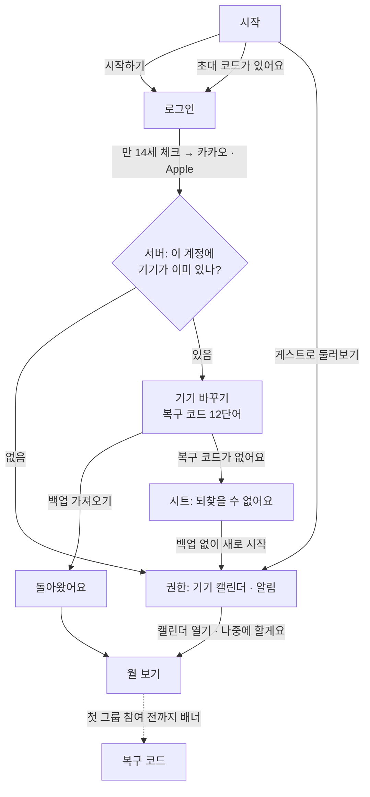
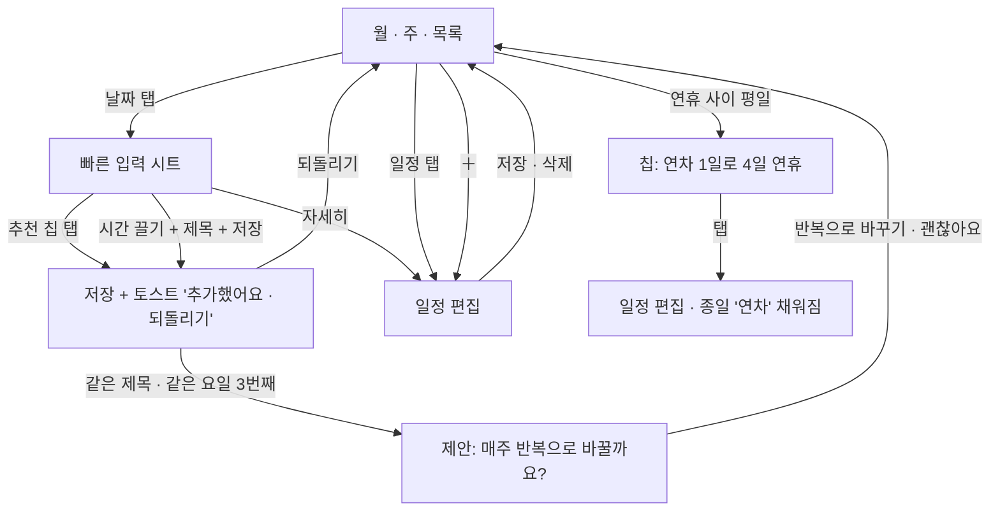
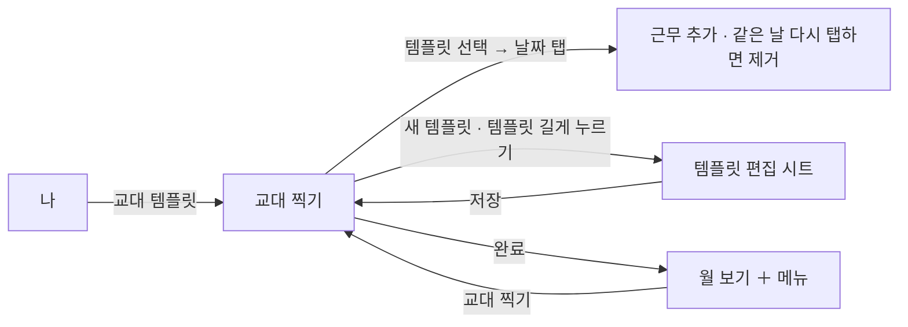
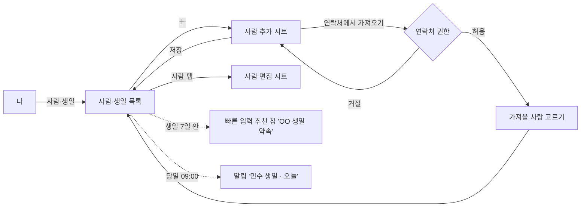
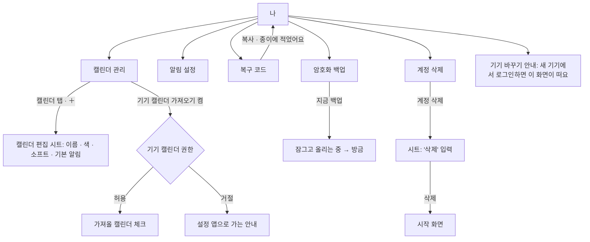

# M1 화면 흐름도와 와이어프레임

M1 캘린더 알파에 들어가는 화면 전부입니다. 흐름도는 화면이 어떻게 이어지는지, 와이어프레임 표는 화면마다 무엇이 있고 어떤 상태가 있는지 적습니다. 그림은 [화면 시안](screens.md)의 PNG이고, 값은 [`tokens.json`](tokens.json)과 [컴포넌트](components.md), 문구는 [문구와 톤](tone.md)을 따릅니다. 기능 규칙은 [개요](../kickoff.md) 5.1·5.2장입니다.

M1에는 그룹이 없습니다. 그룹·채팅 탭은 M2·M3에서 더하고, M1의 탭 막대는 **캘린더 · 나** 두 개입니다. 다음 할 일 막대는 M1부터 있습니다(내 일정과 생일만).

## 1. 화면 목록

| 번호 | 화면 | 종류 | 시안 |
| --- | --- | --- | --- |
| 1 | 시작 | 전체 화면 | [01-welcome](screens/m1/01-welcome@2x.png) |
| 2 | 로그인 | 전체 화면 | [02-sign-in](screens/m1/02-sign-in@2x.png) |
| 3 | 권한 | 전체 화면 | [03-permissions](screens/m1/03-permissions@2x.png) |
| 4 | 월 보기(홈) | 탭 첫 화면 | [04-month](screens/m1/04-month@2x.png) |
| 5 | 빠른 입력 시트 | 시트 | [05-quick-entry](screens/m1/05-quick-entry@2x.png) |
| 6 | 추가한 뒤(토스트) | 상태 | [06-added](screens/m1/06-added@2x.png) |
| 7 | 주 보기 | 탭 첫 화면 | [07-week](screens/m1/07-week@2x.png) |
| 8 | 목록 보기 | 탭 첫 화면 | [08-list](screens/m1/08-list@2x.png) |
| 9 | 일정 편집 | 전체 화면(모달) | [09-editor](screens/m1/09-editor@2x.png) |
| 10 | 교대 찍기 | 전체 화면(모달) | [10-shift](screens/m1/10-shift@2x.png) |
| 11 | 사람·생일 | 밀어 들어가는 화면 | [11-people](screens/m1/11-people@2x.png) |
| 12 | 나 | 탭 첫 화면 | [12-me](screens/m1/12-me@2x.png) |
| 13 | 복구 코드 | 밀어 들어가는 화면 | [13-recovery](screens/m1/13-recovery@2x.png) |
| 14 | 위젯 | 홈 화면 | [14-widgets](screens/m1/14-widgets@2x.png) |
| 15 | 캘린더 관리 | 밀어 들어가는 화면 | [15-calendars](screens/m1/15-calendars@2x.png) |
| 16 | 캘린더 편집 | 시트 | [16-calendar-edit](screens/m1/16-calendar-edit@2x.png) |
| 17 | 사람 추가·편집 | 시트 | [17-person-edit](screens/m1/17-person-edit@2x.png) |
| 18 | 교대 템플릿 편집 | 시트 | [18-template-edit](screens/m1/18-template-edit@2x.png) |
| 19 | 알림 설정 | 밀어 들어가는 화면 | [19-notifications](screens/m1/19-notifications@2x.png) |
| 20 | 암호화 백업 | 밀어 들어가는 화면 | [20-backup](screens/m1/20-backup@2x.png) |
| 21 | 기기 바꾸기 | 전체 화면 | [21-restore](screens/m1/21-restore@2x.png) |
| 22 | 계정 삭제 | 밀어 들어가는 화면 | [22-delete-account](screens/m1/22-delete-account@2x.png) |

"밀어 들어가는 화면"은 오른쪽에서 들어오고 왼쪽 위 "‹ 이전 화면"으로 돌아갑니다. "모달"은 아래에서 올라오고 왼쪽 위 "취소", 오른쪽 위 "저장·완료"입니다. 시트는 손잡이가 있고 끌어내려 닫습니다.

## 2. 흐름도

### 2.1 처음 시작

- 만 14세 확인을 체크해야 로그인 버튼이 켜집니다. 확인한 시각만 저장합니다.
- 게스트는 로그인 없이 시작합니다. 기기를 잃으면 복구 코드로만 돌아올 수 있다고 시작 화면에서 알리고, 나중에 "나"에서 카카오·Apple에 연결합니다.
- 계정당 활성 기기는 1대입니다. 두 번째 기기에서 로그인하면 기기 바꾸기로 갑니다.
- 권한은 둘 다 거절해도 월 보기로 갑니다. 거절한 것은 "나 › 캘린더 관리", "나 › 알림"에서 다시 켤 수 있습니다.
- 복구 코드는 처음부터 강요하지 않습니다. 월 보기 위에 배너("복구 코드를 저장해 두세요 · 첫 그룹에 들어가기 전까지")로 알리고, M2에서 첫 그룹에 들어갈 때 반드시 거칩니다.

### 2.2 일정 넣기와 고치기

- 빠른 입력은 추천 칩 다섯 개와 끌어서 고르는 시간 범위, 제목 입력 한 칸입니다. 칩은 누르는 즉시 저장되고 시트가 닫힙니다.
- 월·주·목록 사이는 머리글의 세그먼트로 바꿉니다. 마지막으로 본 뷰를 기억합니다.
- 기기 캘린더에서 가져온 일정을 누르면 편집 대신 읽기 전용 상세가 열리고 "이 일정은 기기 캘린더에서 왔어요. 그 앱에서 고칠 수 있어요"를 보여 줍니다.

### 2.3 교대 템플릿

찍은 근무는 템플릿의 캘린더(기본 '알바')에 들어가는 일반 일정입니다. 템플릿을 고치거나 지워도 이미 찍은 근무는 남습니다.

### 2.4 사람·생일

음력 생일은 저장할 때 음력으로 두고, 해마다 그 해의 양력 날짜로 바꿔 캘린더와 알림에 넣습니다.

### 2.5 나: 캘린더 관리 · 알림 · 백업 · 계정

- 기기 바꾸기는 **새 기기**에서 하는 일입니다. 현재 기기의 "나 › 기기 바꾸기"는 절차 안내와 복구 코드 보기로 이어집니다.
- 계정 삭제 뒤에도 이 기기의 일정은 남고, 앱은 그룹 기능 없는 캘린더로 계속 쓸 수 있습니다.

### 2.6 위젯과 알림에서 들어오기

| 출발 | 도착 |
| --- | --- |
| 작은 위젯(오늘) | 월 보기, 오늘 |
| 중간 위젯의 일정 | 일정 편집(읽기) |
| 중간 위젯의 다음 약속 | 약속 상세(M2). M1에서는 내 일정이면 일정 편집 |
| 일정 알림 | 일정 편집(읽기) |
| 생일 알림 | 사람·생일, 그 사람 |
| 연차 제안 알림 | 월 보기, 그 주 |

## 3. 와이어프레임

화면마다 위에서 아래 순서로 적습니다. 크기는 pt이고, 높이가 적힌 것은 고정 높이입니다. "코어"는 Rust 코어에서 받아야 하는 데이터와 부르는 동작입니다.

### 1. 시작

| 항목 | 내용 |
| --- | --- |
| 목적 | 앱이 무엇인지 띠 하나로 보여 주고 시작하게 합니다 |
| 구성 | 앱 이름(17 · 600) → 미리보기 카드: 날짜, 그룹 세 개의 0–24시 띠(그룹 색 1~5단계) → 큰 제목 "일정은 쉽게,\n약속은 빠르게"(32) → 본문 두 문장 → 안심 한 줄(자물쇠 아이콘) → 주요 버튼 "시작하기" → 글자 버튼 "초대 코드가 있어요" |
| 상태 | 초대 링크로 설치했으면 카드 대신 "'주말모임'에 초대받았어요" 카드와 버튼 "참여하기"(M2) |
| 코어 | 없음(정적 데이터) |

### 2. 로그인

| 항목 | 내용 |
| --- | --- |
| 구성 | 뒤로 → 제목 "그날어때 시작하기" → 설명 "계정은 로그인과 멤버 목록에만 써요…" → (아래쪽) 체크박스 "만 14세 이상이에요 · 확인한 시각만 저장해요" → 카카오 버튼(노랑 `#FEE500`, 글자 `#191919`, 카카오 규정) → Apple 버튼(검정, Apple 규정) → 글자 버튼 "게스트로 둘러보기" → 약관 두 줄 |
| 상태 | 체크 전: 두 로그인 버튼과 게스트 꺼짐(`fill`/`tertiaryText`). 로그인 실패: 토스트 "로그인이 안 됐어요. 다시 시도해 주세요". 네트워크 없음: 토스트 "연결이 없어요. 게스트로 시작하고 나중에 연결할 수 있어요" |
| 코어 | `auth.kakao(token)`, `auth.apple(token)`, `auth.guest()` → 기기 등록 결과(새 기기 / 기존 기기 있음) |
| 플랫폼 | iOS는 Sign in with Apple 버튼을 카카오보다 아래에 둬도 되지만 같은 크기여야 합니다(지침 4.8). 안드로이드는 Apple 로그인을 웹 흐름으로 엽니다 |

### 3. 권한

| 항목 | 내용 |
| --- | --- |
| 구성 | 제목 "두 가지만\n허락해 주세요" → 설명 → 카드 1: 기기 캘린더 가져오기(아이콘, 제목, 설명 3줄, 버튼 "가져오기" → 허용 뒤 "가져왔어요 · 캘린더 3개") → 카드 2: 알림 받기(버튼 "허용") → 주요 버튼 "캘린더 열기" → 글자 버튼 "나중에 할게요" |
| 상태 | 각 카드는 대기 / 허용됨 / 거절됨(버튼이 "설정에서 켜기"). 둘 다 끝나면 "캘린더 열기"가 켜지고, "나중에 할게요"는 언제나 켜져 있음 |
| 코어 | 허용 뒤 `calendars.importDevice(ids)`. 알림 권한은 앱이 처리 |
| 플랫폼 | iOS 17: `requestFullAccessToEvents`. 안드로이드: `READ_CALENDAR`, 13 이상은 `POST_NOTIFICATIONS` |

### 4. 월 보기(홈)

| 항목 | 내용 |
| --- | --- |
| 구성 | 머리글: 연도(13) + 월(32), 오른쪽 세그먼트 월·주·목록 + ＋ → 요일 줄(일 빨강, 토 파랑) → 5~6주 격자(칸 88, 날짜 13 · 600, 오늘은 먹색 원) → 칸 안: 공휴일 이름(빨강 11), 일정 막대 최대 3개 + "+N", 생일 아이콘 + 이름 → 다음 할 일 막대(56) → 탭 막대(64, 캘린더 · 나) |
| 동작 | 날짜 탭 → 빠른 입력 시트. 일정 막대 탭 → 일정 편집. 좌우 밀기 → 이전·다음 달. 머리글 월 탭 → 오늘로 |
| 상태 | 첫 실행(일정 0): 격자는 그대로, 오늘 칸 아래 말풍선 "날짜를 누르면 추천이 떠요". 복구 코드 배너: 첫 그룹 참여 전까지 머리글 아래 흰 카드. 기기 캘린더 권한 거절: 표시 없음(캘린더 관리에서만 안내) |
| 코어 | `calendar.month(year, month)` → 날짜별 일정(제목, 캘린더 색, 종일, 시간), 공휴일, 생일, 연차 제안. `nextUp(from: now, count: 12)` |
| 접근성 | 날짜 칸은 하나의 버튼: "10월 30일 금요일, 일정 2개, 민수 생일". 일정 막대는 칸 안에서 개별로 읽지 않고 시트에서 읽음 |

### 5. 빠른 입력 시트

| 항목 | 내용 |
| --- | --- |
| 구성 | 손잡이 → 제목 "10월 30일 금요일" + 보조(생일·공휴일 있으면) + 닫기 → "추천 · 누르면 바로 저장돼요" → 추천 칩 5개(44, 가로 줄바꿈) → "직접 입력" → 제목 입력(52) → 시간 띠(0–24시, 끌어서 범위, 눈금 0·6·12·18·24) → 아래 줄: 캘린더 칩(색 점 + 이름) · "반복 안 함" 칩 · 글자 버튼 "자세히" · 주요 버튼 "저장" |
| 동작 | 칩 탭 → 즉시 저장, 시트 닫힘, 토스트. 띠에서 끌기 → 30분 단위, 손잡이 양 끝. 제목 비어 있고 범위만 고르면 저장 버튼 꺼짐("제목을 적어 주세요"). "자세히" → 일정 편집으로 값 넘김 |
| 상태 | 추천이 5개 미만(기록 없음): 있는 만큼만. 그날 일정과 겹치는 칩은 빠짐. 종일 선택 토글은 "자세히"에서만 |
| 코어 | `suggest(date)` → 칩 5개(제목, 시작·끝, 캘린더, 출처). `events.add(...)` → id. 되돌리기는 `events.delete(id)` |
| 높이 | 552. 글자가 커지면 칩이 줄바꿈되며 시트가 늘고, 90%를 넘으면 안에서 스크롤 |

### 6. 추가한 뒤

| 항목 | 내용 |
| --- | --- |
| 구성 | 다음 할 일 막대 자리에 토스트 "카페 마감을 추가했어요 · 되돌리기"(5초). 같은 제목·같은 요일 3번째면 토스트 아래 카드 "매주 금요일 반복으로 바꿀까요?" + 버튼 "괜찮아요" · "반복으로 바꾸기" |
| 동작 | 되돌리기 → 삭제, 토스트 "되돌렸어요". 반복으로 바꾸기 → 그 일정에 `weekly` 반복 적용, 토스트 "매주 금요일로 바꿨어요" |
| 코어 | `events.add` 결과의 `repeatHint`(요일, 횟수) |

### 7. 주 보기

| 항목 | 내용 |
| --- | --- |
| 구성 | 머리글: 연·월(13) + "25–31일"(32) + 세그먼트 → 요일 줄(날짜 원) → 종일 줄(생일, 종일 일정) → 시간 축 8시부터(1시간 48, 스크롤해서 0–24시) → 일정 블록(모서리 8, 캘린더 색 2단계, 왼쪽 2pt 진한 선, 제목 12 · 600 + 시각 11) → 다음 할 일 막대, 탭 막대 |
| 동작 | 빈 칸 길게 누르기 → 그 시각으로 빠른 입력. 블록 탭 → 편집. 좌우 밀기 → 주 이동 |
| 상태 | 현재 시각 빨간 선 + 왼쪽 점. 겹치는 일정은 나란히 나눠 그림(최대 3열, 넘으면 "+N") |
| 코어 | `calendar.week(start)` |

### 8. 목록 보기

| 항목 | 내용 |
| --- | --- |
| 구성 | 머리글 "다가오는 일정" + 세그먼트 → 날짜 머리글(13 · 600, 오늘은 빨강 "오늘 · 10월 25일 일요일") → 일정 줄(48: 캘린더 색 점 8, 제목 17, 설명 14 "학교 · 매주 월·수", 오른쪽 시각 17 고정폭) → 끝없이 아래로 |
| 상태 | 일정 없음: "앞으로 4주 동안 일정이 없어요" + 버튼 "오늘 일정 넣기". 지난 일정은 위로 스크롤하면 회색으로 |
| 코어 | `calendar.list(from, limit)` 페이지 단위 |

### 9. 일정 편집

| 항목 | 내용 |
| --- | --- |
| 구성 | 머리글 "취소 · 일정 편집 · 저장(먹색 알약)" → 제목 입력(흰 카드 56) → 캘린더 줄(색 점 + 이름 ›) → 묶음: 종일 스위치 / 시작(날짜 칩 + 시각 칩) / 끝(시각) → 묶음: 반복 칩(안 함 · 매주 금요일 · 매주 화·목 · 매일 · 직접 정하기) / 알림(1시간 전 ›) → 묶음: 사진·파일(M3 표시, 3개 · 10MB 안내) → 안내 한 줄(이 캘린더를 공유하는 그룹에는 일정 있음으로만 보여요) → 빨간 글자 "일정 삭제" |
| 동작 | 시작 시각을 바꾸면 끝은 길이를 유지하며 따라감. 반복 일정을 고칠 때 시트 "이 일정만 · 이후 모두" |
| 상태 | 새 일정: 제목 "새 일정", 삭제 없음. 기기 캘린더 일정: 모든 칸 읽기 전용, 위에 안내 카드. 종일: 시각 칩 숨김 |
| 코어 | `events.get(id)`, `events.update(id, scope: one|following)`, `events.delete(id, scope)`, `calendars.list()` |

### 10. 교대 찍기

| 항목 | 내용 |
| --- | --- |
| 구성 | 머리글 "취소 · 교대 찍기 · 완료" → 월 넘기기(‹ 11월 ›) → 요일 줄 → 날짜 격자(칸 56: 날짜 + 찍힌 템플릿 칩 "미들"(템플릿 색)) → 아래 패널: "템플릿을 고르고 날짜를 누르세요" + 이번 달 횟수 → 템플릿 2열(선택된 것은 먹색 테두리와 체크, 색 막대 + 이름 + 시간) + "새 템플릿"(점선) → 설명 |
| 동작 | 날짜 탭 → 선택한 템플릿으로 근무 추가(햅틱). 이미 그 템플릿이 있으면 제거. 다른 템플릿이 있으면 바꿈. 템플릿 길게 누르기 → 편집 시트 |
| 상태 | 템플릿 0개: 패널에 "첫 템플릿을 만들어요" + 버튼. 완료는 바뀐 것이 있을 때만 켜짐 |
| 코어 | `shifts.templates()`, `shifts.stamp(date, templateId)`, `shifts.unstamp(date, templateId)`. 결과는 일반 일정 |

### 11. 사람·생일

| 항목 | 내용 |
| --- | --- |
| 구성 | 머리글 "‹ 나 · ＋" → 제목 "사람·생일" → 검색(44, 이름) → "다가오는 생일"(3명: 아바타, 이름, 날짜(음력이면 음력 + 올해 양력), 오른쪽 D-day 먹색 알약 + 출처 "주말모임에서 공개 · 직접 등록") → "모든 사람 · 12명"(이름, 생일) → 버튼 "연락처에서 생일 가져오기" → 설명 |
| 상태 | 0명: "아직 아무도 없어요" + 설명 + 두 버튼(직접 추가 · 연락처에서). 그룹에서 공개된 생일은 편집 불가(출처 표시) |
| 코어 | `people.list()`, `people.upcoming(days: 30)`, `people.importContacts(items)` |

### 12. 나

| 항목 | 내용 |
| --- | --- |
| 구성 | 제목 "나" → 프로필 카드(아바타, 이름, "카카오 계정 · 기기 1대" ›) → 플러스 카드(M4) → 묶음 "캘린더": 캘린더 관리 5개 › / 교대 템플릿 3개 › / 사람·생일 12명 › / 기기 캘린더 가져오기 "읽기만 · 켜짐" › → 묶음 "보안과 백업": 복구 코드 "✓ 저장함" › / 암호화 백업 "오늘 03:12" › / 기기 바꾸기 › → 묶음 "계정": 알림 › / 서버가 아는 것 · 보안 안내 › / 계정 삭제(빨강) › → 다음 할 일 막대, 탭 막대 |
| 상태 | 게스트: 프로필 카드가 "게스트 · 기기를 잃으면 복구 코드로만 돌아올 수 있어요" + 버튼 "카카오·Apple 연결". 복구 코드 미저장: 값이 빨간 "저장 안 함" |
| 코어 | `account.me()`, `backup.status()`, `calendars.count()` 등 요약 값 |

### 13. 복구 코드

| 항목 | 내용 |
| --- | --- |
| 구성 | 제목 + 설명("이 12단어는 그날어때도 모릅니다") → 12단어 격자(3열, 번호 + 단어 16 · 600) → 경고 카드(빨간 삼각형 아이콘: 코드와 기기를 함께 잃으면…) → 백업 상태 한 줄 → 버튼 "복사"(보조) · "종이에 적었어요"(주요) |
| 동작 | 복사는 60초 뒤 클립보드에서 지움(iOS `expirationDate`, 안드로이드 `ClipDescription` 민감 표시). "종이에 적었어요" → 저장함으로 기록, 배너 사라짐 |
| 상태 | 화면 캡처 막기(안드로이드 `FLAG_SECURE`, iOS는 캡처 감지 뒤 토스트 "캡처 대신 종이에 적어 두세요") |
| 코어 | `recovery.words()`(처음 한 번 생성, 이후 같은 값), `recovery.markSaved()` |

### 14. 위젯

| 항목 | 내용 |
| --- | --- |
| 구성 | 작은(2×2): 요일(빨강/파랑/먹색) + 큰 날짜 + 오늘 일정 두 줄(색 점, 제목, 시각). 중간(4×2): 왼쪽 오늘 일정 3줄, 오른쪽 "다음 약속" 카드(그룹 이름, 날짜, 띠). 밝은·어두운 모드 |
| 상태 | 오늘 일정 없음: "오늘은 비어 있어요". 로그인 전: "그날어때를 열어 시작하세요". 다음 약속 없음(M1): 오른쪽에 내일 일정 |
| 코어 | 앱이 써 둔 스냅샷 JSON만 읽음. 위젯은 코어를 열지 않음 |

### 15. 캘린더 관리

| 항목 | 내용 |
| --- | --- |
| 구성 | 머리글 "‹ 나 · ＋" → 제목 + 설명(색은 내 화면용, 그룹에는 비어 있는지만) → 묶음 "내 캘린더 · 4개": 줄마다 색 네모 14(소프트는 빗금) + 이름 + 설명(색 이름 · 일정 수 · 소프트 안내) + 표시 스위치, 마지막 줄 "＋ 새 캘린더" → 묶음 "기기 캘린더": 가져오기 스위치(설명: 읽기만) + 기기 캘린더마다 체크박스(이름, 일정 수) + 안내 |
| 동작 | 줄 탭 → 캘린더 편집 시트. 표시 끔 → 월·주·목록에서 숨김(그룹에는 그대로 보임). 가져오기 켬 → 권한 요청 → 체크 목록 켜짐. 끔 → 체크 목록 흐림(0.4) |
| 상태 | 기기 캘린더 권한 거절: 스위치 대신 버튼 "설정에서 켜기". 기기 캘린더 0개: "기기에 캘린더가 없어요" |
| 코어 | `calendars.list()`, `calendars.setVisible(id, bool)`, `calendars.deviceSources()`, `calendars.importDevice(ids)` |

### 16. 캘린더 편집

| 항목 | 내용 |
| --- | --- |
| 구성 | 시트(188부터) → 제목(캘린더 이름) + 보조(소프트 · 색 이름) + 닫기 → 이름 입력 → 색 12개(6열, 선택은 흰 링 + 먹색 링, 체크) → 묶음: 소프트 캘린더 스위치(설명 3줄) / 기본 알림(10분 전 ›) → 주요 버튼 "저장" → 빨간 글자 "캘린더 삭제 · 일정 7개도 지워져요" |
| 상태 | 새 캘린더: 제목 "새 캘린더", 이름 비어 있으면 저장 꺼짐, 삭제 없음. 마지막 남은 캘린더는 삭제 불가(글자 흐림 + "캘린더는 하나 이상 있어야 해요") |
| 코어 | `calendars.save(id?, name, color, soft, defaultAlert)`, `calendars.delete(id)` → 삭제될 일정 수 미리 받기 |

### 17. 사람 추가·편집

| 항목 | 내용 |
| --- | --- |
| 구성 | 시트(168부터) → 제목 "사람 추가" + 안심 한 줄 → 이름 입력 → 세그먼트 양력·음력 → 묶음: 생일(날짜 ›) / 태어난 해(선택 ›) + 안내(음력이면 "올해는 11월 11일 수요일이에요") → 묶음: 알림(당일 09:00 ›) / 날짜 잡기 추천에 쓰기 스위치 → 작은 알약 "연락처에서 가져오기" → 주요 버튼 "저장" |
| 상태 | 편집: 제목은 이름, 아래에 빨간 글자 "이 사람 지우기". 그룹에서 공개된 사람: 이름·생일 읽기 전용, 알림만 바꿈. 이름 비어 있으면 저장 꺼짐 |
| 코어 | `people.save(...)`, `lunar.toSolar(month, day, year)` |

### 18. 교대 템플릿 편집

| 항목 | 내용 |
| --- | --- |
| 구성 | 시트(168부터) → 제목 "템플릿 편집" + 설명 → 미리보기 카드(색 막대, 이름, 시간 범위 · 길이) → 이름 입력 → 묶음: 시작 / 끝 / 캘린더(알바 · 민트 ›) / 알림 + 안내(자정 넘김) → 묶음: 근무 시간 집계(플러스 표시) → 주요 버튼 "저장" → 빨간 글자 "템플릿 삭제 · 이미 찍은 근무는 남아요" |
| 상태 | 새 템플릿: 시작 09:00, 끝 18:00 기본값. 끝이 시작보다 이르면 자동으로 다음 날로 보고 안내 줄 강조 |
| 코어 | `shifts.saveTemplate(...)`, `shifts.deleteTemplate(id)` |

### 19. 알림 설정

| 항목 | 내용 |
| --- | --- |
| 구성 | 제목 "알림" + 설명(모두 기기 알림) → 묶음 "일정": 기본 알림(10분 전 ›) / 종일 일정(전날 18:00 ›) / 다음 할 일 막대 스위치 + 안내 → 묶음 "사람·생일": 생일 알림 스위치(당일 09:00) / 연휴·연차 제안 스위치 → 묶음 "그룹": 채팅과 약속(M2 표시, 설명) → 묶음: 시스템 알림 설정 "켜짐 ›" |
| 상태 | 시스템 권한 꺼짐: 맨 위에 카드 "알림이 꺼져 있어요 · 설정에서 켜기", 아래 스위치는 모두 흐림 |
| 코어 | `settings.notifications()`, `settings.update(...)`. 예약은 앱이 함(iOS 가까운 64개) |

### 20. 암호화 백업

| 항목 | 내용 |
| --- | --- |
| 구성 | 제목 + 설명(기기에서 잠근 뒤 올림, 복구 코드로만 풂) → 상태 카드(마지막 백업 시각 20 · 600, 일정·사람 수 · 크기, 버튼 "지금 백업") → 묶음: 자동 백업 스위치(와이파이 하루 한 번) → 묶음 "최근 백업 · 3개까지 보관": 세 줄(시각, 자동/직접 + 내용, 크기) → 두 카드 "들어가는 것 / 안 들어가는 것" |
| 상태 | 백업 중: 카드 제목 "백업하는 중", 버튼 꺼짐 "올리는 중". 끝: "방금". 실패(네트워크): 카드 아래 한 줄 "연결되면 다시 올릴게요", 자동 재시도. 복구 코드 미저장: 카드 위 안내 "복구 코드를 저장해야 백업을 되찾을 수 있어요 ›" |
| 코어 | `backup.status()`, `backup.now()`(진행 콜백), `backup.list()`, `backup.setAuto(bool)` |

### 21. 기기 바꾸기

| 항목 | 내용 |
| --- | --- |
| 구성 | 머리글 "‹ 로그인" → 제목 + 설명(다른 기기에서 쓰는 중, 복구 코드로 가져오고 이전 기기는 로그아웃) → 진행 "7 / 12" + 작은 알약 "붙여넣기" → 12칸 격자(3열 48, 채운 칸은 `groupedBackground`, 현재 칸은 먹색 2pt 테두리) → 안심 카드(단어는 기기에서만, 틀리면 빨갛게, 횟수 제한 없음) → 주요 버튼 "백업 가져오기"(12단어 전에는 꺼짐 "단어 N개 더") → 글자 버튼 "복구 코드가 없어요" |
| 동작 | 칸 탭 → 키보드, 단어 자동 완성(단어 목록에서 앞글자). 붙여넣기 → 12단어 한 번에. 가져오기 → 진행 화면(잠금 풀고 받는 중 · 크기) → "돌아왔어요"(가져온 수, 이전 기기 로그아웃, 그룹 재참여 안내) → "캘린더 열기" |
| 상태 | 틀린 단어: 그 칸 테두리와 글자 `sunday`, 아래 "8번째 단어가 목록에 없어요". 코드 없음 시트: 되찾을 수 없다는 설명 두 문단 + 빨간 글자 "백업 없이 새로 시작" + "이전 기기에서 찾아볼게요" |
| 코어 | `recovery.validateWord(text)`, `recovery.restore(words)`(진행 콜백) → 통계, `device.replace()` |

### 22. 계정 삭제

| 항목 | 내용 |
| --- | --- |
| 구성 | 제목 + 설명(되돌릴 수 없음) → 카드 "서버에서 지워지는 것"(4항목: 계정·기기, 백업 3개, 그룹 멤버십, 보낸 사진·파일) → 카드 "이 기기에 남는 것"(내 일정과 사람, ICS 내보내기) → 안내(접속 기록 3개월, 플러스 구독은 스토어에서 해지) → 빨간 글자 버튼 "계정 삭제" → 글자 버튼 "그냥 둘게요" |
| 동작 | 계정 삭제 → 시트 "하린님의 계정을 삭제할까요?" + 경고 한 줄 + 입력 "'삭제'라고 적어 주세요" → 글자가 맞으면 빨간 글자 버튼 "삭제" 켜짐 → 삭제 뒤 시작 화면, 토스트 "계정을 삭제했어요" |
| 상태 | 플러스 구독 중(M4): 안내가 카드로 올라오고 버튼 "구독 관리로" 추가. 오프라인: 버튼 꺼짐 "연결되면 지울 수 있어요" |
| 코어 | `account.delete()` → 서버 삭제 후 로컬 그룹 상태 제거, 캘린더는 유지 |

## 4. 공통 상태

| 상태 | 처리 |
| --- | --- |
| 오프라인 | 캘린더, 추천, 편집, 교대, 사람은 모두 기기에서 되므로 표시 없음. 백업·로그인·삭제만 버튼을 끄고 이유를 적음. 상단 배너는 쓰지 않음 |
| 로딩 | 기기 데이터는 즉시 그림. 서버 응답을 기다리는 버튼은 글자를 "~하는 중"으로 바꾸고 끔. 스피너는 전체 화면에 쓰지 않음 |
| 빈 화면 | [문구와 톤 3장](tone.md#빈-화면). 그림 없이 한 문장 + 행동 하나 |
| 큰 글자 | 모든 화면이 세로로 늘어나며 스크롤. 띠는 목록으로. 탭 막대 이름은 두 줄까지 |
| 어두운 모드 | 중립색은 토큰의 `dark`, 캘린더 색은 밝은 모드와 같은 값(2단계 막대 위 먹색 글자 → 어두운 모드에서는 5단계 막대 위 흰 글자로 바꿈) |
| 가로 모드 | 휴대폰은 세로 고정. 태블릿은 M4 이후 |

## 5. 확정한 결정

플랫폼 파트가 이어받는 결정입니다. 사용자가 2026-10-25에 확정했습니다.

1. **M1 탭 막대는 캘린더 · 나 두 개.** 그룹 탭은 M2, 채팅 탭은 M3에서 더합니다. 탭이 늘어나도 막대 높이와 모양은 같습니다.
2. **일정 상세 화면은 따로 없습니다.** 일정을 누르면 편집 화면이 열리고, 기기 캘린더 일정만 읽기 전용으로 보입니다.
3. **복구 코드는 첫 그룹 참여 전까지 미룹니다.** M1에서는 배너로만 알리고 강제하지 않습니다(개요 10장 결정).
4. **되돌리기 5초, 확인 창 없음.** 삭제·차단·계정 삭제만 시트로 묻습니다. 플랫폼 기본 alert는 쓰지 않습니다.
5. **기기 캘린더는 캘린더 관리 안의 스위치로 켜고 끕니다.** 켤 때 권한을 요청하고, 캘린더별로 가져올지 고릅니다.
6. **계정 삭제는 '삭제'를 적어야 합니다.** 되돌릴 수 없는 유일한 동작이라 예외로 입력 확인을 둡니다.
