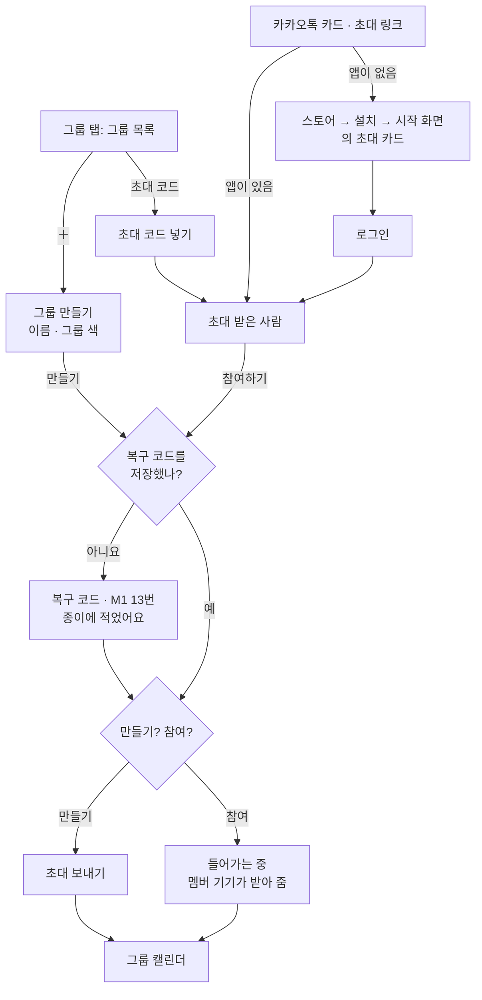
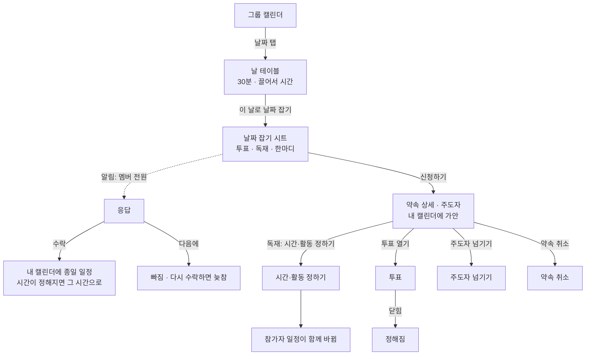
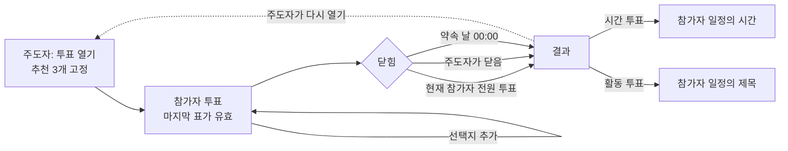
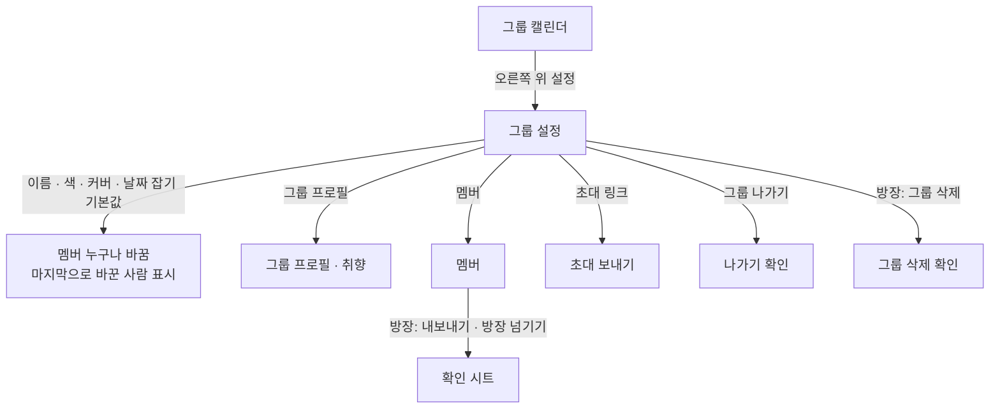

# M2 화면 흐름도와 와이어프레임

M2 그룹 알파에 들어가는 화면입니다. [M1 화면](m1.md)과 같은 형식으로, 흐름도는 화면이 어떻게 이어지는지, 와이어프레임 표는 화면마다 무엇이 있고 어떤 상태가 있는지 적습니다. 그림은 [화면 시안](screens.md)의 `screens/m2` PNG입니다. 기준은 [개요](../kickoff.md) 5.3 그룹 캘린더, 5.4 날짜 잡기, 5.6 그룹 설정과 [공통 계약](../parts/protocol.md) 2·4·5·8장입니다.

- **탭 막대:** M2는 캘린더 · 그룹 · 나 세 개입니다. 채팅 탭은 M3에서 더합니다. 시안 보드는 채팅까지 네 탭으로 그렸으므로, M2에서는 채팅 탭과 그 배지를 뺍니다.
- **그룹 화면:** M2의 그룹 화면은 그룹 캘린더 하나입니다. 시안 머리글의 "캘린더 · 채팅 · 사진" 세그먼트와 약속·응답·정해짐 화면 머리글의 채팅 아이콘은 M3에서 켭니다. 그래서 M2의 날짜 잡기는 알림, 그룹 목록의 소식, 그룹 캘린더의 약속으로 보이고, 채팅 타임라인의 카드는 M3부터입니다.
- **그룹 색:** 그룹 화면의 머리글과 강조색, 띠의 단계, 내 캘린더에 들어간 약속의 색은 그 그룹의 색을 따릅니다([README](README.md) 2.2, 개요 5.6).

## 1. 화면 목록

| 번호 | 화면 | 종류 | 시안 |
| --- | --- | --- | --- |
| 1 | 그룹 목록 | 탭 첫 화면 | [01-groups](screens/m2/01-groups@2x.png) |
| 2 | 초대 보내기 | 시트 | [02-invite](screens/m2/02-invite@2x.png) |
| 3 | 초대 받은 사람 | 전체 화면 | [03-join](screens/m2/03-join@2x.png) |
| 4 | 그룹 캘린더 | 밀어 들어가는 화면 | [04-group-calendar](screens/m2/04-group-calendar@2x.png) |
| 5 | 날 테이블 | 밀어 들어가는 화면 | [05-day-table](screens/m2/05-day-table@2x.png) |
| 6 | 날짜 잡기 시트 | 시트 | [06-date-sheet](screens/m2/06-date-sheet@2x.png) |
| 7 | 약속 상세 | 밀어 들어가는 화면 | [07-appointment](screens/m2/07-appointment@2x.png) |
| 8 | 응답 | 밀어 들어가는 화면 | [08-respond](screens/m2/08-respond@2x.png) |
| 9 | 투표 | 밀어 들어가는 화면 | [09-vote](screens/m2/09-vote@2x.png) |
| 10 | 정해짐 | 밀어 들어가는 화면 | [10-decided](screens/m2/10-decided@2x.png) |
| 11 | 그룹 설정 | 밀어 들어가는 화면 | [11-group-settings](screens/m2/11-group-settings@2x.png) |
| 12 | 그룹 캘린더 · 어두운 모드 | 상태 | [12-group-calendar-dark](screens/m2/12-group-calendar-dark@2x.png) |
| 13 | 그룹 만들기 | 시트 | 아직 없음 |
| 14 | 초대 코드 넣기 | 시트 | 아직 없음 |
| 15 | 시간·활동 정하기(주도자) | 시트 | 아직 없음 |
| 16 | 주도자 넘기기 | 시트 | 아직 없음 |
| 17 | 약속 취소 | 시트 | 아직 없음 |
| 18 | 멤버 | 밀어 들어가는 화면 | 아직 없음 |
| 19 | 그룹 프로필 | 시트 | 아직 없음 |
| 20 | 나가기 · 내보내기 · 그룹 삭제 | 시트 | 아직 없음 |

"아직 없음"인 화면은 이 문서의 표가 와이어프레임입니다. 부품은 [컴포넌트](components.md)와 M1의 같은 종류(시트 머리, 설정 줄, 빨간 글자 버튼)를 그대로 씁니다. 첫 그룹 전에 거치는 복구 코드는 M1 13번 화면입니다(2.1). 앱 스크린샷의 이름은 이 번호를 따릅니다(`m2/04-group-calendar`처럼).

## 2. 흐름도

### 2.1 그룹 만들기와 들어오기

- 그룹은 한 사람이 20개까지, 그룹마다 20명까지입니다. 꽉 차면 만들기·참여하기 버튼을 끄고 이유를 적습니다.
- 첫 그룹을 만들거나 참여하기 전에 복구 코드를 적게 합니다(M1 결정 3). 이미 "저장함"이면 건너뜁니다. 그룹에 들어간 뒤 기기를 잃으면 복구 코드 없이는 그 기록을 되찾을 수 없기 때문입니다.
- 초대 링크나 코드로 들어온 사람은 초대한 멤버가 승인한 것으로 봅니다(개요 10장). 서버에서는 대기(`pending`)이고, 온라인인 멤버 기기 하나가 Add 커밋으로 넣어 주면 들어갑니다(계약 2장). 그래서 참여하기 뒤에 "들어가는 중" 상태가 있습니다.
- 앱이 없으면 스토어를 거칩니다. 안드로이드는 설치 정보(Install Referrer)로 초대를 이어 받고, iOS는 설치 뒤 링크를 한 번 더 누르거나 시작 화면의 "초대 코드가 있어요"에 코드를 붙여넣습니다.
- 새 멤버는 들어온 뒤의 기록만 봅니다. 날이 지나지 않은 약속은 새 멤버용 번들로 받습니다(계약 5장).

### 2.2 날짜 잡기

- 신청은 멤버 전원에게 갑니다(개요 10장). 신청하는 순간 주도자의 캘린더에 가안으로 들어가고, 첫 수락이 오면 확정입니다.
- 응답은 수락과 다음에 둘이고, 이름과 함께 멤버 모두에게 보입니다. 사람마다 마지막 응답이 유효합니다.
- 결정 방식의 처음값은 그룹 설정의 기본 결정 방식입니다. 주도자는 신청 뒤에도 바꿀 수 있습니다(`RequestUpdate`).
- **끝:** 약속 날이 한국 시간으로 지나면 끝납니다. 수락이 없던 신청은 주도자의 가안까지 모든 기기에서 사라지고, 수락이 있던 약속은 참가자 캘린더에 지난 일정으로 남습니다. 그룹 캘린더에는 지난 약속이 90일 보입니다.
- 시간이 정해진 약속과 가안은 모든 그룹에 일정이 있는 시간으로 보이고, 시간이 미정인 약속은 하루를 막지 않도록 비어 있는 시간으로 둡니다(개요 5.4).

### 2.3 투표

- 선택지는 추천 3개, 멤버가 더한 것, 맨 아래 "아무거나"입니다. 추천 3개는 주도자가 여는 순간 주도자 기기가 계산해 고정합니다.
- 선택지 추가는 신청할 때의 그룹 설정을 따릅니다(`Request.leader_options`). "주도자만"이면 다른 사람에게는 "선택지 추가"가 보이지 않습니다.
- 표는 참가자(수락한 사람과 주도자)마다 하나입니다. 늦참자도 닫히기 전까지 투표할 수 있습니다.
- 결과는 가장 많은 표를 받은 선택지입니다. 모두 "아무거나"이거나 아무도 투표하지 않았으면 추천 1번, 동점이면 목록에서 먼저 나오는 것입니다. 다시 열면 추천을 새로 계산하고 표는 지웁니다.

### 2.4 그룹 설정과 관리

- 그룹 공통 설정은 멤버 누구나 바꿉니다. 방장에게 남는 것은 멤버 내보내기와 그룹 삭제, 방장 넘기기뿐입니다(개요 5.6).
- 동시에 바꾸면 서버가 나중 저장을 거절하고(409 `state_conflict`), 기기가 최신 값에 내가 바꾼 항목만 다시 얹어 저장합니다. 같은 항목이면 나중 값이 남습니다. 화면에는 오류를 띄우지 않고 바뀐 값과 "마지막으로 바꾼 사람"만 새로 보입니다.
- 날짜 잡기 기본값은 이미 신청된 약속에 영향을 주지 않습니다. 결정 방식과 선택지 추가 권한은 신청에 복사되기 때문입니다(계약 4장).
- 방장이 나가거나 계정을 지우면 가장 오래된 활성 멤버가 방장이 됩니다([API](../parts/api-server.md) 방장 승계).

### 2.5 알림과 링크로 들어오기

| 출발 | 도착 |
| --- | --- |
| 초대 링크(`/i/<코드>`) | 3번 초대 받은 사람 |
| 날짜 잡기 신청 알림 | 8번 응답 |
| 수락·다음에 알림(주도자) | 7번 약속 상세 |
| 투표 열림 알림 | 9번 투표 |
| 투표 닫힘 알림 | 10번 정해짐 |
| 시간·활동 변경 알림(참가자) | 7번 약속 상세 |
| 취소 알림 | 4번 그룹 캘린더의 그 날, 토스트 "하린이 11/7(토) 약속을 취소했어요" |
| 들어가기 끝남(대기 → 활성, 실시간 `welcome`) | 4번 그룹 캘린더, 토스트 "주말모임에 들어왔어요". 앱이 닫혀 있었으면 다음에 열 때 |
| 중간 위젯의 다음 약속 | 7번 약속 상세 |

알림 문구는 [문구와 톤](tone.md#알림-문구)을 따릅니다. 그룹 설정에서 약속 알림을 끈 멤버에게는 신청·응답·투표·변경 알림이 가지 않습니다(계약 8장).

## 3. 와이어프레임

화면마다 위에서 아래 순서로 적습니다. 크기는 pt이고, 높이가 적힌 것은 고정 높이입니다. "데이터"는 코어가 내야 하는 값과 그 값이 오는 곳(엔트리, 상태 블롭, 서버)입니다.

### 1. 그룹 목록

| 항목 | 내용 |
| --- | --- |
| 구성 | 큰 제목 "그룹"(32) + 오른쪽 글자 버튼 "초대 코드" · ＋ → 안내 한 줄 "그룹 4개 · 20개까지, 그룹마다 20명까지" → 그룹 줄(84): 그룹 아바타(커버가 있으면 커버, 없으면 그룹 색 5단계 바탕에 첫 글자) · 이름(17 · 600) · 둘째 줄 소식 · 오른쪽 응답 배지 → 다음 할 일 막대 → 탭 막대 |
| 둘째 줄 | 하나만 보입니다. 응답할 신청("엄마가 11월 15일(일)로 날짜를 잡았어요" + 작은 알약 "응답"), 진행 중인 투표("11월 7일(토) · 시간 투표 3/4명"), 다음 약속("11월 7일(토) 19:00 · 보드게임 카페"), "잡힌 약속 없음" 순으로 앞의 것이 이깁니다. 채팅 미리보기는 M3에서 더합니다 |
| 순서 | 맨 위 고정한 그룹 → 응답할 일이 있는 그룹 → 최근 소식 순 |
| 동작 | 줄 탭 → 4번. 응답 알약 → 8번. ＋ → 13번. "초대 코드" → 14번 |
| 상태 | 0개: "아직 그룹이 없어요" + 설명 "그룹을 만들면 멤버들의 비어 있는 시간을 합쳐 볼 수 있어요" + 주요 버튼 "그룹 만들기" + 글자 버튼 "초대 코드가 있어요". 들어가는 중: 둘째 줄 "들어가는 중 · 멤버가 앱을 열면 들어가요", 누르면 3번의 기다림 상태. 20개: ＋ 꺼짐, 안내 줄이 "그룹은 20개까지 들어갈 수 있어요" |
| 배지 | 탭 막대의 그룹 탭과 그룹 줄 오른쪽: 응답하지 않은 신청 수 |
| 데이터 | 그룹마다 이름·색·커버(`group_meta`), 고정 여부(기기), 멤버 상태(서버), 응답할 신청과 투표 진행과 다음 약속(엔트리로 계산) |

### 2. 초대 보내기

| 항목 | 내용 |
| --- | --- |
| 구성 | 시트(그룹 캘린더 위) → 제목 "주말모임에 친구 초대" + 닫기 → 설명 "링크로 들어온 친구는 바로 멤버가 돼요 · 지금 5명, 20명까지" → 버튼 "카카오톡으로 초대"(54, 카카오 노랑 `#FEE500`) → 나란히 "링크 복사" · "다른 앱으로"(시스템 공유) → 초대 코드 카드: 코드(24 · 600, 5자씩 두 묶음 "GN7KQ-4XZM2") + "11월 1일까지 쓸 수 있어요" + 작은 알약 "복사" → "카카오톡에서는 이렇게 보여요" 미리보기 카드 |
| 카카오톡 카드 | 앱 이름, "'주말모임'에 초대받았어요", "하린님이 초대했어요. 일정을 합쳐 보고 같이 날짜를 잡아요.", 버튼 "참여하기". 링크는 `https://<초대 도메인>/i/<코드>#<그룹 이름과 색>`이고, 그룹 이름은 서버가 모르므로 초대하는 기기가 링크 뒤쪽(#)에 붙입니다 |
| 동작 | 링크·코드 복사 → 토스트 "복사했어요". 카카오톡으로 초대 → 카카오톡 공유(카카오톡이 없으면 카카오 웹 공유) |
| 상태 | 코드는 7일 동안 씁니다. 끝났으면 카드가 "끝난 코드예요" + 작은 알약 "새 코드 만들기". 20명이 다 참: 세 버튼 꺼짐, 설명 "20명이 다 찼어요. 멤버가 나가면 다시 초대할 수 있어요". 오프라인이고 받은 코드가 없음: 버튼 꺼짐 "연결되면 초대할 수 있어요" |
| 데이터 | 초대 코드와 끝나는 시각(`POST /groups/{id}/invites`), 멤버 수 |

### 3. 초대 받은 사람

| 항목 | 내용 |
| --- | --- |
| 구성 | 닫기 → 그룹 아바타(64) → "하린님이 초대했어요" → 그룹 이름(32) → "멤버 5명 · 이름은 들어가면 보여요" → 카드 "참여하면 이 그룹에 보이는 것": "30분 단위로 비어 있는지만" + "일정 제목·장소·첨부는 보이지 않아요. 내용은 멤버 기기에서만 열려요." → 묶음: 공유 기간 "오늘부터 8주 ›" · 포함할 캘린더 "학교 · 알바 · 개인 ›"(소프트 캘린더는 "비어 있음으로") · 생일 공개 스위치 → 주요 버튼 "주말모임 참여하기" → 글자 버튼 "다른 초대 코드 붙여넣기" |
| 그룹 이름 | 링크(#)로 왔으면 그 이름과 색. 코드만 넣었으면 이름 자리에 "하린님의 그룹"을 쓰고 그룹 색 대신 먹색 아바타. 실제 이름은 들어간 뒤 그룹 메타로 바뀝니다 |
| 동작 | 참여하기 → (첫 그룹이고 복구 코드를 적지 않았으면 M1 13번) → 들어가는 중 → 그룹 캘린더. 공유 설정은 이 화면에서 정한 값으로 시작하고, 그룹 설정에서 바꿉니다 |
| 들어가는 중 | 같은 화면이 "들어가는 중" 상태로 바뀜: 제목 "주말모임에 들어가는 중이에요", 설명 "멤버 기기가 받아 주면 바로 열려요. 멤버가 모두 앱을 닫고 있으면 조금 걸릴 수 있어요." + 글자 버튼 "그룹 목록으로". 끝나면 토스트 "주말모임에 들어왔어요"(앱이 닫혀 있었으면 다음에 열 때) |
| 오류 | 끝난 코드·다 쓴 코드: 빨간 카드 "이 초대는 끝났어요. 초대한 사람에게 새 링크를 받아 주세요." 이미 멤버: 바로 그룹 캘린더. 그룹이 20명: 버튼 꺼짐 "이 그룹은 20명이 다 찼어요". 내 그룹이 20개: 버튼 꺼짐 "그룹은 20개까지 들어갈 수 있어요". 로그인 전: 로그인(M1 2번)을 거쳐 돌아옴 |
| 데이터 | 서버의 초대 미리보기(초대한 사람의 이름, 멤버 수, 끝나는 시각, 다 찼는지), 링크(#)의 그룹 이름·색, `POST /invites/{code}/join` |

### 4. 그룹 캘린더

| 항목 | 내용 |
| --- | --- |
| 구성 | 머리글: "‹ 그룹" · 그룹 이름(17 · 600) · 오른쪽 친구 초대(2번) · 설정(11번). 커버가 있으면 3:1 커버 머리글(스크롤하면 접힘), 없으면 그룹 색 띠 → 멤버 줄 "5명 · 지영, 민수, 서연, 현우" → 월 제목 + 범례(1명 · 5명 단계 막대) → 요일 줄 → 5~6주 격자(칸 76): 날짜, 그날의 1시간 띠(16, 0–24시 24칸, 6시간마다 눈금), 약속(그룹 색 5단계 막대 + 참가자 수), 생일 아이콘(공개한 멤버만), 공휴일 → 다음 할 일 막대 → 탭 막대 |
| 띠 | 칸의 값은 그 한 시간 내내 일정이 없는 멤버 수. 0명은 빈 칸, 1명은 가장 연하게, 전원은 가장 진하게(`freeCount` 규칙). 공유 기간 밖의 날은 띠 없음 |
| 동작 | 날짜 탭 → 5번 날 테이블. 약속 막대 탭 → 7번(주도자) 또는 8번(응답 전)·7번(응답 뒤). 좌우 밀기 → 이전·다음 달. 띠를 길게 누름 → 말풍선 "14시 · 3명 비어 있음 · 지영, 민수, 서연" |
| 상태 | 공유한 멤버가 나뿐: 띠 대신 안내 "멤버가 공유하면 비어 있는 시간이 보여요". 불참(공유하지 않음·일시중지·키가 아직 없음): 그 멤버는 비어 있는 것으로 세지 않고, 멤버 줄에 "현우 · 공유 안 함". 오프라인: 마지막으로 받은 값으로 그리고 월 제목 아래 "10분 전 기준". 들어온 지 얼마 안 됨: 멤버 블롭을 받는 동안 띠 자리에 옅은 빈 칸 |
| 접근성 | 날짜 칸은 하나의 버튼: "11월 7일 토요일, 9시부터 21시 사이 최대 4명 비어 있음, 약속 1개". 가장 큰 글자에서는 띠 대신 "가장 많이 비는 시간 · 18–22시 · 4명" 한 줄 |
| 데이터 | 멤버마다 `availability`(30분 비트), `member_profile`(이름, 생일 공개), 그룹 메타, 약속 엔트리, 공휴일 |

어두운 모드(12번)에서는 띠가 어두운 쪽에서 밝아지는 그룹 색의 어두운 단계로 바뀌고, 탭 막대는 어두운 글라스입니다.

### 5. 날 테이블

| 항목 | 내용 |
| --- | --- |
| 구성 | 머리글 "‹ 주말모임" → 제목 "11월 7일 토요일" + 설명 "주말모임 5명 · 30분 단위 · 끌어서 시간 고르기" → 선택 요약 카드: "비어 있는 사람 · 모두", 범위 "18:00–22:00 · 4시간", "4명 비어 있어요" → 테이블: 시각 눈금, 맨 위 합친 줄(그룹 색 단계), 멤버마다 한 줄(36, 아바타 + 이름, 비어 있는 30분 칸을 그룹 색으로) → 겹침 안내 "현우는 21:30부터 일정이 있어요" → 주요 버튼 "이 날로 날짜 잡기" |
| 동작 | 테이블을 끌어 범위 고르기(30분 단위, 양 끝 손잡이 20×44). 범위 안 내내 비어 있는 사람의 줄이 강조됩니다. 날짜 잡기 → 6번(고른 범위를 시간으로 가져감, 범위가 없으면 시간 미정) |
| 상태 | 지난 날: 날짜 잡기 버튼 꺼짐 "지난 날이에요". 이미 약속이 있는 날: 위에 그 약속 줄(누르면 7번). 불참 멤버: 줄이 흐리고 "공유 안 함" |
| 접근성 | 범위는 조절 요소: 위아래로 30분 이동, 늘리기·줄이기. 멤버 줄은 "지영, 18시부터 22시까지 내내 비어 있음"처럼 읽힘. 가장 큰 글자에서는 30분 칸 대신 멤버마다 비어 있는 구간 목록 |
| 데이터 | 그날의 `availability` 비트(멤버별), 이 그룹과 다른 그룹의 약속 |

### 6. 날짜 잡기 시트

| 항목 | 내용 |
| --- | --- |
| 구성 | 시트 머리 "11월 7일 토요일 · 날짜 잡기" + "주말모임 5명 모두에게 신청해요" → 질문 "시간과 활동은 어떻게 정할까요?" → 선택 카드 둘: "투표"(그룹 기본값 표시) "수락한 사람들과 시간·활동을 투표로 골라요. 추천 3개와 '아무거나'가 먼저 들어가요." / "독재" "내가 시간과 활동을 정해요. 바꾸면 참가자 일정도 함께 바뀌어요." → 독재면 시간(날 테이블에서 가져온 범위, 겹침 안내)과 활동 칩(추천 3개 + 직접 입력) → 한마디(선택) → 안내 "신청하면 내가 주도자가 되고, 내 캘린더에 가안으로 들어가요. 첫 수락이 오면 확정되고, 11월 7일이 지나면 끝나요." → 주요 버튼 "신청하기" |
| 동작 | 신청하기 → `Request` 엔트리(알림: 멤버 전원) → 7번, 내 캘린더에 가안 |
| 상태 | 오프라인: 버튼 꺼짐 "연결되면 신청할 수 있어요". 같은 날 내가 주도하는 약속이 이미 있음: 막지 않고 위에 한 줄 "이 날 약속이 이미 있어요 ›" |
| 데이터 | `Request { day, mode, start?, end?, activity?, note?, leader_options }`. `leader_options`는 그룹 설정의 "투표 선택지 추가"를 복사 |

### 7. 약속 상세

| 항목 | 내용 |
| --- | --- |
| 구성 | 머리글 "‹ 주말모임" → 상태 줄 "확정 · 지영이 처음 수락"(가안이면 "가안 · 아직 수락이 없어요") → 날짜(28) → "주말모임 · 투표로 정해요 · 주도자 나" → 일정 카드(내 캘린더에 들어간 모습, 시간 미정이면 "종일" + 설명) → 응답 묶음 "참가자 4명 · 수락 3 · 다음에 1" + 멤버 줄(아바타, 이름, 수락·다음에·응답 전) → "정할 것": 시간 투표(진행 "3/4명 투표") · 활동("열면 지금 참가자 기준으로 추천 3개를 정해요" + "투표 열기") → 주도자만: "주도자 넘기기" · 빨간 글자 "약속 취소" |
| 참가자 보기 | 주도자 전용 버튼 대신 내 응답 바꾸기("수락했어요 · 바꾸기"). 투표가 열려 있으면 "투표하기" |
| 동작 | 투표 열기 → `Poll`(알림: 전원) → 9번. 독재면 "시간·활동 정하기" → 15번. 주도자 넘기기 → 16번. 약속 취소 → 17번. 결정 방식 바꾸기(주도자): 줄 "투표로 정해요 ›" → 투표·독재 선택 |
| 상태 | 투표 닫힘: "정할 것"이 결과("19:00–21:00 · 보드게임 카페")로 바뀌고 10번으로 가는 줄. 지난 약속: 버튼이 모두 사라지고 "지난 약속"(그룹 캘린더에 90일). 취소됨: "취소된 약속이에요" 한 줄과 돌아가기 |
| 데이터 | 그 약속의 엔트리 전부(`Request`, `RequestUpdate`, `LeadTransfer`, `Response`, `Poll*`, `Cancel`)로 계산한 상태 |

### 8. 응답

| 항목 | 내용 |
| --- | --- |
| 구성 | 머리글 "‹ 주말모임" → "날짜 잡기 · 투표로 정해요" → 제목 "11월 7일 토요일, 어때요?" → "하린님이 주말모임에 신청했어요" + 한마디 말풍선 → "그날 내 일정" 띠(0–24시, 내 일정 막대) → "지금까지": 주도자와 응답한 사람(수락·다음에) → 안내 "수락하면 내 캘린더에 '주말모임' 종일 일정으로 들어가고, 시간이 정해지면 그 시간으로 바뀌어요. 응답은 이름과 함께 멤버 모두에게 보여요." → 나란히 "다음에"(보조) · "수락"(주요) |
| 동작 | 수락 → `Response { accept: true }`(알림: 주도자) → 7번, 토스트 "수락했어요 · 내 캘린더에 넣었어요". 다음에 → `Response { accept: false }` → 그룹 캘린더, 토스트 "다음에로 답했어요". 응답은 언제든 바꿀 수 있음 |
| 상태 | 이미 응답함: 버튼이 "수락했어요 · 다음에로 바꾸기"처럼 바뀜. 지난 날·취소됨: 버튼 없이 상태 한 줄 |
| 데이터 | 신청 엔트리, 내 그날 일정(기기), 응답 목록 |

### 9. 투표

| 항목 | 내용 |
| --- | --- |
| 구성 | 머리글 "‹ 11월 7일" + 세그먼트 "시간 · 활동" → 질문 "몇 시에 볼까요?"(활동이면 "뭐 할까요?") → "11월 7일 토요일 · 참가자 4명 중 3명 투표" → 선택지 줄: 범위(또는 활동 이름), 근거("추천 · 4명 모두 비어 있어요", "지영이 추가 · 2명 비어 있어요"), 투표한 사람 아바타, 내 표 표시 → 맨 아래 "아무거나 · 어느 시간이든 좋아요" → 글자 버튼 "선택지 추가" → 안내 "마지막에 고른 것이 내 표예요. 모두 투표하거나 주도자가 닫으면 끝나고, 늦어도 11월 7일 00:00에 닫혀요." → 주도자만 "투표 닫기" |
| 동작 | 줄 탭 → 바로 내 표(`PollVote`, 알림 없음). 선택지 추가 → 시간이면 날 테이블식 범위 고르기, 활동이면 칩·직접 입력 → `PollOption`. 닫히면 결과 보기 → 10번 |
| 상태 | 참가자가 아님(응답 전·다음에): 줄을 누를 수 없고 위에 "수락하면 투표할 수 있어요 · 수락". 선택지 추가가 주도자만: 버튼 없음. 닫힘: "4명 모두 투표해서 닫혔어요" + "결과 보기" |
| 데이터 | `Poll`(고정된 추천), `PollOption`, `PollVote`, `PollClose`, 서버 수신 시각(`received_at`) |

### 10. 정해짐

| 항목 | 내용 |
| --- | --- |
| 구성 | 머리글 "‹ 주말모임" → "정해졌어요" → 날짜, 시간(28 · 600), 활동 → "하린, 지영, 민수, 서연 4명 · 현우는 다음에" → 카드 "내 캘린더에 들어갔어요 · 참가자 모두 같은 시간으로": 시간 축 미니 보기 + "주말모임 · 보드게임 카페" 막대 + "1시간 전 알림" → 글자 버튼 "캘린더에서 보기" → 묶음 "어디서 볼까요?": 설명 "동네 이름을 넣으면 카카오맵 검색으로 넘어가요. 위치는 모으지 않아요." + 동네 입력 + "지도에서 찾기" + 미리보기 "'합정 보드게임 카페'로 검색해요" |
| 동작 | 지도에서 찾기 → `https://map.kakao.com/link/search/<동네 활동>`(동네는 기기에 남기지 않음) |
| 상태 | 시간만 정해지고 활동은 미정: 제목은 "주말모임", 지도 묶음 없음. 다시 열린 투표가 있으면 위에 "투표를 다시 열었어요 · 투표하기" |
| 데이터 | 투표 결과로 바뀐 약속 상태, 내 캘린더 일정 |

### 11. 그룹 설정

| 항목 | 내용 |
| --- | --- |
| 구성 | 머리글 "‹ 주말모임 · 그룹 설정" → 커버(3:1) + "커버 바꾸기" + 설명 → 묶음 "그룹 공통 · 멤버 누구나" + "마지막으로 바꾼 사람 지영 · 어제": 이름 › · 그룹 색(12색 줄) + 설명 · 날짜 잡기 기본 결정 방식(투표·독재) · 시간 추천 범위(09:00–21:00 ›) · 투표 선택지 추가(멤버 누구나·주도자만) + "이미 신청된 약속은 그대로, 다음 신청부터 적용돼요." → 묶음 "나에게만": 그룹 프로필 › · 포함할 캘린더 › · 공유 기간 › · 공유 일시중지 · 생일 공개 · 취향 공개 · 채팅 알림(M3) · 약속 알림 · 전체 끄기(1시간·오늘·계속) · 내 캘린더에서 약속 색 · 그룹 목록 맨 위에 고정 → 묶음 "관리": 멤버 "5명 · 방장 하린 ›" · 초대 링크 › · 그룹 나가기 → 방장만: 멤버 내보내기 · 방장 넘기기 · 그룹 삭제 |
| 동작 | 공통 항목은 바꾸는 즉시 저장(`group_meta`, 버전 비교). 나에게만 항목은 기기와 내 상태 블롭(`member_profile`, `availability`), 알림은 서버. 공유 기간은 2~13주, 포함할 캘린더는 M1 캘린더 관리의 목록 |
| 상태 | 오프라인: 공통 항목과 알림은 꺼짐 "연결되면 바꿀 수 있어요", 나에게만의 기기 항목은 그대로. 커버 올리는 중: 커버 위 진행 막대 |
| 데이터 | `group_meta { name, color, cover, plan { mode, window, options_by }, changed_by, changed_at }`, `member_profile`, 서버의 알림 설정(`notify_chat`, `notify_plan`, `muted_until`) |

### 13. 그룹 만들기

| 항목 | 내용 |
| --- | --- |
| 구성 | 시트 머리 "그룹 만들기" + 닫기 → 이름 입력(52, 20자까지) → 그룹 색 12색 줄(처음값은 내 다른 그룹이 쓰지 않은 첫 색) → 설명 "커버와 날짜 잡기 기본값은 만든 뒤 그룹 설정에서 바꿔요." → 주요 버튼 "만들기"(이름이 비면 꺼짐 "이름을 적어 주세요") |
| 동작 | 만들기 → (첫 그룹이고 복구 코드를 적지 않았으면 M1 13번) → 그룹 생성 → 4번 그룹 캘린더 위에 2번 초대 보내기 시트(닫으면 4번) |
| 상태 | 20개: 열리지 않고 1번의 안내. 오프라인: 버튼 꺼짐 "연결되면 만들 수 있어요" |
| 데이터 | 그룹 생성(MLS 그룹, 계약 2장), 첫 `group_meta` |

### 14. 초대 코드 넣기

| 항목 | 내용 |
| --- | --- |
| 구성 | 시트 머리 "초대 코드" → 입력(52, 대문자로 보이고 하이픈은 저절로) + 붙여넣기 버튼 → 주요 버튼 "확인" |
| 동작 | 확인 → 3번. 대소문자와 하이픈·띄어쓰기는 무시하고 비교 |
| 상태 | 10자 전: 버튼 꺼짐 "코드 N자 더". 없는 코드: 빨간 한 줄 "이 코드를 찾지 못했어요". 너무 자주 시도: "잠시 뒤 다시 시도해 주세요"(IP당 시간당 10회, API) |

### 15. 시간·활동 정하기(주도자)

| 항목 | 내용 |
| --- | --- |
| 구성 | 시트 머리 "11월 7일 · 시간과 활동" → 참가자만의 작은 날 테이블(합친 줄 + 참가자 줄) → 범위 요약 "19:00–21:00 · 2시간" → 겹침 안내 "지영은 이 시간에 일정이 있어요"(사람마다 한 줄) → 활동 칩(추천 3개 + 직접 입력) → 주요 버튼 "정하기" |
| 동작 | 정하기 → `RequestUpdate`(알림: 참가자) → 참가자 캘린더의 일정이 그 시간·제목으로 바뀜, 토스트 "참가자 4명의 일정을 바꿨어요". 시간 지우기 → 다시 종일 |
| 상태 | 겹침이 있어도 막지 않습니다. 오프라인: 버튼 꺼짐 |

### 16. 주도자 넘기기

| 항목 | 내용 |
| --- | --- |
| 구성 | 시트 머리 "주도자 넘기기" → 설명 "넘기면 나는 일반 참가자가 돼요. 시간·활동 정하기와 투표 열고 닫기, 약속 취소를 그 사람이 해요." → 활성 멤버 줄(라디오, 수락한 사람 먼저) → 주요 버튼 "넘기기"(고르기 전 꺼짐 "넘길 사람을 골라 주세요") |
| 동작 | 넘기기 → `LeadTransfer` → 7번이 참가자 보기로, 토스트 "지영에게 주도자를 넘겼어요". 받는 사람에게 가는 알림은 5장 결정 10 |

### 17. 약속 취소

| 항목 | 내용 |
| --- | --- |
| 구성 | 시트 머리 "11월 7일 약속을 취소할까요?" → 결과 목록: "참가자 4명의 캘린더에서 빠져요", "열린 투표도 함께 닫혀요", "취소했다는 알림이 멤버 모두에게 가요" → 빨간 글자 버튼 "약속 취소" → 글자 버튼 "그냥 둘게요" |
| 동작 | 약속 취소 → `Cancel`(알림: 전원) → 4번, 토스트 "약속을 취소했어요". 되돌리기는 없습니다(되돌릴 수 없는 것만 시트로 묻는 규칙, [문구와 톤](tone.md#확인-대신-되돌리기)) |

### 18. 멤버

| 항목 | 내용 |
| --- | --- |
| 구성 | 머리글 "‹ 그룹 설정 · 멤버" → "5명 · 20명까지" → 멤버 줄(60): 아바타, 그룹 프로필 이름, 표시("방장", "나", "들어가는 중", "공유 안 함") → 글자 버튼 "친구 초대" |
| 동작 | 방장이 다른 멤버 줄을 누르면 메뉴: "방장 넘기기" · 빨간 글자 "내보내기" → 20번. 그 밖에는 줄을 눌러도 메뉴 없음 |
| 상태 | 들어가는 중인 멤버: 흐린 줄 "들어가는 중 · 멤버 기기가 받아 주면 들어와요" |
| 데이터 | 서버의 멤버 목록(역할, 상태), `member_profile` |

### 19. 그룹 프로필

| 항목 | 내용 |
| --- | --- |
| 구성 | 시트 머리 "이 그룹에서 나" → 사진(원 80, "바꾸기") → 이름 입력(처음값은 계정 이름) → 설명 "이 그룹 멤버에게만 보여요" → 묶음 "취향 · 활동 추천에 쓰여요": 활동 카테고리마다 좋아요 · 싫어요(고르지 않아도 됨) → 주요 버튼 "저장" |
| 동작 | 저장 → `member_profile` 다시 봉인. 사진은 256KB 이하로 줄여 올림(계약 9장) |
| 데이터 | `member_profile { nickname, avatar, birthday_md, lunar, tags }`. 활동 카테고리 20개의 값은 기획이 M2 시작 전에 정합니다(개요 10장) |

### 20. 나가기 · 내보내기 · 그룹 삭제

| 경우 | 시트 |
| --- | --- |
| 그룹 나가기 | 제목 "주말모임에서 나갈까요?" → 결과: "이 그룹의 약속은 내 캘린더에 남아요", "다시 들어오려면 새 초대가 필요해요", 방장이면 "방장은 가장 오래된 멤버 지영에게 넘어가요", 주도하는 약속이 있으면 그 처리(5장 결정) → 빨간 글자 "나가기" → "그냥 둘게요" |
| 멤버 내보내기(방장) | 제목 "현우를 내보낼까요?" → "현우는 이 그룹을 더 볼 수 없어요. 이미 받은 기록은 현우 기기에 남아요." → 빨간 글자 "내보내기" |
| 방장 넘기기(방장) | 제목 "지영에게 방장을 넘길까요?" → "내보내기와 그룹 삭제는 방장만 할 수 있어요." → 주요 버튼 "넘기기" |
| 그룹 삭제(방장) | 제목 "주말모임을 삭제할까요?" → 결과: "멤버 5명 모두에게서 그룹이 사라져요", "약속은 참가자 캘린더에 남아요", "되돌릴 수 없어요" → 입력 "'삭제'라고 적어 주세요" → 빨간 글자 "그룹 삭제" |

## 4. 공통 상태

| 상태 | 처리 |
| --- | --- |
| 오프라인 | 받은 값으로 그룹 캘린더와 날 테이블을 그리고 "10분 전 기준"을 적음. 신청·응답·투표·설정처럼 보내는 동작은 버튼을 끄고 "연결되면 …" |
| 동기화 늦음 | 순번 빈틈을 채우는 동안 화면은 그대로 두고, 3초가 넘으면 머리글 아래 가는 진행 막대 |
| 불참 | 공유하지 않음, 일시중지, 상태 키가 아직 없음은 모두 "공유 안 함"으로 같게 보임. 비어 있는 것으로 세지 않음 |
| 새 멤버 | 들어온 뒤의 기록만. 날이 지나지 않은 약속은 번들로 받아 바로 보임 |
| 오래 열지 않음 | 30일 넘게 따라잡지 못하면 다시 들어오는 동안 그룹 줄에 "다시 들어가는 중"(계약 6장). 로컬 기록은 남음 |
| 업데이트가 필요한 메시지 | 모르는 엔트리: 약속 상세에 "앱을 업데이트하면 볼 수 있어요" 한 줄 |
| 큰 글자 | 띠와 날 테이블은 가장 큰 글자에서 목록으로([컴포넌트](components.md) 8장) |
| 어두운 모드 | 그룹 색의 어두운 5단계(`color.group.*.dark`), 탭 막대는 어두운 글라스 |

## 5. 결정

### 검토할 것 (M2 와이어프레임)

1. **M2 탭 막대는 캘린더 · 그룹 · 나, 그룹 화면은 그룹 캘린더 하나입니다.** 채팅 탭과 그룹 화면의 채팅·사진 세그먼트는 M3에서 켭니다. 시안 보드는 M3까지의 모습이라 네 탭입니다.
2. **첫 그룹을 만들거나 참여하기 직전에 복구 코드를 적게 합니다.** M1 결정 3의 M2 부분이고, 이미 저장했으면 건너뜁니다.
3. **참여 전에는 초대한 사람과 멤버 수만 보여 주고, 다른 멤버 이름은 들어간 뒤에 보여 줍니다.** 코드를 가진 사람은 아직 멤버가 아니기 때문입니다. 그룹 이름은 서버가 모르므로 초대하는 기기가 링크 뒤쪽(#)에 붙이고, 코드만 넣은 사람에게는 "하린님의 그룹"으로 보입니다. 서버에는 초대 미리보기(초대한 사람 이름, 멤버 수, 끝나는 시각, 다 찼는지)가 필요합니다(백엔드).
4. **카카오톡 카드에는 그룹 이름과 초대한 사람 이름이 들어갑니다.** 사용자가 직접 보내는 메시지라 카카오를 거치는 것을 받아들이고, 초대 화면의 미리보기가 그대로 보여 주므로 따로 경고하지 않습니다(보안).
5. **초대 코드는 10자(5자씩 두 묶음), 7일 동안 씁니다.** 끝난 코드는 초대 화면에서 "새 코드 만들기"로 바꿉니다. 7일은 `group_invites.expires_at`의 기본값 제안입니다(백엔드).
6. **주도자가 그룹에서 빠지면 그 약속의 주도자는 가장 먼저 수락한 참가자에게 넘어갑니다.** 나가기·내보내기·계정 삭제 모두 같습니다. 수락한 사람이 없으면 수락 없는 신청처럼 사라집니다. 지금 계약은 현재 주도자만 `LeadTransfer`를 쓸 수 있어서, 빠진 주도자의 약속은 멈춥니다. 상태 함수가 정할 규칙입니다(코어). 나가기 시트는 이 결과를 미리 보여 줍니다.
7. **응답은 언제든 바꿀 수 있고, 지난 약속과 취소된 약속의 화면에는 버튼이 없습니다.** 개요 5.4의 "마지막 응답이 유효"를 화면에 그대로 옮긴 것입니다.
8. **약속 취소와 그룹 삭제는 시트로 묻고, 그룹 삭제만 '삭제' 입력을 받습니다.** 그룹 삭제는 멤버 모두에게서 그룹을 지우는 되돌릴 수 없는 동작이라 계정 삭제와 같은 무게를 둡니다. 기기 인증(M1 결정 26)은 더하지 않습니다.
9. **동시에 바꾼 그룹 설정은 조용히 합칩니다.** 409 `state_conflict`를 받아도 오류를 띄우지 않고, 바뀐 값과 "마지막으로 바꾼 사람"만 새로 보입니다.
10. **주도자를 넘겨받은 사람에게 알림을 보냅니다.** 제목 "주말모임", 본문 "하린이 11/7(토) 약속의 주도자를 넘겼어요"로 그 사람에게만(`alert: [받는 사람]`, 종류 `plan`) 갑니다. 계약 8장의 알림 표에 `LeadTransfer`가 없어 더해야 합니다(코어·계약).
