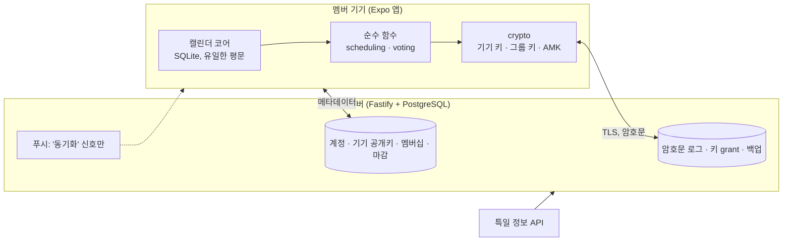
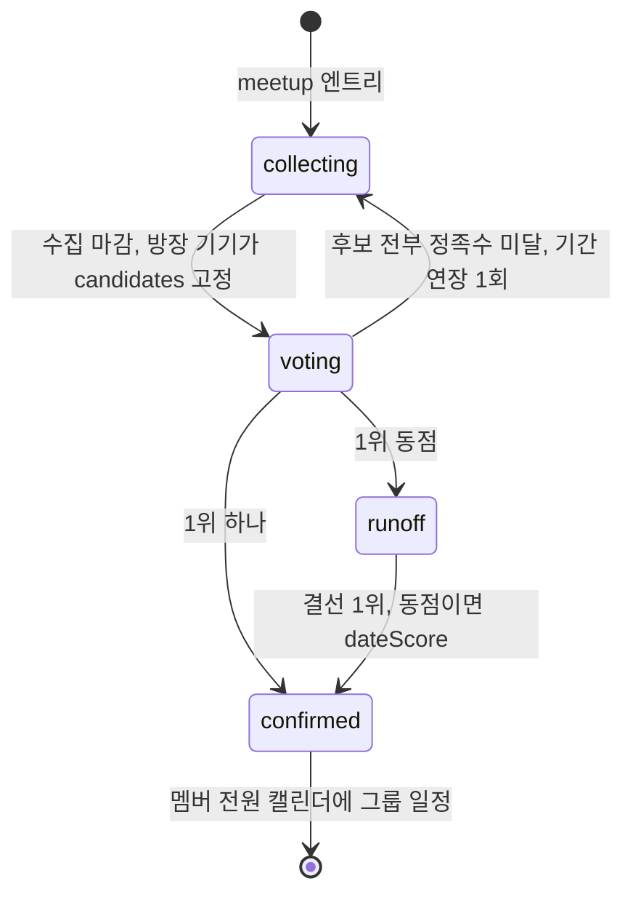
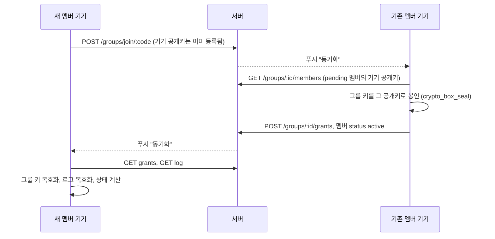

# 그날어때 개발 착수 문서

2026-10-24 · v2 · 놀날(가칭) v1을 전면 개정

## 0. 한 장 요약

**그날어때**는 내 일정을 가장 편하게 넣고 보는 캘린더 앱입니다. 그룹을 만들면 멤버들의 캘린더를 바탕으로 "다 되는 날"이 바로 나오고, 운영자를 포함해 멤버가 아닌 누구도 그 내용을 볼 수 없습니다.

v1과 다른 결정은 세 가지입니다. 각 결정의 대안과 대가를 함께 적었으니, 뒤집으려면 이 표에서 뒤집으면 됩니다.

| 결정 | v2 | v1 | 대안을 택하면 |
| --- | --- | --- | --- |
| 보안 수준 | 운영자도 못 읽음(E2EE). 서버는 암호문 저장소 | 서버가 평문 바쁨/비어 있음을 받아 계산 | 서버 계산이 가능해지지만, 텔레그램 그룹 대화 수준(서버가 읽을 수 있음)이라 "텔레그램급"을 내세울 수 없음 |
| 일정의 원본 | 이 앱(기기 SQLite) + 암호화 백업 | OS 캘린더를 읽기만 | 캘린더 앱이 아니라 약속 도구가 되고, 설치를 요구할 단독 가치가 사라짐 |
| MVP 공유 범위 | 친구 그룹의 날짜 확정 하나 | 날짜 + 장소 랭킹 + 장소 투표 | 장소 기능은 영업시간·평점·이동 시간의 데이터 출처가 없어 MVP에서 구현할 수 없음 |

전제: 멤버는 모두 앱을 설치합니다(커뮤니티 앱). E2EE에서는 키를 들고 있을 기기가 모든 멤버에게 있어야 하므로 이 전제와 설계가 맞물립니다.

## 1. 제품 정의

### 사용자와 장면

- **친구 그룹(3~10명):** "다음 달에 언제 볼까?"가 단톡방에서 며칠 끌리다 흐지부지되는 문제.
- **아르바이트생·학생:** 주마다 바뀌는 근무표·시간표를 캘린더에 넣기 귀찮아 캘린더가 비어 있는 문제. 캘린더가 비면 "빈 시간 찾기"도 틀립니다. 그래서 캘린더 입력 UX가 공유 기능의 정확도를 결정합니다.

### 단독 가치와 네트워크 가치

- 혼자 써도 되는 가치: 교대 템플릿, 빠른 입력, 캘린더 여러 개, 기기 캘린더 미러. 이것이 설치의 명분입니다.
- 같이 쓸 때의 가치: 그룹 히트맵, 날짜 추천, 투표, 확정 일정의 자동 반영.

### 검증할 가설

친구 그룹은 단톡방의 "언제 돼?" 대신 그날어때 그룹에서 날짜를 정한다. 단, 각자의 캘린더가 이 앱에 들어 있을 때.

### 성공 지표와 중단 기준

숫자는 초기값이며 알파에서 조정합니다.

| 지표 | 정의 | 게이트 기준 |
| --- | --- | --- |
| 캘린더 활성 | 첫 7일 중 4일 이상 앱을 연 사용자 비율 | 50% 이상 |
| 초대 전환 | 초대 코드 사용 → 활성 멤버 → 첫 가용 시간 공유 | 50% 이상 |
| 확정 도달 | 약속을 만든 그룹 중 날짜 확정까지 간 비율 | 60% 이상 |
| 확정 속도 | 약속 생성 → 확정의 중위 시간 | 48시간 이내 |
| 재사용 | 확정 후 60일 안에 두 번째 약속을 만든 그룹 | 30% 이상 |

중단 기준: 그룹 알파에서 초대 전환이 25% 미만이고 온보딩을 두 번 고친 뒤에도 같으면, 그룹 기능을 보류하고 캘린더 단독 제품으로 재평가합니다.

### 경쟁 위치

공유 캘린더는 TimeTree가 선점했고, 빈 시간 찾기는 When2meet류가 있습니다. 둘을 함께 하면서 운영자도 내용을 못 보는 조합은 비어 있습니다. 구글·네이버 캘린더는 둘 다 하지 않습니다.

## 2. 범위

| 구분 | 항목 |
| --- | --- |
| MVP 포함 | 캘린더: 월·주·목록 뷰, 빠른 입력, 캘린더 여러 개(색), 반복 일정, 알림, 교대 템플릿, 기기 캘린더 읽기 미러 |
| MVP 포함 | 계정: 카카오 로그인, Sign in with Apple, 게스트, 앱 내 계정 삭제, 복구 코드, 암호화 백업 |
| MVP 포함 | 그룹: 생성, 카카오톡 초대 링크, 멤버 승인, 그룹별 공유 설정, 날짜별 가능 인원 히트맵 |
| MVP 포함 | 날짜 추천: 공휴일·대체공휴일·연휴, 연차 제안, 정족수, 만남 형태 분류 |
| MVP 포함 | 투표: 찬성/반대/아무거나, 결선, 자동 확정, 확정 일정을 멤버 전원의 캘린더에 반영 |
| MVP 제외 | 장소 추천·랭킹 (2단계에서 카카오맵 링크 공유 + 투표부터) |
| MVP 제외 | 위치 수집 전부 |
| MVP 제외 | 앱 내 채팅 (카카오톡에 맡김) |
| MVP 제외 | 근무표 짜기 (사장·알바 모드) |
| MVP 제외 | 다기기 실시간 동기화 (백업·복구로 대체) |
| MVP 제외 | 기기 캘린더로 쓰기 (양방향 동기화) |
| MVP 제외 | 머신러닝, 인스타그램 연동 |

## 3. 설계 원칙

1. **서버는 암호문만 봅니다.** 일정 내용, 바쁨/비어 있음, 투표는 그룹 멤버의 기기에서만 복호화됩니다.
2. **계산은 기기에서 합니다.** 날짜 추천과 집계는 순수 함수이고, 멤버 10명·12주 교집합이 수 ms입니다.
3. **그룹 상태는 로그의 함수입니다.** 서버가 보관한 암호문 로그를 같은 함수에 넣으면 모든 기기가 같은 결과를 냅니다.
4. **수집하지 않은 것은 유출되지 않습니다.** 서버가 보는 메타데이터는 8장의 표에 전부 적습니다.
5. **캘린더가 먼저입니다.** 공유 기능의 정확도는 캘린더에 들어 있는 데이터의 양이 정합니다.

## 4. 아키텍처



| 영역 | 선택 | 이유 |
| --- | --- | --- |
| 모바일 | React Native + Expo (TypeScript), 개발 빌드 | 캘린더·보안 저장소·SQLite 모듈, 서버와 언어 통일. libsodium 네이티브 모듈 때문에 Expo Go는 쓰지 않음 |
| 로컬 DB | expo-sqlite | 일정 원본. OS 파일 암호화에 더해 키는 Keychain/Keystore |
| 암호 | libsodium (`react-native-libsodium`, Node에서는 `libsodium-wrappers-sumo`) | X25519 봉인, XChaCha20-Poly1305, Argon2id를 한 라이브러리에서. 직접 조합할 것이 없음 |
| 반복 일정 | rrule | RFC 5545 확장 |
| 서버 | Node.js + Fastify (TypeScript), zod | 가볍고 스키마를 앱과 공유 |
| DB | PostgreSQL 16 | 확장 없음. PostGIS·Redis 제거 |
| ORM | Drizzle | `bytea`는 내장 타입이 없어 `customType`으로 정의 |
| 지연 작업 | PostgreSQL 폴링 워커(1분) | 마감 푸시. Redis 불필요 |
| 외부 | 특일 정보 API, Expo Notifications (APNs·FCM), 카카오 로그인·카카오톡 공유, Sign in with Apple | 공휴일, 푸시(내용 없음), 계정, 초대 |

흐름: 설치 → 계정·기기 키 생성 → 캘린더 사용 → 그룹 생성 또는 참여(승인 시 그룹 키 전달) → 그룹별 공유 설정 → 비트맵 암호화 업로드 → 수집 마감 → 방장 기기가 후보 고정 → 투표 → 마감 → 모든 기기가 같은 결과를 계산 → 확정 일정이 그룹 캘린더로 각자의 캘린더에 들어감.

## 5. 캘린더 코어 (기기)

### 기능

- **뷰:** 월, 주, 목록. 캘린더별 색과 표시/숨김.
- **빠른 입력:** 날짜 탭 → 시간 범위 드래그 → 제목. 반복은 "매주 화·목" 같은 프리셋.
- **교대 템플릿:** "오픈 07–13", "마감 17–23" 같은 템플릿을 만들고 달력 날짜를 탭해서 찍습니다. 템플릿은 입력 UX이고 결과는 일반 일정입니다. 아르바이트생의 불규칙 근무표가 캘린더에 들어오게 하는 장치입니다.
- **기기 캘린더 미러:** expo-calendar로 읽기만 합니다. 미러 캘린더는 바쁨 계산에만 쓰고, 제목은 기기 밖으로 나가지 않습니다.
- **소프트 캘린더:** `blocks_free = 0`이면 내 화면에는 보이지만 그룹 빈 시간 계산에서는 비어 있음으로 칩니다. 예: 헬스장, 혼자 하는 공부.
- **알림:** expo-notifications의 로컬 예약. 서버가 필요 없습니다.

### 데이터 모델 (SQLite)

```sql
-- apps/mobile local store (expo-sqlite). The only place where calendar content exists in plaintext.
CREATE TABLE calendars (
  id           TEXT PRIMARY KEY,
  name         TEXT NOT NULL,
  color        TEXT NOT NULL,
  kind         TEXT NOT NULL CHECK (kind IN ('personal', 'routine', 'device_mirror', 'group')),
  blocks_free  INTEGER NOT NULL DEFAULT 1,   -- 0 = soft: I see it, but it never counts as busy for a group
  group_id     TEXT                          -- set when kind = 'group'
);

CREATE TABLE events (
  id               TEXT PRIMARY KEY,
  calendar_id      TEXT NOT NULL REFERENCES calendars(id) ON DELETE CASCADE,
  title            TEXT NOT NULL,
  starts_at        TEXT NOT NULL,            -- ISO 8601 with offset
  ends_at          TEXT NOT NULL,
  all_day          INTEGER NOT NULL DEFAULT 0,
  tz               TEXT NOT NULL DEFAULT 'Asia/Seoul',
  rrule            TEXT,                     -- RFC 5545, e.g. FREQ=WEEKLY;BYDAY=TU,TH
  exdates          TEXT,                     -- JSON array of ISO timestamps
  note             TEXT,
  device_event_id  TEXT,                     -- set for device_mirror rows
  updated_at       TEXT NOT NULL,
  CHECK (ends_at > starts_at)
);
CREATE INDEX events_by_start ON events (starts_at);

-- One occurrence of a recurring event moved, edited or cancelled.
CREATE TABLE event_overrides (
  event_id       TEXT NOT NULL REFERENCES events(id) ON DELETE CASCADE,
  occurrence_at  TEXT NOT NULL,
  starts_at      TEXT,
  ends_at        TEXT,
  title          TEXT,
  cancelled      INTEGER NOT NULL DEFAULT 0,
  PRIMARY KEY (event_id, occurrence_at)
);

CREATE TABLE reminders (
  event_id        TEXT NOT NULL REFERENCES events(id) ON DELETE CASCADE,
  offset_minutes  INTEGER NOT NULL,
  PRIMARY KEY (event_id, offset_minutes)
);

-- 아르바이트: "오픈 07-13", "마감 17-23" tapped onto days. Templates are input UX; the result is ordinary events.
CREATE TABLE shift_templates (
  id        TEXT PRIMARY KEY,
  name      TEXT NOT NULL,
  start_hm  TEXT NOT NULL,                   -- '17:00'
  end_hm    TEXT NOT NULL,                   -- '23:00'; an end before start means past midnight
  color     TEXT NOT NULL
);

-- What I share with each group: window and which calendars count as busy. Never titles.
CREATE TABLE group_shares (
  group_id          TEXT PRIMARY KEY,
  window_start      TEXT NOT NULL,           -- local date, 00:00 Asia/Seoul
  window_days       INTEGER NOT NULL CHECK (window_days BETWEEN 7 AND 91),
  calendar_ids      TEXT NOT NULL,           -- JSON array
  last_uploaded_at  TEXT
);
```

### 반복 일정

rrule로 기간 안의 발생을 확장하고, `exdates`와 `event_overrides`로 예외를 처리합니다. 종일 일정은 해당 날짜 전체를 바쁨으로 칩니다. 시간대는 MVP에서 `Asia/Seoul` 하나이고, 해외 멤버는 2단계입니다.

### 백업과 복구

- 스냅샷(캘린더·일정·템플릿 JSON)을 계정 마스터 키(AMK)로 암호화해 `PUT /me/backup`으로 올립니다. 변경 후 디바운스, 최소 하루 1회, 5MB 상한.
- 복구: 새 기기에서 로그인 → 복구 코드 입력 → `GET /me/recovery`로 salt와 래핑된 AMK를 받음 → Argon2id로 복구 키 유도 → AMK 복호화 → 최신 백업 복호화.
- 복구 코드 없이 모든 기기를 잃으면 복구할 수 없습니다. 이것이 "운영자도 못 읽음"의 대가이고, 가입 흐름에서 그대로 알립니다.

### 첫 테스트 목록

- `expands a weekly RRULE with an EXDATE across a month boundary in Asia/Seoul`
- `applies a shift template to three days as three ordinary events`
- `treats an end time before the start time as a shift past midnight`
- `rounds an 18:10-19:20 event to the 18:00-19:30 busy slots`
- `excludes calendars flagged blocks_free = 0 from the group bitmap`
- `maps device-mirrored events to busy slots without exporting titles`
- `restores a backup snapshot on a fresh device with the recovery code`

## 6. 공유: 그룹과 빈 시간

### 그룹은 공유 캘린더 방입니다

채팅은 없습니다. 멤버 목록은 멤버 모두에게 보이고, 방장이 참여를 승인하고 강퇴할 수 있습니다. 그룹 이름은 `group_meta` 엔트리로 암호화해 서버는 알지 못합니다.

### 그룹별 공유 설정

- 기간: 기본 4주, 최대 13주. 그룹마다 다릅니다.
- 포함 캘린더: 어떤 캘린더를 이 그룹의 바쁨 계산에 넣을지 고릅니다.
- 내용: 바쁨/비어 있음만. 제목·장소·메모는 어떤 경로로도 나가지 않습니다.
- v1은 사용자 단위 전역 `availability_blocks`여서 그룹 하나에 들어가면 모든 그룹과 서버에 전체 패턴이 보였습니다. v2는 그룹별로, 기간 안에서만 공유합니다.

### 비트맵

엔트리 평문은 JSON입니다.

```ts
// packages/shared/src/entries.ts — every group log entry decrypts to one of these.
type Entry =
  | { kind: "group_meta"; name: string }
  | { kind: "availability"; windowStart: string; days: number; bits: string }   // 30-min slots, 1 = free, MSB first, base64
  | { kind: "meetup"; ref: string; windowStart: string; days: number; quorum: number; collectDueAt: string; voteDueAt: string }
  | { kind: "candidates"; ref: string; slots: { start: string; end: string; members: string[] }[] }  // frozen by the owner's device
  | { kind: "vote"; ref: string; round: number; slotStart: string; value: "yes" | "no" | "any" }
  | { kind: "confirmed"; ref: string; slotStart: string; slotEnd: string; by: "rule" | "owner" };
```

4주는 1344비트, 168바이트입니다. 10명이 12주를 공유해도 내려받기는 5.3KB, 복호화와 교집합은 1.4ms입니다(Node 22에서 측정).

### 응답 상태와 수집 마감

- 공유하지 않은 멤버는 '미응답'이고 불참으로 계산합니다. 늘 가능으로 보지 않습니다. v1은 입력하지 않은 사람을 4주 내내 비어 있는 것으로 계산했습니다.
- 수집 마감(기본 72시간)이 지나거나 방장이 조기 종료하면, 방장 기기가 그 시점의 비트맵으로 후보를 계산해 `candidates` 엔트리로 고정합니다. 이후 캘린더가 바뀌어도 후보는 움직이지 않습니다.
- 방장은 "3/5 공유함" 같은 상태를 보고 독촉하거나 진행할 수 있습니다.

### 그룹 화면

날짜별 가능 인원 히트맵(When2meet식)과 추천 후보 상위 5~7개. 히트맵은 각 기기에서 복호화한 비트맵으로 그립니다.

### 날짜 추천 (순수 함수, 기기 실행)

슬롯별 인원수를 세는 방식은 겹침을 과대평가합니다. A가 13–15시, B가 14–16시, C가 13–16시이고 정족수가 2명이면 인원수로는 13–16시 3시간이 나오지만, 같은 두 사람이 함께 있을 수 있는 시간은 최대 2시간입니다. 그래서 블록을 늘리는 동안 **같은 멤버 집합**이 유지되는지 봅니다.

```ts
// packages/scheduling/src/blocks.ts — pure; runs on the phone over decrypted member bitmaps.
export interface Block { start: number; end: number; members: number[] } // half-open slot range

const isFree = (bitmap: Uint8Array, slot: number) => (bitmap[slot >> 3] >> (7 - (slot & 7))) & 1;

// Counting free heads per slot overstates overlap: a block only holds while the SAME members stay free.
// Each time the shared set shrinks we emit the block so far, so "all three 14-15" survives next to "B+C 14-16".
export function quorumBlocks(free: Uint8Array[], slots: number, quorum: number): Block[] {
  const out: Block[] = [];
  for (let start = 0; start < slots; start++) {
    let set = free.map((_, m) => m).filter((m) => isFree(free[m], start));
    if (set.length < quorum) continue;
    let end = start + 1;
    while (end < slots) {
      const next = set.filter((m) => isFree(free[m], end));
      if (next.length < quorum) break;
      if (next.length < set.length) out.push({ start, end, members: set });
      set = next; end++;
    }
    out.push({ start, end, members: set });
  }
  return dominated(out);
}

// Drop a block when another block covers its range with a superset of members.
function dominated(blocks: Block[]): Block[] {
  return blocks.filter((b, i) => !blocks.some((o, j) => j !== i && o.start <= b.start && o.end >= b.end &&
    b.members.every((m) => o.members.includes(m)) && (o.start < b.start || o.end > b.end || o.members.length > b.members.length)));
}
```

위 예시에 넣으면 `13-15 {A,C}`, `14-15 {A,B,C}`, `14-16 {B,C}`가 나오고 `13-16`은 나오지 않습니다. 멤버 10명·12주·정족수 7명이 100ms입니다.

**만남 형태 분류** (기준값은 초기값)

- 4시간 미만: 짧은 만남
- 4시간 이상, 같은 날 안: 당일
- 당일 12:00 이전에 시작해 다음 날 12:00 이후까지 이어짐: 1박 가능. v1의 "밤을 넘기면 여행"은 화요일 19시~수요일 9시도 여행 후보로 만들었습니다.

**점수**

$$
\text{dateScore} = w_a \cdot \frac{\text{attending}}{\text{members}} + w_h \cdot \text{dayOff} + w_l \cdot \text{longWeekend} + w_d \cdot \text{duration} - w_n \cdot \text{lateNight} - w_s \cdot \text{tooSoon}
$$

| 항 | 의미 | 초기 가중치 |
| --- | --- | --- |
| attending / members | 블록 멤버 수 ÷ 공유한 멤버 수 | 0.40 |
| dayOff | 주말·공휴일·대체공휴일이면 1 | 0.20 |
| longWeekend | 3일 이상 연휴에 속하면 1 | 0.10 |
| duration | 같은 형태 안에서 길이를 0~1로 정규화 | 0.10 |
| lateNight | 블록 대부분이 23시 이후면 1 | 0.10 |
| tooSoon | 시작이 48시간 이내면 1 | 0.10 |

**공휴일과 연차 제안**

- 공휴일은 공공데이터포털의 특일 정보 API로 매일 동기화해 서버의 `holidays`에 넣고, 앱이 받아 갑니다. 임시공휴일은 정부 발표 뒤에 추가되므로 주기 동기화가 필요합니다.
- 같은 날에 공휴일이 둘일 수 있습니다(2025-05-05 어린이날·부처님오신날). v1의 `day` 단독 PK는 이 데이터에서 깨졌습니다.
- 공휴일 사이에 낀 평일 하루를 쉬면 연휴가 4일 이상이 되는 경우 "연차 1일로 4일 연휴" 제안을 따로 보여 줍니다. 누가 연차를 쓸 수 있는지는 앱이 가정하지 않습니다.

### 첫 테스트 목록

- `returns one block covering the window when all members are free`
- `excludes slots where a member in the block is busy`
- `keeps the member set fixed while extending a quorum block`
- `treats a member without shared availability as absent, never as free`
- `classifies a block as trip-capable only when it covers noon to noon of the next day`
- `marks substitute holidays as day off and accepts two holidays on one date`
- `suggests one leave day that bridges a holiday into a 4-day weekend`
- `handles blocks crossing midnight in Asia/Seoul`
- `penalizes blocks that start within 48 hours`

## 7. 투표와 확정

날짜 투표에 적용하는 규칙입니다. 어떤 경우에도 하나로 끝나야 하고, 모든 기기가 같은 결과를 내야 합니다.



**집계 규칙** (숫자는 초기값)

1. 후보 5~7개를 공개하고, 멤버는 후보마다 찬성/반대/아무거나를 고릅니다.
2. 날짜 후보에서 반대는 "그날 못 간다"입니다. 후보의 참석 인원 = 고정된 멤버 집합 − 반대. 참석 인원이 정족수 미만이면 탈락합니다. v1의 "반대가 1/3 이상이면 탈락"은 2~3인 그룹에서 반대 1표로 후보가 전멸해 "방장이 정함"이 주 경로가 되는 규칙이었습니다.
3. 점수 = 찬성 − 반대. 아무거나는 0입니다. v1의 취향 대리 투표는 날짜 후보에 정의되지 않아 뺐습니다.
4. 가용 시간을 공유했지만 투표 마감까지 응답하지 않은 멤버는 아무거나로 처리하고 `implicit`으로 기록합니다. 공유하지 않은 멤버는 후보 집합에 없으므로 묵시적 동의가 생기지 않습니다.
5. 1위가 하나면 확정합니다. 동점이면 동점 후보만으로 결선을 한 번 합니다.
6. 결선도 동점이면 `dateScore`가 높은 후보로 자동 확정합니다. 방장은 확정 전에 바꿀 수 있고, 그 경우 `by: "owner"`로 남습니다.
7. 전원이 아무거나면 `dateScore` 1위를 바로 확정합니다. 모든 후보가 정족수 미달이면 수집 기간을 2주 연장해 한 번 더 모으고, 그래도 없으면 방장이 정합니다.
8. 마감 시각의 기준은 서버가 엔트리에 찍은 `received_at`입니다. 마감 뒤에 도착한 투표는 집계에서 뺍니다.

**결정성**

- 집계는 `(로그 엔트리, 마감 시각, 활성 멤버 목록) → 결과`인 순수 함수입니다. 모든 기기가 같은 입력으로 같은 답을 냅니다.
- 마감 시각에 서버가 "동기화" 푸시를 보내면, 가장 먼저 연 기기가 결과를 `confirmed` 엔트리로 올립니다. 둘이 동시에 올려도 같은 내용이고, 서버 `id`가 작은 것을 정본으로 봅니다.
- 확정되면 멤버 전원의 캘린더에 `kind = 'group'` 캘린더로 일정이 들어갑니다. 공유 기능이 캘린더 코어로 돌아오는 지점입니다.

**첫 테스트 목록**

- `drops a date only when no-votes push attendance below quorum`
- `scores yes minus no and treats any as zero`
- `converts silence after the vote deadline into implicit any for members who shared availability`
- `ignores votes whose server timestamp is after the deadline`
- `runs a single runoff among tied candidates`
- `breaks a runoff tie by dateScore`
- `confirms the top dateScore when every member votes any`
- `derives the same result from the same log regardless of entry order`
- `treats the lowest-id confirmed entry as canonical when two devices finalize`

## 8. 보안·개인정보 설계

목표는 텔레그램 비밀 대화와 같은 수준, 즉 **운영자도 내용을 읽을 수 없는** 상태입니다. 텔레그램의 일반·그룹 대화는 서버가 읽을 수 있는 서버-클라이언트 암호화이고, v1의 설계가 바로 그 수준이었습니다.

### 키 계층

| 키 | 생성 | 보관 | 용도 |
| --- | --- | --- | --- |
| 기기 키쌍 (X25519) | 첫 실행 | 개인키는 Keychain/Keystore(`expo-secure-store`), 공개키는 서버 | 그룹 키를 이 기기로 봉인 |
| 계정 마스터 키 AMK (32B) | 첫 실행 | 기기 보안 저장소. 서버에는 복구 키로 래핑한 사본만 | 백업 암호화 |
| 복구 키 (32B) | 복구 코드(BIP39 12단어, 128비트) + salt → Argon2id | 서버에는 salt만 | AMK 래핑 |
| 그룹 키 (32B, 버전 있음) | 그룹 생성·회전 시 멤버 기기가 생성 | 멤버 기기 공개키마다 봉인한 grant를 서버에 | 그룹 로그 엔트리 AEAD |

### 흐름

- **가입:** 기기 키쌍과 AMK를 만들고 공개키를 서버에 등록합니다. 복구 코드는 첫 그룹 참여 전까지 설정을 미룰 수 있고, 미설정이면 배너로 알립니다.
- **그룹 참여:** 아래 순서입니다. 승인은 활성 멤버 누구의 기기든 할 수 있어 초대자가 자리를 비워도 진행됩니다.
- **새 기기:** 로그인 → 복구 코드 → AMK → 백업 복원. 그룹 키는 기존 멤버의 기기가 새 기기에 grant하며, 참여와 같은 경로입니다.
- **탈퇴·강퇴:** 서버가 `status = 'removed'`로 바꾸면 방장 기기가 새 버전의 그룹 키를 만들어 남은 멤버에게 grant합니다. 이후 엔트리는 새 버전으로 암호화됩니다. 나간 사람이 이미 받은 과거 데이터는 회수할 수 없습니다. 모든 E2EE가 같습니다.
- **계정 삭제:** 앱 안에서 합니다. 서버는 계정·기기·백업·복구 정보와 그 사용자가 쓴 로그 엔트리를 지우고, 기기는 로컬 키와 DB를 지웁니다. 서버가 평문을 가진 적이 없으므로 "백업에 남은 암호문" 같은 꼬리가 없습니다.



### 서버가 보는 것

이 표가 개인정보 처리방침의 수집 항목입니다. 텔레그램 비밀 대화·시그널과 같은 종류의 노출이고, 메타데이터까지 숨기는 기법(sealed sender 등)은 범위 밖입니다.

| 항목 | 이유 |
| --- | --- |
| 계정 식별자(카카오·애플 `sub`), 닉네임 | 로그인, 멤버 목록 표시 |
| 기기 공개키, 플랫폼, 푸시 토큰 | 키 봉인, 푸시 |
| 그룹 멤버십 그래프, 역할, 상태, 가입 시각 | 승인·강퇴·키 회전 |
| 초대 코드 생성·사용 기록 | 남용 방지, 전환율 측정 |
| 로그 엔트리의 작성자, 수신 시각, 크기, 키 버전 | 마감 판정, 용량 제한 |
| 약속의 단계(수집·투표·확정) 전환 시각 | 마감 푸시, 확정 도달 측정 |
| 백업 크기와 시각 | 용량 제한 |
| 접속 IP와 요청 로그 | 보안. 보존 기간을 정책에 명시 |

### 코드

```ts
// packages/crypto/src/index.ts — same code on the phone (react-native-libsodium) and in Node tests (libsodium-wrappers-sumo).
import sodium from "libsodium-wrappers-sumo";

export interface DeviceKeyPair { publicKey: Uint8Array; privateKey: Uint8Array }

export async function ready(): Promise<void> { await sodium.ready; }

export function generateDeviceKeyPair(): DeviceKeyPair {
  const kp = sodium.crypto_box_keypair();
  return { publicKey: kp.publicKey, privateKey: kp.privateKey };
}

export function newSymmetricKey(): Uint8Array {
  return sodium.randombytes_buf(sodium.crypto_aead_xchacha20poly1305_ietf_KEYBYTES);
}

// A grant: the group key sealed to one device. The server stores it but cannot open it.
export function sealKeyToDevice(key: Uint8Array, devicePublicKey: Uint8Array): Uint8Array {
  return sodium.crypto_box_seal(key, devicePublicKey);
}

export function openSealedKey(sealed: Uint8Array, device: DeviceKeyPair): Uint8Array {
  return sodium.crypto_box_seal_open(sealed, device.publicKey, device.privateKey);
}

const NONCE = 24; // XChaCha20: random nonces are safe at this size, no counter to persist
const TAG = 16;

// AAD binds an entry to its group, author and key version so it cannot be replayed into another context.
export function encryptEntry(key: Uint8Array, plaintext: Uint8Array, aad: string): Uint8Array {
  const nonce = sodium.randombytes_buf(NONCE);
  const ct = sodium.crypto_aead_xchacha20poly1305_ietf_encrypt(plaintext, sodium.from_string(aad), null, nonce, key);
  const out = new Uint8Array(NONCE + ct.length);
  out.set(nonce, 0); out.set(ct, NONCE);
  return out;
}

export function decryptEntry(key: Uint8Array, blob: Uint8Array, aad: string): Uint8Array {
  if (blob.length < NONCE + TAG) throw new Error("blob shorter than nonce + tag");
  return sodium.crypto_aead_xchacha20poly1305_ietf_decrypt(null, blob.subarray(NONCE), sodium.from_string(aad), blob.subarray(0, NONCE), key);
}

// Recovery code -> wrapping key. The code carries 128 bits of entropy, so INTERACTIVE limits are enough and phone-friendly.
export function deriveRecoveryKey(code: string, salt: Uint8Array): Uint8Array {
  return sodium.crypto_pwhash(32, sodium.from_string(code.normalize("NFKC")), salt,
    sodium.crypto_pwhash_OPSLIMIT_INTERACTIVE, sodium.crypto_pwhash_MEMLIMIT_INTERACTIVE, sodium.crypto_pwhash_ALG_ARGON2ID13);
}
```

AAD 문자열은 `group:<id>|author:<userId>|v:<keyVersion>`로 고정합니다. 패키징 주의: `crypto_pwhash`는 `libsodium-wrappers`(기본 빌드)에 없고 `-sumo`에만 있습니다. 또 0.7.16의 ESM 진입점은 `libsodium.mjs`를 같은 폴더에서 찾아 Node ESM·Vitest에서 깨지므로, CJS 진입점으로 resolve하거나 alias를 둡니다.

### MVP가 하지 못하는 것

- **키 검증(TOFU):** 서버가 멤버의 공개키를 바꿔치면 중간자가 가능합니다. 2단계에서 안전 번호 비교를 넣습니다. 그때까지는 "서버 운영자가 적극적으로 공격하지 않는다"는 가정이 들어갑니다.
- 메타데이터 노출(위 표).
- 복구 코드와 모든 기기를 함께 잃으면 데이터도 잃습니다.
- 나간 멤버가 이미 받은 과거 데이터는 회수되지 않습니다.

### 하지 않을 것

- 서버에서 복호화하거나 평문을 받는 경로 만들기
- 일정 제목·메모·장소를 어떤 서버로도 보내기(크래시 리포트·분석 SDK 포함)
- 위치 수집, 인스타그램 스크래핑
- 직접 만든 암호 알고리즘, 폰 모델별 알고리즘
- 개인정보를 애플리케이션 로그에 출력하기

## 9. 서버

서버는 신원·멤버십·암호문을 보관하고 마감 푸시를 보내는 작은 장치입니다.

```sql
-- The server never holds calendar content. Everything a member writes into a group is an opaque ciphertext entry.
CREATE TABLE users (
  id                uuid PRIMARY KEY DEFAULT gen_random_uuid(),
  kakao_sub         text UNIQUE,                 -- null for guests
  apple_sub         text UNIQUE,                 -- Sign in with Apple (App Store guideline 4.8)
  display_name      text NOT NULL,
  age_confirmed_at  timestamptz NOT NULL,        -- self-declared "14세 이상"; no birth date is stored
  created_at        timestamptz NOT NULL DEFAULT now()
);

CREATE TABLE devices (
  id          uuid PRIMARY KEY DEFAULT gen_random_uuid(),
  user_id     uuid NOT NULL REFERENCES users(id) ON DELETE CASCADE,
  public_key  bytea NOT NULL CHECK (octet_length(public_key) = 32),   -- X25519
  platform    text NOT NULL CHECK (platform IN ('ios', 'android')),
  push_token  text,
  created_at  timestamptz NOT NULL DEFAULT now(),
  revoked_at  timestamptz
);

-- Account master key, wrapped by a key derived from the recovery code. Server holds salt + ciphertext only.
CREATE TABLE recovery (
  user_id      uuid PRIMARY KEY REFERENCES users(id) ON DELETE CASCADE,
  kdf_salt     bytea NOT NULL CHECK (octet_length(kdf_salt) = 16),
  amk_wrapped  bytea NOT NULL,
  updated_at   timestamptz NOT NULL DEFAULT now()
);

-- Encrypted calendar snapshots (AMK). Keep the last few per user.
CREATE TABLE backups (
  id          bigserial PRIMARY KEY,
  user_id     uuid NOT NULL REFERENCES users(id) ON DELETE CASCADE,
  ciphertext  bytea NOT NULL CHECK (octet_length(ciphertext) <= 5 * 1024 * 1024),
  created_at  timestamptz NOT NULL DEFAULT now()
);
CREATE INDEX ON backups (user_id, id DESC);

CREATE TABLE groups (
  id          uuid PRIMARY KEY DEFAULT gen_random_uuid(),
  created_by  uuid REFERENCES users(id) ON DELETE SET NULL,   -- ownership lives in group_members.role
  created_at  timestamptz NOT NULL DEFAULT now()
);

CREATE TYPE member_role   AS ENUM ('owner', 'member');
CREATE TYPE member_status AS ENUM ('pending', 'active', 'removed');

CREATE TABLE group_members (
  group_id   uuid REFERENCES groups(id) ON DELETE CASCADE,
  user_id    uuid REFERENCES users(id) ON DELETE CASCADE,
  role       member_role NOT NULL DEFAULT 'member',
  status     member_status NOT NULL DEFAULT 'pending',
  joined_at  timestamptz NOT NULL DEFAULT now(),
  PRIMARY KEY (group_id, user_id)
);
CREATE UNIQUE INDEX one_active_owner_per_group ON group_members (group_id) WHERE role = 'owner' AND status = 'active';

CREATE TABLE group_invites (
  code        text PRIMARY KEY CHECK (length(code) >= 10),   -- base32, at least 50 bits
  group_id    uuid NOT NULL REFERENCES groups(id) ON DELETE CASCADE,
  created_by  uuid REFERENCES users(id) ON DELETE SET NULL,
  expires_at  timestamptz NOT NULL,
  max_uses    int NOT NULL DEFAULT 20,
  uses        int NOT NULL DEFAULT 0 CHECK (uses <= max_uses)
);

CREATE TABLE group_keys (
  group_id    uuid REFERENCES groups(id) ON DELETE CASCADE,
  version     int NOT NULL,
  created_by  uuid REFERENCES users(id) ON DELETE SET NULL,
  created_at  timestamptz NOT NULL DEFAULT now(),
  PRIMARY KEY (group_id, version)
);

-- One grant per (key version, device): the group key sealed to that device's public key.
CREATE TABLE group_key_grants (
  group_id    uuid NOT NULL,
  version     int NOT NULL,
  device_id   uuid NOT NULL REFERENCES devices(id) ON DELETE CASCADE,
  sealed_key  bytea NOT NULL CHECK (octet_length(sealed_key) = 32 + 48),   -- crypto_box_seal adds 48 bytes
  granted_by  uuid REFERENCES users(id) ON DELETE SET NULL,
  PRIMARY KEY (group_id, version, device_id),
  FOREIGN KEY (group_id, version) REFERENCES group_keys(group_id, version) ON DELETE CASCADE
);

-- Append-only log of opaque entries. Clients derive all group state from it with one deterministic function.
CREATE TABLE group_log (
  id           bigserial PRIMARY KEY,
  group_id     uuid NOT NULL REFERENCES groups(id) ON DELETE CASCADE,
  author_id    uuid NOT NULL REFERENCES users(id) ON DELETE CASCADE,   -- account deletion removes what they wrote
  key_version  int NOT NULL,
  ciphertext   bytea NOT NULL CHECK (octet_length(ciphertext) <= 16 * 1024),
  received_at  timestamptz NOT NULL DEFAULT now(),                     -- authoritative clock for deadlines
  FOREIGN KEY (group_id, key_version) REFERENCES group_keys(group_id, version)
);
CREATE INDEX ON group_log (group_id, id);

-- The only plaintext facts about a meetup: when each phase closes, so the server can send a content-free push.
CREATE TYPE meetup_phase AS ENUM ('collect', 'vote', 'confirmed');
CREATE TABLE deadlines (
  group_id     uuid REFERENCES groups(id) ON DELETE CASCADE,
  meetup_ref   text NOT NULL,              -- client-generated opaque id
  phase        meetup_phase NOT NULL,
  due_at       timestamptz NOT NULL,
  notified_at  timestamptz,
  PRIMARY KEY (group_id, meetup_ref, phase)
);
CREATE INDEX ON deadlines (due_at) WHERE notified_at IS NULL;

CREATE TABLE holidays (
  day            date NOT NULL,
  name           text NOT NULL,
  is_substitute  boolean NOT NULL DEFAULT false,
  PRIMARY KEY (day, name)                  -- 2025-05-05 is both 어린이날 and 부처님오신날
);
```

v1 스키마와 달리 확장이 필요 없고(v1은 `btree_gist` 없이 첫 인덱스에서 실패), 방장이 탈퇴해도 그룹이 남고(`created_by`는 참조만, 소유권은 `group_members.role`), 활성 방장은 그룹당 하나로 강제됩니다.

| 메서드 | 경로 | 용도 |
| --- | --- | --- |
| POST | `/auth/kakao` | 카카오 로그인 |
| POST | `/auth/apple` | Sign in with Apple |
| POST | `/auth/guest` | 게스트 계정(기기 전용) |
| POST | `/auth/link` | 게스트를 카카오·애플 계정에 연결 |
| DELETE | `/me` | 계정 삭제 |
| POST | `/me/devices` | 기기 등록: 공개키, 플랫폼, 푸시 토큰 |
| DELETE | `/me/devices/:id` | 기기 해제 |
| PUT, GET | `/me/recovery` | 복구용 salt와 래핑된 AMK |
| PUT, GET | `/me/backup` | 암호화 스냅샷 |
| POST | `/groups` | 그룹 생성. 첫 키 버전과 자기 기기 grant를 함께 보냄 |
| POST | `/groups/:id/invites` | 초대 코드 발급 |
| POST | `/groups/join/:code` | 참여 요청 → `pending` |
| GET | `/groups/:id/members` | 멤버, 상태, 기기 공개키 |
| POST | `/groups/:id/grants` | 대기 멤버의 기기에 키 grant → `active` |
| POST | `/groups/:id/keys` | 키 회전: 새 버전 + grants |
| DELETE | `/groups/:id/members/:userId` | 탈퇴·강퇴 |
| POST | `/groups/:id/log` | 엔트리 추가 |
| GET | `/groups/:id/log` | 전체 로그. 소그룹이라 전체 조회로 충분 |
| PUT | `/groups/:id/deadlines` | 단계별 마감 등록 |
| GET | `/holidays?from&to` | 공휴일 |

- **마감 워커:** 1분마다 `due_at <= now() AND notified_at IS NULL`을 읽어 그룹 멤버 기기에 "동기화" 푸시를 보냅니다. 푸시 본문에는 그룹 식별자도 넣지 않습니다. 앱이 열리면 모든 그룹을 동기화합니다.
- **공휴일 동기화:** 매일 특일 정보 API를 읽어 `holidays`를 갱신합니다.
- **레이트 리밋:** 초대 코드 시도, 로그 추가, 백업 업로드에 사용자·IP 단위 제한을 둡니다. 앱 무결성 검증(App Attest·Play Integrity)은 서버가 암호문만 보관하는 구조에서 막을 것이 스팸뿐이라 MVP에서 뺍니다.
- **Drizzle:** `bytea`는 `customType`으로 정의합니다. v1의 `tstzrange`·`geography`는 서버에서 사라졌습니다.

## 10. 모두 설치 전제와 초대 경로

초대받은 사람은 설치 → 가입 → 그룹 참여 → 공유까지 네 단계를 지나야 합니다. 이 퍼널이 제품의 생사를 정하므로 경로를 설계하고 단계마다 측정합니다.

- **링크:** `https://<도메인>/i/<code>`를 카카오톡 공유로 보냅니다. 설치되어 있으면 Universal Link·App Link로 앱이 열리고, 없으면 스토어로 갑니다.
- **설치 뒤 복귀:** Firebase Dynamic Links는 2025-08-25에 종료됐고 구글은 대체품을 내지 않았습니다. Android는 Play Install Referrer로 코드를 전달합니다. iOS는 네이티브 수단이 없어서, 첫 실행 화면에서 "초대 코드가 있나요?"를 묻고 클립보드 붙여넣기를 받습니다. Branch 같은 서드파티 지연 딥링크는 가격·개인정보 조건을 보고 2단계에 평가합니다.
- **측정:** 초대 코드 생성 → 사용 → `active` → 첫 로그 엔트리의 전환을 서버 메타데이터만으로 셉니다. 내용 없이 측정됩니다.
- **첫 실행의 가치:** 초대로 들어온 사람도 가입 직후 기기 캘린더 미러를 켜면 바로 쓸 수 있어야 합니다. 그래야 "공유해 줘"가 부담이 아닙니다.

## 11. 법·규제·스토어 체크리스트

위치를 처리하지 않으므로 v1의 위치기반서비스사업 신고는 MVP 범위에서 빠집니다. 아래는 출시 전 변호사 검토 대상입니다.

- [ ] 개인정보 처리방침: 8장 "서버가 보는 것" 표를 수집 항목으로, 보존 기간과 처리 위탁(Expo 푸시, 클라우드)을 명시
- [ ] 만 14세 미만 가입 차단: 자기 확인 체크박스와 시각만 저장, 생년월일 미수집
- [ ] App Store 심사 지침 4.8: 카카오 로그인을 제공하므로 Sign in with Apple 병행
- [ ] App Store 심사 지침 5.1.1(v): 앱 내 계정 삭제
- [ ] App Store 암호화 수출 항목(`ITSAppUsesNonExemptEncryption`)과 연간 자가분류 보고 대상 여부 확인
- [ ] 전기통신사업법 부가통신사업 신고 대상 여부(소규모 면제 기준) 확인
- [ ] 카카오 로그인 동의 항목을 닉네임까지로 최소화
- [ ] 수사기관 요청 대응 원칙: 운영자가 제공할 수 있는 것은 메타데이터뿐임을 정책에 명시
- [ ] 백업·접속 로그 보존 기간, 탈퇴 즉시 삭제 정책
- [ ] 키 관리 코드 외부 리뷰 1회(예산이 없으면 체크리스트 리뷰로 대체하고 기록)
- [ ] 2단계에서 장소 기능을 넣을 때: 사용자가 직접 고른 역·동은 위치정보법상 "측위된" 위치정보가 아닐 여지가 있으나 확인 필요. GPS를 쓰면 위치기반서비스사업 신고 대상이며, 소상공인·1인 창조기업은 개시 후 1개월 이내 신고 특례(제9조의2)
- [ ] 상표·스토어 중복 확인: "그날어때"

## 12. 저장소 구조와 초기 셋업 순서

외부 의존성이 없는 순수 로직을 먼저 테스트 주도로 만들고, 앱과 서버를 그 위에 얹습니다. 스키마와 타입은 `packages/shared`에서 공유합니다.

```
geunal-eottae/
  apps/
    mobile/            # Expo (React Native, TypeScript); calendar core + group UI + local SQLite
    api/               # Fastify + TypeScript; identity, membership, ciphertext log, deadline worker
  packages/
    shared/            # zod schemas: log entry kinds, API DTOs
    calendar-core/     # pure: recurrence expansion, busy bitmap from events + routines, Asia/Seoul
    scheduling/        # pure: quorum blocks, classification, holiday scoring, leave-day suggestions
    voting/            # pure: deterministic tally from a decrypted log
    crypto/            # isomorphic libsodium: device keys, group keys, sealed grants, entry AEAD, recovery KDF
  infra/
    docker-compose.yml # postgres only
  docs/
    kickoff.md         # this document
    adr/               # architecture decision records
  pnpm-workspace.yaml
```

**셋업 순서**

1. 저장소 초기화: pnpm workspaces, TypeScript `strict`, ESLint/Prettier, Vitest. GitHub Actions에서 lint + test.
2. `packages/calendar-core`: 5장의 테스트 목록부터 작성하고 통과시킵니다.
3. `packages/scheduling`: 6장의 테스트 목록. `quorumBlocks`부터.
4. `packages/crypto`: 8장의 코드와 테스트. Node와 RN 양쪽에서 같은 테스트 벡터를 통과해야 합니다.
5. `apps/mobile` 캘린더: 월·주 뷰, 빠른 입력, 교대 템플릿, 기기 캘린더 미러, 알림, 복구 코드, 백업. 그룹 기능 없이 내부 알파로 배포합니다(13장 M1).
6. `infra/docker-compose.yml`로 PostgreSQL을 띄우고 9장 스키마를 첫 마이그레이션으로 넣습니다(Drizzle + drizzle-kit).
7. `apps/api`: 인증(카카오·애플·게스트), 기기, 복구, 백업, 그룹·초대·grant·로그, 마감 워커, 공휴일 동기화.
8. `packages/voting`과 `apps/mobile` 그룹 플로우: 생성 → 초대 → 승인 → 공유 설정 → 히트맵 → 후보 고정 → 투표 → 확정 → 캘린더 반영.
9. 초대 경로: Universal Link·App Link, Play Install Referrer, iOS 코드 붙여넣기.
10. 외부 연동은 어댑터로 감싸서 테스트에서는 가짜 구현을 씁니다.

커밋은 Conventional Commits 형식입니다. 예: `feat(scheduling): emit quorum blocks with fixed member sets`.

## 13. 마일스톤과 게이트

날짜는 정하지 않고 단계와 통과 조건만 정합니다. 각 단계는 앞 게이트를 통과해야 시작합니다.

| 단계 | 내용 | 게이트 |
| --- | --- | --- |
| M0 코어 | `calendar-core`, `scheduling`, `voting`, `crypto`의 첫 테스트 목록 | CI 녹색. 암호 테스트가 Node와 RN에서 같은 결과 |
| M1 캘린더 알파 | 그룹 기능 없는 캘린더를 내부 테스터 10명에게 2주 | 캘린더 활성 50% 이상, 크래시 없는 세션 99.5% 이상, 기기 캘린더 가져오기 성공 90% 이상, 복구 코드로 새 기기 복원 시나리오 100% 통과 |
| M2 그룹 알파 | 실제 친구 그룹 5개에 공유·투표 개방 | 초대 전환 50% 이상, 확정 도달 3/5 이상, 확정 중위 48시간 이내, 키 관리 코드 리뷰 완료 |
| M3 공개 베타 | 스토어 공개 | 11장 체크리스트 완료, 삭제·복구·키 회전 플로우 E2E 테스트, 스토어 심사 통과 |

M1에서 캘린더 활성이 25% 미만이면 캘린더 UX를 다시 설계하기 전에는 M2에 들어가지 않습니다. M2의 중단 기준은 1장과 같습니다.

**2단계 후보** (베타 이후, 우선순위 미정)

- 다기기 실시간 동기화: 개인 로그를 그룹 로그와 같은 구조로
- iCloud Keychain·Google Block Store로 복구 코드 없는 복원
- 안전 번호 비교(키 검증)
- 그룹 공유 일정(TimeTree형, E2EE)
- 장소: 카카오맵 링크 공유 + 투표. 랭킹은 데이터 출처가 생긴 뒤에
- 근무표 모드(사장·알바): 교집합이 아니라 커버리지 문제라 별도 설계
- 인스타그램 공유 시트로 "가고 싶은 곳" 저장
- 해외 멤버의 시간대

## 14. 미결정 사항

- [ ] 복구 코드 시점: 가입 즉시 강제 vs 첫 그룹 참여 전까지 유예(권고: 유예 + 배너)
- [ ] 게스트 계정 허용 여부(권고: 허용. 복구 코드 없으면 기기 분실 시 복구 불가를 고지)
- [ ] 최소 참석 인원 기본값: 전원 vs 전원 − 1(권고: 전원, 방장이 조정)
- [ ] 그룹 최대 인원(권고: 20)
- [ ] 슬롯 단위 30분, 기본 기간 4주, 수집 마감 72시간이 적절한지
- [ ] 멤버 승인 권한: 방장만 vs 활성 멤버 누구나(권고: 누구나. 승인 지연이 전환율을 깎음)
- [ ] 백업 보관 개수와 기간
- [ ] 클라우드 공급자와 리전(국내 리전 전제)
- [ ] 수익 모델: 캘린더 프리미엄 기능인지, 2단계 장소·숙소 제휴인지
- [ ] 크래시 리포트 도구 사용 여부와 스크러빙 규칙

## 부록 A. v1 → v2 변경 요약

| 항목 | v1 | v2 | 이유 |
| --- | --- | --- | --- |
| 제품 중심 | 약속 도구, 캘린더는 입력 | 캘린더 앱, 공유는 기능 | 설치를 요구할 단독 가치 |
| 보안 모델 | 서버 봉투 암호화 + 서버 계산 | E2EE, 서버는 암호문 저장소, 계산은 기기 | "운영자도 못 읽음" |
| 가용 시간 | 사용자 전역, 미입력 = 늘 가능 | 그룹별·기간별, 미공유 = 불참 | 빈 캘린더가 결과를 오염시키지 않게 |
| 정족수 블록 | 슬롯별 인원수 | 같은 멤버 집합 유지 | 인원수 방식은 겹침을 과대평가 |
| 1박 기준 | 밤을 넘기면 | 정오 → 다음 날 정오 | 평일 밤샘 구간 오분류 방지 |
| 투표 탈락 | 반대 1/3 이상(올림) | 참석 인원 < 정족수 | 2~3인 그룹에서 후보 전멸 방지 |
| 대리 투표 | 취향 점수 기반 | 없음 | 날짜 후보에 취향 점수가 없음 |
| 장소 랭킹 | MVP 핵심 | 2단계, 링크 공유부터 | 영업시간·평점·이동 시간 출처 없음 |
| 위치 | 법정동 코드 암호화 저장 | 수집하지 않음 | 위치정보법 범위 밖으로 |
| 스택 | PostGIS, Redis, KMS, App Attest | PostgreSQL 하나, libsodium | 서버에 평문이 없으면 필요 없음 |
| 스키마 | `btree_gist` 누락, 공휴일 PK 충돌, 방장 탈퇴 불가 | 확장 없음, `(day, name)` PK, 소유권은 role | 실행해서 확인 |
| 암호 코드 | AES-GCM, 태그 길이 미고정 | libsodium AEAD, 길이 검사, AAD 규약 | 짧은 태그 수용 방지 |
| 계정 | 카카오 + 게스트 | + Sign in with Apple, 앱 내 삭제 | App Store 4.8, 5.1.1(v) |
| 초대 경로 | 명시 없음 | Install Referrer, iOS 코드 입력 | Firebase Dynamic Links 종료 |
| 지표 | 없음 | 퍼널·활성·확정·재사용 + 중단 기준 | 게이트를 숫자로 |

## 부록 B. 이 문서의 코드 검증

작성 시점에 실행해 확인한 것입니다. 저장소에 아직 코드는 없습니다.

- 9장 PostgreSQL 스키마: PostgreSQL 16.15에 확장 없이 적용. 활성 방장 둘 삽입 거부, 방장 계정 삭제 뒤 그룹 유지 확인.
- 5장 SQLite 스키마: Node 22 `node:sqlite`에 적용. 종료 시각이 시작보다 빠른 일정 거부 확인.
- 6장 `quorumBlocks`: A/B/C 예시에서 `13-15 {A,C}`, `14-15 {A,B,C}`, `14-16 {B,C}`. 10명·12주·정족수 7명에 100ms.
- 8장 `crypto`: libsodium-wrappers-sumo 0.7.16. 봉인 키는 해당 기기만 열림, AAD 변경·절단 blob 거부, Argon2id 복구 키 결정성 확인(WASM에서 1회 약 0.6초).
- 반복 일정: rrule 2.8.1로 화·목 18시 규칙에 2/26 제외를 넣고 2월–3월 경계에서 2/24, 3/3, 3/5 확장 확인.
- 실행하지 않은 것: 투표 집계 코드(테스트 목록만), RN 기기에서의 libsodium, Mermaid 렌더링.

## 출처

- [Telegram FAQ — 비밀 대화와 클라우드 대화의 암호화 범위](https://telegram.org/faq)
- [App Store 심사 지침 4.8, 5.1.1](https://developer.apple.com/app-store/review/guidelines/)
- [Firebase Dynamic Links 종료 (Pragmatic Engineer)](https://blog.pragmaticengineer.com/google-shutting-down-firebase-dynamic-links/)
- [expo-calendar 문서](https://docs.expo.dev/versions/latest/sdk/calendar/)
- [카카오 로컬 API 개발 가이드 — 응답 필드에 영업시간·평점 없음](https://developers.kakao.com/docs/latest/ko/local/dev-guide)
- [위치정보의 보호 및 이용 등에 관한 법률 (2025-10-01 시행)](https://www.nepla.ai/law/%EC%9C%84%EC%B9%98%EC%A0%95%EB%B3%B4%EC%9D%98%20%EB%B3%B4%ED%98%B8%20%EB%B0%8F%20%EC%9D%B4%EC%9A%A9%20%EB%93%B1%EC%97%90%20%EA%B4%80%ED%95%9C%20%EB%B2%95%EB%A5%A0)
- [libsodium 문서](https://doc.libsodium.org/)
- [Instagram Basic Display API 종료 안내](https://avada.com/?p=895355)
