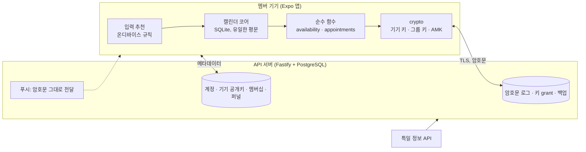
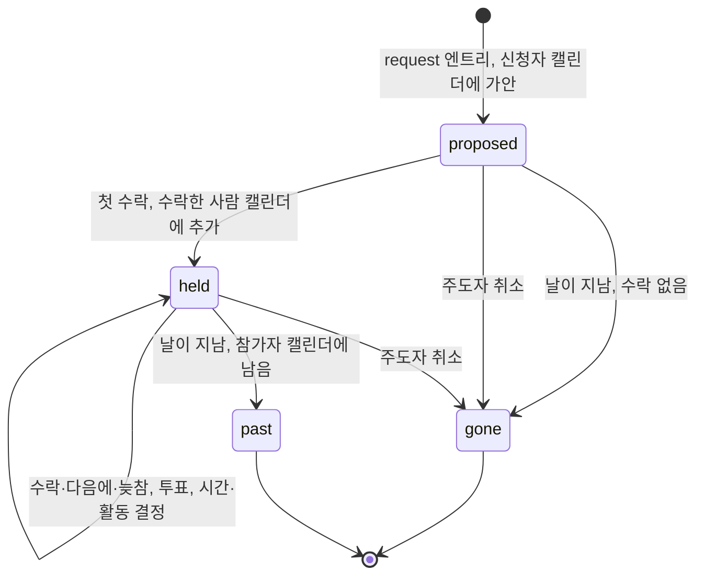
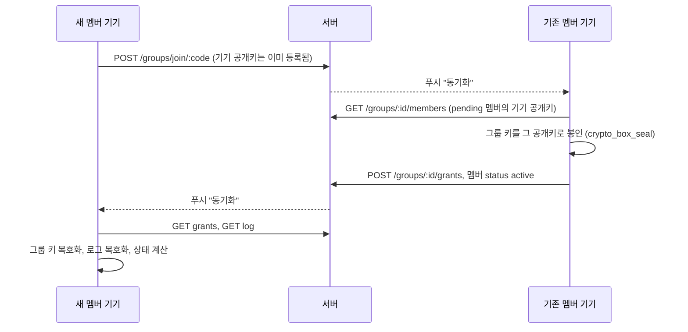

# 그날어때 개발 착수 문서

2026-10-24 · v2.3 · 놀날(가칭) v1을 전면 개정하고, 입력 추천·그룹 캘린더·날짜 잡기·결정 방식 사양을 반영

## 0. 한 장 요약

**그날어때**는 내 일정을 가장 편하게 넣고 보는 캘린더 앱입니다. 그룹 캘린더는 멤버들의 일정을 합쳐서 보여 주는 캘린더입니다. 일정이 있는 시간은 비워 두고 비어 있는 시간을 색으로 채우며, 앱이 "이 정도면 빈 것"이라고 판정하지 않습니다. 그룹 캘린더에서 할 수 있는 조정은 날짜 잡기 하나뿐이고, 날짜를 잡으면 수락한 사람들의 캘린더에 약속이 들어가고 그것이 다시 그룹 캘린더에 비칩니다. 시간과 활동은 투표 또는 주도자의 결정으로 정합니다. 운영자를 포함해 멤버가 아닌 누구도 그 내용을 볼 수 없습니다.

v1과 다른 결정은 네 가지입니다. 각 결정의 대안과 대가를 함께 적었으니, 뒤집으려면 이 표에서 뒤집으면 됩니다.

| 결정 | v2.3 | v1 | 대안을 택하면 |
| --- | --- | --- | --- |
| 보안 수준 | 운영자도 못 읽음(E2EE). 서버는 암호문 저장소 | 서버가 평문 바쁨/비어 있음을 받아 계산 | 서버 계산이 가능해지지만, 텔레그램 그룹 대화 수준(서버가 읽을 수 있음)이라 "텔레그램급"을 내세울 수 없음 |
| 일정의 원본 | 이 앱(기기 SQLite) + 암호화 백업 | OS 캘린더를 읽기만 | 캘린더 앱이 아니라 약속 도구가 되고, 설치를 요구할 단독 가치가 사라짐 |
| 약속 흐름 | 날짜 잡기 → 수락/다음에 → 수락 즉시 캘린더 추가. 시간·활동은 투표 또는 독재. 날이 지나면 끝 | 후보 5~7개 투표 + 결선 | 투표만 있으면 며칠이 걸리고, 독재만 있으면 주도자가 없는 그룹이 멈춤 |
| MVP 공유 범위 | 날짜·시간·활동까지. 장소는 지도 검색 링크로 연결 | 장소 랭킹 + 장소 투표 | 장소 랭킹은 영업시간·평점·이동 시간의 데이터 출처가 없어 MVP에서 구현할 수 없음 |

전제: 멤버는 모두 앱을 설치합니다(커뮤니티 앱). E2EE에서는 키를 들고 있을 기기가 모든 멤버에게 있어야 하므로 이 전제와 설계가 맞물립니다. 한 사람이 여러 그룹에 속할 수 있고, 캘린더는 하나입니다.

## 1. 제품 정의

### 사용자와 장면

- **친구 그룹(3~10명):** "다음 달에 언제 볼까?"가 단톡방에서 며칠 끌리다 흐지부지되는 문제.
- **아르바이트생·학생:** 주마다 바뀌는 근무표·시간표를 캘린더에 넣기 귀찮아 캘린더가 비어 있는 문제. 캘린더가 비면 그룹 캘린더도 비어 보입니다. 그래서 캘린더 입력 UX가 공유 기능의 정확도를 결정합니다.
- **여러 그룹:** 친구, 가족, 동아리, 알바 동료. 캘린더는 하나고 그룹마다 무엇을 공유할지 따로 정합니다. 한 그룹에서 잡힌 약속은 내 캘린더에 들어가므로 다른 그룹에는 자동으로 일정이 있는 시간이 됩니다.

### 단독 가치와 네트워크 가치

- 혼자 써도 되는 가치: 입력 추천, 교대 템플릿, 캘린더 여러 개, 생일 알림, 연휴·연차 제안, 기기 캘린더 미러. 이것이 설치의 명분입니다.
- 같이 쓸 때의 가치: 멤버 일정을 합친 그룹 캘린더, 날 하나 탭해서 잡는 약속, 투표 또는 주도자 결정, 활동 추천, 수락 즉시 캘린더 반영.

### 검증할 가설

친구 그룹은 단톡방의 "언제 돼?" 대신 그날어때 그룹 캘린더에서 비어 있는 시간을 보고 날짜를 잡는다. 단, 각자의 캘린더가 이 앱에 들어 있을 때.

### 성공 지표와 중단 기준

숫자는 초기값이며 알파에서 조정합니다.

| 지표 | 정의 | 게이트 기준 |
| --- | --- | --- |
| 캘린더 활성 | 첫 7일 중 4일 이상 앱을 연 사용자 비율 | 50% 이상 |
| 추천 입력 비율 | 추천 칩을 탭해 만든 일정 ÷ 전체 일정 | 30% 이상 |
| 초대 전환 | 초대 코드 사용 → 활성 멤버 → 첫 가용 시간 공유 | 50% 이상 |
| 수락률 | 날짜 잡기 중 날이 지나기 전에 1명 이상 수락한 비율 | 60% 이상 |
| 첫 수락 속도 | 신청 → 첫 수락의 중위 시간 | 24시간 이내 |
| 성사율 | 날이 지난 약속 중 참가자 2명 이상이었던 비율 | 50% 이상 |
| 재사용 | 약속 뒤 60일 안에 두 번째 날짜 잡기가 있는 그룹 | 30% 이상 |

중단 기준: 그룹 알파에서 초대 전환이 25% 미만이고 온보딩을 두 번 고친 뒤에도 같으면, 그룹 기능을 보류하고 캘린더 단독 제품으로 재평가합니다.

### 경쟁 위치

공유 캘린더는 TimeTree가 선점했고, 빈 시간 찾기는 When2meet류가 있습니다. 둘을 함께 하면서 운영자도 내용을 못 보는 조합은 비어 있습니다. 구글·네이버 캘린더는 둘 다 하지 않습니다.

## 2. 범위

| 구분 | 항목 |
| --- | --- |
| MVP 포함 | 캘린더: 월·주·목록 뷰, 빠른 입력, 캘린더 여러 개(색), 반복 일정, 알림, 교대 템플릿, 기기 캘린더 읽기 미러, 공휴일·연휴 표시와 연차 제안 |
| MVP 포함 | 입력 추천: 요일·시간·내 기록·생일·연휴를 보고 순위를 매긴 추천 칩(온디바이스 규칙), 사람·생일 등록(연락처 가져오기는 선택) |
| MVP 포함 | 계정: 카카오 로그인, Sign in with Apple, 게스트, 앱 내 계정 삭제, 복구 코드, 암호화 백업 |
| MVP 포함 | 그룹: 여러 그룹, 생성, 카카오톡 초대 링크, 멤버 승인, 그룹별 공유 설정과 일시중지 |
| MVP 포함 | 그룹 캘린더: 멤버 일정을 합친 캘린더. 날짜 칸의 1시간 띠(그 시간 내내 일정이 없는 인원수를 색으로, 1명은 가장 연하게), 날을 탭하면 30분 단위 0–24시 멤버별 테이블, 공휴일, 잡힌 약속, 생일 아이콘(공개한 멤버만) |
| MVP 포함 | 날짜 잡기: 날 선택 → 결정 방식 선택 → 수락/다음에 → 수락한 사람 캘린더에 즉시 추가 → 그룹 캘린더에 반영. 날이 지나면 수락 없는 신청은 사라짐 |
| MVP 포함 | 결정 방식: 투표(추천 3개 + 참가자가 추가한 것 + 항상 맨 아래 "아무거나") 또는 독재(주도자가 정함, 주도자 권한은 넘길 수 있음) |
| MVP 포함 | 추천 로직: 시간 3개(참가자가 내내 비어 있는 인원수 순), 활동 3개(시간·그룹 취향·신선도·인원), 활동을 고르면 카카오맵 검색 링크 |
| MVP 제외 | 장소 랭킹과 장소 DB (카테고리 추천 + 지도 검색 링크로 대체) |
| MVP 제외 | 위치 수집 전부, 날씨 반영 |
| MVP 제외 | 앱 내 채팅 (카카오톡에 맡김) |
| MVP 제외 | 근무표 짜기 (사장·알바 모드) |
| MVP 제외 | 다기기 실시간 동기화 (백업·복구로 대체) |
| MVP 제외 | 기기 캘린더로 쓰기 (양방향 동기화) |
| MVP 제외 | 머신러닝, 인스타그램 연동 |

## 3. 설계 원칙

1. **서버는 암호문만 봅니다.** 일정 내용, 비어 있는 시간, 신청과 응답과 투표는 그룹 멤버의 기기에서만 복호화됩니다.
2. **계산은 기기에서 합니다.** 추천, 합치기, 약속 상태, 투표 집계는 순수 함수이고, 멤버 10명·12주를 합치는 데 수십 ms입니다.
3. **그룹 상태는 로그의 함수입니다.** 서버가 보관한 암호문 로그를 같은 함수에 넣으면 모든 기기가 같은 결과를 냅니다.
4. **그룹 캘린더는 판정하지 않습니다.** 일정이 없는 시간이 비어 있는 시간이고, 색은 비어 있는 인원수입니다. 기준도 보정도 없습니다. 밤에 일정이 없으면 밤도 비어 있는 시간입니다. 자기 일정을 어떻게 넣을지는 사용자의 일입니다.
5. **추천은 제안입니다.** 입력 추천은 탭하지 않으면 저장되지 않고, 시간·활동 추천은 투표의 선택지일 뿐입니다.
6. **수집하지 않은 것은 유출되지 않습니다.** 서버가 보는 메타데이터는 8장의 표에 전부 적습니다.
7. **캘린더가 먼저입니다.** 공유 기능의 정확도는 캘린더에 들어 있는 데이터의 양이 정합니다.

## 4. 아키텍처



| 영역 | 선택 | 이유 |
| --- | --- | --- |
| 모바일 | React Native + Expo (TypeScript), 개발 빌드 | 캘린더·연락처·보안 저장소·SQLite 모듈, 서버와 언어 통일. libsodium 네이티브 모듈 때문에 Expo Go는 쓰지 않음 |
| 로컬 DB | expo-sqlite | 일정 원본. OS 파일 암호화에 더해 키는 Keychain/Keystore |
| 암호 | libsodium (`react-native-libsodium`, Node에서는 `libsodium-wrappers-sumo`) | X25519 봉인, XChaCha20-Poly1305, Argon2id를 한 라이브러리에서. 직접 조합할 것이 없음 |
| 반복 일정 | rrule | RFC 5545 확장 |
| 알림 | Expo Notifications (APNs·FCM) | 암호문을 받아 기기에서 복호화해 표시. iOS 확장은 2단계(8장) |
| 서버 | Node.js + Fastify (TypeScript), zod | 가볍고 스키마를 앱과 공유 |
| DB | PostgreSQL 16 | 확장 없음. PostGIS·Redis 제거. 시간 기반 작업도 공휴일 동기화뿐 |
| ORM | Drizzle | `bytea`는 내장 타입이 없어 `customType`으로 정의 |
| 외부 | 특일 정보 API, 카카오 로그인·카카오톡 공유, Sign in with Apple, 카카오맵 검색 링크 | 공휴일, 계정, 초대, 장소 검색으로 연결 |

흐름: 설치 → 계정·기기 키 생성 → 캘린더 사용(추천 칩으로 입력) → 그룹 생성 또는 참여(승인 시 그룹 키 전달) → 그룹별 공유 설정 → 캘린더가 바뀔 때마다 비트맵 암호화 업로드 → 그룹 캘린더에 멤버 일정을 합쳐 표시 → 날 탭 → 결정 방식 선택 → 신청 → 수락한 사람 캘린더에 약속 추가 → 투표 또는 주도자 결정으로 시간·활동 확정 → 그 캘린더가 다시 그룹 캘린더에 비침 → 날이 지나면 끝.

## 5. 캘린더 코어 (기기)

### 기능

- **뷰:** 월, 주, 목록. 캘린더별 색과 표시/숨김.
- **빠른 입력:** 날짜 탭 → 추천 칩 또는 시간 범위 드래그 → 제목. 반복은 "매주 화·목" 같은 프리셋.
- **교대 템플릿:** "오픈 07–13", "마감 17–23" 같은 템플릿을 만들고 달력 날짜를 탭해서 찍습니다. 템플릿은 입력 UX이고 결과는 일반 일정입니다. 아르바이트생의 불규칙 근무표가 캘린더에 들어오게 하는 장치입니다.
- **사람·생일:** 친구·가족을 이름과 생일로 등록합니다. 연락처에서 가져오기는 선택이고 권한을 따로 묻습니다. 음력 생일은 매년 양력으로 변환해 씁니다. 그룹 멤버가 생일을 공개하면(8장) 자동으로 들어옵니다.
- **공휴일·연휴·연차 제안:** 공휴일과 대체공휴일을 표시하고, 공휴일 사이에 낀 평일 하루를 쉬면 4일 이상 연휴가 되는 경우 "연차 1일로 4일 연휴"를 제안합니다. 누가 연차를 쓸 수 있는지는 앱이 가정하지 않습니다.
- **기기 캘린더 미러:** expo-calendar로 읽기만 합니다. 미러 캘린더는 일정으로만 쓰고, 제목은 기기 밖으로 나가지 않습니다.
- **소프트 캘린더:** `blocks_free = 0`이면 내 화면에는 보이지만 그룹에는 비어 있는 시간으로 보입니다. 예: 헬스장, 혼자 하는 공부.
- **알림:** expo-notifications의 로컬 예약. 서버가 필요 없습니다. 그룹 약속도 내 캘린더의 일정이므로 같은 알림을 씁니다.

### 입력 추천 (온디바이스)

날짜를 탭하면 빠른 입력 시트 위에 추천 칩 다섯 개가 뜹니다. 평일이면 "회사 업무 09–18", "회식 19–22"가, 친구 생일이 가까우면 "민수 생일 약속"이, 연휴 앞이면 "연휴 여행"이 먼저 옵니다. 칩을 탭하면 기본 시간으로 일정이 만들어지고 바로 고칠 수 있습니다. 모든 계산은 기기에서 하고 아무것도 서버로 가지 않습니다.

**후보**

| 출처 | 예 | 근거 |
| --- | --- | --- |
| 기본 사전 | 회사 업무, 회식, 수업, 알바(템플릿), 운동, 약속, 데이트, 가족 모임, 병원, 생일 | 항목마다 기본 시간대와 요일 적합도 |
| 내 기록 | 같은 요일·시간대에 자주 쓴 제목 | `suggestion_stats` |
| 사람·생일 | 7일 안의 생일 → "OO 생일 약속" | `people` |
| 공휴일·연휴 | "연휴 여행", "대체공휴일 나들이" | `holidays` |

**순위**

$$
\text{suggestScore} = w_c \cdot \text{contextFit} + w_p \cdot \text{personalFreq} + w_u \cdot \text{upcoming} + w_r \cdot \text{recency}
$$

| 항 | 의미 | 초기 가중치 |
| --- | --- | --- |
| contextFit | 요일·시간대 적합도(평일 낮에 회사 업무 1, 주말에 0) | 0.40 |
| personalFreq | 같은 요일·시간대에 그 제목을 쓴 횟수, 0~1로 정규화 | 0.30 |
| upcoming | 7일 안의 생일·연휴에 묶인 항목이면 1, 가까울수록 높음 | 0.20 |
| recency | 최근 30일 안에 쓴 제목이면 1 | 0.10 |

- 같은 날 이미 있는 일정과 시간이 겹치는 칩은 뺍니다.
- 같은 제목을 같은 요일에 세 번 넣으면 "매주 반복으로 바꿀까요?"를 한 번 묻습니다. 이것이 루틴을 채우는 길이고, 빈 캘린더 문제를 푸는 가장 싼 방법입니다.
- 추천은 제안입니다. 탭하지 않으면 저장되지 않고, 화면에만 있는 추천(고스트)은 그룹에 일정으로 보이지 않습니다.
- 머신러닝은 없습니다. 가중치는 추천 입력 비율을 보고 손으로 조정합니다.

### 데이터 모델 (SQLite)

```sql
-- apps/mobile local store (expo-sqlite). The only place where calendar content exists in plaintext.
CREATE TABLE calendars (
  id           TEXT PRIMARY KEY,
  name         TEXT NOT NULL,
  color        TEXT NOT NULL,
  kind         TEXT NOT NULL CHECK (kind IN ('personal', 'routine', 'device_mirror', 'group')),
  blocks_free  INTEGER NOT NULL DEFAULT 1,   -- 0 = soft: I see it, but groups see the time as free
  group_id     TEXT                          -- set when kind = 'group'
);

CREATE TABLE events (
  id               TEXT PRIMARY KEY,
  calendar_id      TEXT NOT NULL REFERENCES calendars(id) ON DELETE CASCADE,
  title            TEXT NOT NULL,
  starts_at        TEXT NOT NULL,            -- ISO 8601 with offset
  ends_at          TEXT NOT NULL,
  all_day          INTEGER NOT NULL DEFAULT 0,
  tz               TEXT NOT NULL DEFAULT 'Asia/Seoul',
  rrule            TEXT,                     -- RFC 5545, e.g. FREQ=WEEKLY;BYDAY=TU,TH
  exdates          TEXT,                     -- JSON array of ISO timestamps
  note             TEXT,
  device_event_id  TEXT,                     -- set for device_mirror rows
  group_ref        TEXT,                     -- set for group appointments: the request ref in the group log
  tentative        INTEGER NOT NULL DEFAULT 0, -- 1 while my own request has no accept yet
  updated_at       TEXT NOT NULL,
  CHECK (ends_at > starts_at)
);
CREATE INDEX events_by_start ON events (starts_at);

-- One occurrence of a recurring event moved, edited or cancelled.
CREATE TABLE event_overrides (
  event_id       TEXT NOT NULL REFERENCES events(id) ON DELETE CASCADE,
  occurrence_at  TEXT NOT NULL,
  starts_at      TEXT,
  ends_at        TEXT,
  title          TEXT,
  cancelled      INTEGER NOT NULL DEFAULT 0,
  PRIMARY KEY (event_id, occurrence_at)
);

CREATE TABLE reminders (
  event_id        TEXT NOT NULL REFERENCES events(id) ON DELETE CASCADE,
  offset_minutes  INTEGER NOT NULL,
  PRIMARY KEY (event_id, offset_minutes)
);

-- 아르바이트: "오픈 07-13", "마감 17-23" tapped onto days. Templates are input UX; the result is ordinary events.
CREATE TABLE shift_templates (
  id        TEXT PRIMARY KEY,
  name      TEXT NOT NULL,
  start_hm  TEXT NOT NULL,                   -- '17:00'
  end_hm    TEXT NOT NULL,                   -- '23:00'; an end before start means past midnight
  color     TEXT NOT NULL
);

-- People I care about: birthdays drive "OO 생일 약속" suggestions. Stays on this device and in my encrypted backup.
CREATE TABLE people (
  id             TEXT PRIMARY KEY,
  name           TEXT NOT NULL,
  birthday_md    TEXT,                       -- 'MM-DD'
  is_lunar       INTEGER NOT NULL DEFAULT 0, -- converted to this year's solar date before suggesting
  source         TEXT NOT NULL CHECK (source IN ('manual', 'contacts', 'group')),
  group_user_id  TEXT                        -- set when source = 'group' (a member who opted in)
);

-- On-device counters behind the suggestion ranking. Never uploaded.
CREATE TABLE suggestion_stats (
  title         TEXT NOT NULL,
  weekday       INTEGER NOT NULL,            -- 0 = Sunday
  start_hm      TEXT NOT NULL,
  uses          INTEGER NOT NULL DEFAULT 1,
  last_used_at  TEXT NOT NULL,
  PRIMARY KEY (title, weekday)
);

-- What I share with each group: a rolling window and which calendars count. Never titles.
CREATE TABLE group_shares (
  group_id          TEXT PRIMARY KEY,
  window_days       INTEGER NOT NULL DEFAULT 56 CHECK (window_days BETWEEN 14 AND 91),  -- rolling from today
  calendar_ids      TEXT NOT NULL,           -- JSON array
  paused            INTEGER NOT NULL DEFAULT 0,
  share_birthday    INTEGER NOT NULL DEFAULT 0,
  last_uploaded_at  TEXT
);
```

### 반복 일정

rrule로 기간 안의 발생을 확장하고, `exdates`와 `event_overrides`로 예외를 처리합니다. 종일 일정은 해당 날짜 전체를 일정이 있는 시간으로 칩니다. 시간대는 MVP에서 `Asia/Seoul` 하나이고, 해외 멤버는 2단계입니다.

### 백업과 복구

- 스냅샷(캘린더·일정·템플릿·사람 JSON)을 계정 마스터 키(AMK)로 암호화해 `PUT /me/backup`으로 올립니다. 변경 후 디바운스, 최소 하루 1회, 5MB 상한.
- 복구: 새 기기에서 로그인 → 복구 코드 입력 → `GET /me/recovery`로 salt와 래핑된 AMK를 받음 → Argon2id로 복구 키 유도 → AMK 복호화 → 최신 백업 복호화.
- 복구 코드 없이 모든 기기를 잃으면 복구할 수 없습니다. 이것이 "운영자도 못 읽음"의 대가이고, 가입 흐름에서 그대로 알립니다.

### 첫 테스트 목록

- `expands a weekly RRULE with an EXDATE across a month boundary in Asia/Seoul`
- `applies a shift template to three days as three ordinary events`
- `treats an end time before the start time as a shift past midnight`
- `rounds an 18:10-19:20 event to the 18:00-19:30 slots`
- `leaves calendars flagged blocks_free = 0 out of the group bitmap`
- `maps device-mirrored events to slots without exporting titles`
- `restores a backup snapshot on a fresh device with the recovery code`
- `ranks weekday work above a weekend outing on a Tuesday`
- `suggests a birthday meetup within seven days of a registered birthday`
- `converts a lunar birthday to this year's solar date before suggesting`
- `drops a suggestion that overlaps an existing event`
- `never counts an untapped suggestion as an event`
- `offers to make a title recurring after three same-weekday uses`
- `marks substitute holidays and accepts two holidays on one date`
- `suggests one leave day that bridges a holiday into a 4-day weekend`

## 6. 그룹 캘린더

### 그룹 캘린더는 멤버 일정을 합친 캘린더입니다

채팅은 없고 조정 기능도 날짜 잡기 하나뿐입니다. 멤버 목록은 멤버 모두에게 보이고, 방장이 참여를 승인하고 강퇴할 수 있습니다. 그룹 이름은 `group_meta` 엔트리로 암호화해 서버는 알지 못합니다. 한 사람이 여러 그룹에 속할 수 있고, 그룹 목록에는 아직 응답하지 않은 신청 수가 배지로 붙습니다.

### 그룹별 공유 설정과 상시 공유

- 기간: 오늘부터 8주(기본, 2~13주). 캘린더가 바뀌면 그룹마다 비트맵을 다시 올립니다(디바운스 수 분). 그래서 그룹 캘린더는 늘 최신입니다.
- 포함 캘린더: 어떤 캘린더를 이 그룹에 보일지 고릅니다. 그룹별 일시중지도 됩니다.
- 내용: 일정이 있는지 없는지만. 제목·장소·메모는 어떤 경로로도 나가지 않습니다. v1은 사용자 단위 전역이라 그룹 하나에 들어가면 모든 그룹과 서버에 전체 패턴이 보였습니다.

### 엔트리

그룹 로그의 엔트리 평문은 아래 중 하나입니다.

```ts
// packages/shared/src/entries.ts — every group log entry decrypts to one of these.
type Stage = "time" | "activity";
type Mode = "vote" | "dictator";

type Entry =
  | { kind: "group_meta"; name: string }
  | { kind: "member_profile"; birthday?: string; lunar?: boolean; tags?: string[] }       // opt-in, per group
  | { kind: "availability"; windowStart: string; days: number; bits: string }            // 30-min slots, 1 = no event, MSB first, base64
  | { kind: "request"; ref: string; day: string; mode: Mode; start?: string; end?: string; activity?: string; note?: string }  // 날짜 잡기
  | { kind: "request_update"; ref: string; mode?: Mode; start?: string; end?: string; activity?: string; note?: string }      // leader only
  | { kind: "lead_transfer"; ref: string; to: string }                                    // leader only: hands the role to another member
  | { kind: "response"; ref: string; value: "accept" | "later" }                          // latest per member wins
  | { kind: "poll"; ref: string; stage: Stage; options: string[] }                        // leader only: the three recommendations, frozen
  | { kind: "poll_option"; ref: string; stage: Stage; option: string }                    // any participant adds one
  | { kind: "poll_vote"; ref: string; stage: Stage; option: string | "any" }              // latest per participant wins; "any" is always offered
  | { kind: "poll_close"; ref: string; stage: Stage }                                     // leader only
  | { kind: "cancel"; ref: string };                                                      // leader only
```

4주는 1344비트, 168바이트입니다. 10명이 12주를 공유해도 내려받기는 5.3KB, 복호화와 합치기는 수십 ms입니다(Node 22에서 측정).

### 1시간 띠와 30분 테이블

- **날짜 칸:** 월 그리드의 날짜 칸마다 0시부터 24시까지 24칸 띠가 들어갑니다. 칸의 색은 그 한 시간 내내 일정이 없는 멤버 수입니다. 0명이면 비워 두고, 1명이면 가장 연하게, 전원이면 가장 진하게 칠합니다. 30분만 비어 있는 멤버는 그 시간 칸에 들어가지 않습니다. 공휴일과 잡힌 약속, 생일 아이콘(공개한 멤버만)도 날짜 칸에 보입니다.
- **날 탭:** 그날의 0–24시 테이블이 30분 단위로 열립니다. 맨 위는 합친 줄(멤버 수를 색으로, 같은 농도 규칙), 아래는 멤버마다 한 줄입니다. 일정이 있는 부분은 비어 있고 일정이 없는 부분이 색으로 채워집니다. 누구의 어느 시간이 비어 있는지 그대로 보이고, 일정 내용은 어디에도 없습니다.
- **판정 없음:** "몇 시간 이상 비어야 빈 시간" 같은 기준을 두지 않습니다. 새벽 3시에 일정이 없으면 새벽 3시도 비어 있는 시간입니다. 앱은 그 이상 아무것도 하지 않습니다.
- **합치는 함수는 세는 것뿐입니다.**

```ts
// packages/availability/src/merge.ts — the group calendar is members' schedules merged. Nothing here decides what "free" means.
const isFree = (bitmap: Uint8Array, slot: number) => (bitmap[slot >> 3] >> (7 - (slot & 7))) & 1;

// How many members have no event in each 30-minute slot: the day table. The UI maps the count to colour; 0 stays blank, 1 is the lightest.
export function freeCounts(bitmaps: Uint8Array[], slots: number): Uint8Array {
  const counts = new Uint8Array(slots);
  for (const bm of bitmaps) for (let s = 0; s < slots; s++) counts[s] += isFree(bm, s);
  return counts;
}

// Members with no event for every slot of [from, to): who is free throughout a dragged range.
export function freeThroughout(bitmaps: Uint8Array[], from: number, to: number): number[] {
  const out: number[] = [];
  bitmaps.forEach((bm, i) => {
    for (let s = from; s < to; s++) if (!isFree(bm, s)) return;
    out.push(i);
  });
  return out;
}

// Members with no event during the whole hour: the 1-hour strip inside a month cell. Half an hour free is not an hour free.
export function hourCounts(bitmaps: Uint8Array[], dayIndex: number): Uint8Array {
  const counts = new Uint8Array(24);
  for (let h = 0; h < 24; h++) counts[h] = freeThroughout(bitmaps, dayIndex * 48 + h * 2, dayIndex * 48 + h * 2 + 2).length;
  return counts;
}
```

A가 13–15시, B가 14–16시, C가 13–16시에 비어 있으면 테이블의 합친 줄은 14–15시에 3명, 13–14시와 15–16시에 2명이고, 13–16시를 드래그하면 "C만 내내 비어 있음"이 나옵니다. 띠는 13시 칸 2명, 14시 칸 3명, 15시 칸 2명, 16시 칸 1명(가장 연하게)입니다. 13:30부터 비어 있는 멤버는 13시 칸에는 들어가지 않고 14시 칸부터 들어갑니다.

### 첫 테스트 목록

- `counts free members per 30-minute slot without any threshold`
- `counts a member for an hour cell only when both half-hours are free`
- `lists members free throughout a dragged range`
- `shows a member's night as free when they have no event there`
- `paints a single free member in the lightest shade, not blank`
- `shows a held appointment as an event to every member and as busy for its participants`
- `shows a birthday icon only for members who opted in`
- `propagates an appointment held in one group as busy to every other group`
- `treats a member without shared availability as absent, never as free`

## 7. 날짜 잡기

그룹 캘린더에서 할 수 있는 조정은 이것 하나입니다. 날을 고르고, 결정 방식을 고르고, 신청합니다. 수락한 사람의 캘린더에 약속이 바로 들어가고, 그 캘린더가 다시 그룹 캘린더에 비칩니다. 시간과 활동은 투표로 정하거나 주도자가 정합니다. 응답 제한 시간은 없고, 신청은 그 날이 지나면 끝납니다.



### 규칙

1. **신청:** 날을 탭하면 그날의 30분 테이블이 열립니다. 결정 방식(투표 / 독재)을 고르고 신청합니다. 독재면 시간 범위를 드래그하고 활동을 고를 수 있고, 드래그하는 동안 그 시간 내내 비어 있는 사람이 바로 표시됩니다. 신청은 멤버 전원에게 갑니다.
2. **주도자:** 신청한 사람이 주도자입니다. 주도자는 결정 방식을 바꾸고, 독재면 시간·활동을 정하고, 투표면 투표를 열고 닫고, 약속을 취소할 수 있습니다. 주도자 권한은 다른 활성 멤버에게 넘길 수 있고(`lead_transfer`), 넘기면 이전 주도자는 일반 참가자가 됩니다.
3. **신청자의 캘린더:** 신청하는 순간 신청자의 캘린더에 가안(`tentative = 1`)으로 들어갑니다. 첫 수락이 오면 확정 일정이 됩니다.
4. **응답:** 수락 / 다음에. 응답은 이름과 함께 멤버 모두에게 보입니다. 단톡방과 같은 투명성이고, 공개 범위는 미결정 항목입니다. 멤버마다 마지막 응답이 유효합니다. 수락 뒤 다음에는 빠지는 것이고, 다음에 뒤 수락은 늦참입니다. 날이 지나기 전까지 언제든 됩니다.
5. **수락의 효과:** 수락한 사람의 캘린더에 `kind = 'group'` 캘린더로 "그룹명 · 활동" 일정이 들어갑니다. 시간이 미정이면 종일로 들어가고, 정해지면 그 시간으로 바뀝니다. 참가자의 비트맵이 다시 올라가면서 그룹 캘린더에는 그 시간이 일정이 있는 시간으로 보이고, 약속 자체도 참가자 이름과 함께 보입니다.
6. **독재:** 주도자가 시간·활동을 정하고 바꿉니다(`request_update`). 바뀌면 참가자 전원의 일정이 함께 바뀌고 알림이 갑니다. 테이블에 참가자들의 비어 있는 시간이 보이므로 주도자는 겹치지 않는 시간을 고를 수 있고, 겹치는 시간을 고르면 "지영은 이 시간에 일정이 있어요"가 뜹니다. 그래도 정할 수 있고, 참가자는 다음에로 빠질 수 있습니다.
7. **투표:** 아래 "투표" 절의 규칙을 따릅니다. 시간 투표와 활동 투표는 따로 열리고 동시에 진행할 수 있습니다.
8. **끝:** 신청한 날이 `Asia/Seoul` 기준으로 지나면 끝입니다. 수락이 없었던 신청은 신청자의 가안을 포함해 모든 기기에서 사라집니다. 수락이 있었던 약속은 참가자 캘린더에 지난 일정으로 남고 그룹 캘린더에도 지난 약속으로 남습니다. 주도자는 그 전에 취소할 수 있고, 취소하면 참가자 캘린더에서도 빠집니다.
9. **결정성:** 상태는 `(로그 엔트리, 지금 시각, 활성 멤버) → 상태`인 순수 함수입니다. 만료와 투표 마감에 서버가 관여하지 않습니다. 날짜가 지났는지, 모두 투표했는지는 각 기기가 로그에서 알 수 있기 때문입니다.
10. **알림:** 신청이 오면, 내 신청에 수락이 오면, 투표가 열리거나 닫히면, 참가한 약속의 시간·활동이 바뀌면 푸시가 옵니다(8장). 약속 전 알림은 내 캘린더의 일정 알림이 합니다.

### 투표

- **선택지:** 추천 로직이 만든 3개, 참가자가 추가한 것, 그리고 맨 아래에 항상 "아무거나". 추천 3개는 주도자가 투표를 여는 순간 주도자 기기가 계산해 `poll` 엔트리에 고정합니다. 그래서 모든 기기가 같은 선택지를 봅니다. 참가자는 `poll_option`으로 선택지를 추가할 수 있고, "아무거나"는 저장하지 않아도 늘 있습니다.
- **투표:** 참가자(수락한 사람과 주도자)마다 한 표, 마지막 표가 유효합니다. 투표 뒤에 수락한 늦참자도 닫히기 전까지 투표할 수 있습니다.
- **닫힘:** 현재 참가자 전원이 투표했을 때, 주도자가 닫을 때(`poll_close`), 또는 약속 날 00:00이 되면 닫힙니다. 셋 다 로그와 시각만으로 모든 기기가 같은 판단을 합니다.
- **집계:** 가장 많은 표를 받은 선택지입니다. "아무거나"는 어느 선택지에도 더해지지 않습니다. 표가 모두 아무거나거나 아무도 투표하지 않았으면 추천 1번입니다. 동점이면 주도자가 동점 선택지 중에서 정하고, 약속 날 00:00까지 정하지 않으면 선택지 목록에서 먼저 나오는 것(추천이 먼저, 그 다음 추가된 순)이 됩니다.
- **다시 열기:** 주도자는 투표를 다시 열 수 있습니다. 추천 3개가 그 시점의 참가자와 일정으로 다시 계산되고 표는 초기화됩니다. 주도자가 투표 대신 직접 정하고 싶으면 결정 방식을 독재로 바꾸면 됩니다.
- **결과:** 시간 투표 결과는 참가자 전원의 일정 시간으로, 활동 투표 결과는 일정 제목으로 들어갑니다.

### 시간 추천 3개

참가자들의 그날 비트맵에서 정시에 시작하는 범위를 놓고, 그 범위 내내 일정이 없는 참가자 수가 많은 순, 같으면 이른 순으로 서로 겹치지 않게 3개를 고릅니다. 길이는 활동이 정해졌으면 그 활동의 기본 길이, 아니면 2시간입니다. 추천이 훑는 시간대(초기값 09:00–21:00)는 추천의 설정값이고 그룹 설정에서 바꿀 수 있습니다. 비어 있는 시간을 판정하는 기준이 아닙니다.

```ts
// packages/appointments/src/timeOptions.ts — the three time options a vote opens with. A recommendation, not a judgement about anyone's day.
import { freeThroughout } from "@geunal/availability";

export interface TimeOption { start: number; end: number; free: number } // slot offsets within the day

// Rank hour-aligned ranges by how many participants are free throughout, then by the earliest start; keep three that do not overlap.
// The search window (default 09:00-21:00) is a recommender setting, not a rule about when people are free.
export function timeOptions(bitmaps: Uint8Array[], dayIndex: number, lengthSlots: number, windowFrom = 18, windowTo = 42): TimeOption[] {
  const base = dayIndex * 48;
  const ranked: TimeOption[] = [];
  for (let s = windowFrom; s + lengthSlots <= windowTo + lengthSlots && s < windowTo; s += 2) {
    ranked.push({ start: s, end: s + lengthSlots, free: freeThroughout(bitmaps, base + s, base + s + lengthSlots).length });
  }
  ranked.sort((a, b) => b.free - a.free || a.start - b.start);
  const chosen: TimeOption[] = [];
  for (const o of ranked) {
    if (chosen.length === 3) break;
    if (chosen.every((c) => o.end <= c.start || o.start >= c.end)) chosen.push(o);
  }
  return chosen;
}
```

위의 A·B·C 예시에 2시간으로 넣으면 `19:00–21:00 (3명)`, `13:00–15:00 (2명)`, `09:00–11:00 (1명)`이 나옵니다. 아무도 비어 있지 않은 날에도 3개가 나오고 인원이 0명으로 표시됩니다. 참가자는 그 위에 원하는 시간을 추가할 수 있습니다.

### 활동 추천 3개

"무엇을 할지"는 장소가 아니라 카테고리로 추천합니다. 장소 랭킹에 필요한 영업시간·평점·이동 시간은 공개 API에 없고(카카오 로컬 API 응답에는 이름·주소·좌표·전화·URL만 있습니다), 위치를 수집하면 위치정보법 신고 대상이 되기 때문입니다. 활동이 정해지면 참가자가 동네 이름을 넣어 카카오맵 검색(`https://map.kakao.com/link/search/<동네 카테고리>`)으로 넘어갑니다. GPS는 쓰지 않습니다.

- **사전:** MVP는 20개 안팎. 식사, 술, 카페, 보드게임 카페, 영화, 노래방, 볼링, 전시·공연, 산책·공원, 등산, 쇼핑, 방탈출, 스포츠 관람, 집 모임, 드라이브, 당일 여행 등. 항목마다 적합 시간대(낮·저녁·밤), 기본 길이, 실내·야외, 인원 범위, 비용 등급.
- **입력:** 정해진 시간 범위(없으면 요일만), 요일·공휴일, 참가자의 취향 태그(`member_profile`, 선택), 그룹의 지난 활동(지난 `request` 엔트리), 현재 참가자 수.

$$
\text{activityScore} = w_f \cdot \text{timeFit} + w_t \cdot \text{taste}_{group} + w_n \cdot \text{novelty} + w_s \cdot \text{sizeFit},
\qquad
\text{taste}_{group} = \alpha \cdot \text{mean}(\text{taste}_i) + (1 - \alpha) \cdot \min(\text{taste}_i)
$$

| 항 | 의미 | 초기 가중치 |
| --- | --- | --- |
| timeFit | 시작 시각·길이가 카테고리 적합 범위에 들면 1. 시간 미정이면 요일 적합도만 | 0.35 |
| taste_group | 참가자 태그 일치의 평균과 최솟값 가중합. `min` 항이 한 명이 정말 싫어하는 것을 1위에서 밀어냄 | 0.35 (α = 0.6) |
| novelty | 그룹이 최근 90일 안에 한 활동이면 0, 처음이면 1 | 0.20 |
| sizeFit | 인원이 카테고리 범위 안이면 1 | 0.10 |

상위 3개가 투표 선택지가 되고, 독재면 주도자에게 칩으로 보입니다. 태그가 없는 참가자는 평균에서 뺍니다. 날씨는 MVP에 넣지 않습니다. 기상청 단기예보는 3일 안쪽만 다루고, 특정 날짜·지역을 서버에 물으면 약속 날짜와 지역이 서버에 드러나기 때문입니다. 2단계에서 전국 주요 지역 예보를 서버가 하루 한 번 묶어 내려 주고 기기가 고르는 방식으로 넣습니다.

### 첫 테스트 목록

- `adds the appointment to the requester's calendar as tentative on request`
- `adds the appointment to a member's calendar on accept and removes it on later`
- `treats the latest response per member as the current one`
- `removes an unaccepted request from every device once the day has passed in Asia/Seoul`
- `keeps a held appointment in participants' calendars after the day has passed`
- `applies a leader's time change to every participant's event`
- `ignores request updates, polls and cancels not written by the current leader`
- `moves the leader role on lead_transfer and demotes the previous leader`
- `removes the appointment from every participant's calendar on cancel`
- `freezes the three recommended options in the poll entry so every device shows the same list`
- `always offers "any" as the last option without storing it`
- `closes a poll when every current participant has voted`
- `closes a poll at 00:00 of the appointment day with the votes so far`
- `picks the first recommendation when every vote is "any"`
- `leaves a tie to the leader and falls back to list order at the start of the day`
- `resets votes when the leader reopens a poll`
- `ranks a disliked activity below a neutral one through the least-misery term`
- `derives the same state from the same log regardless of entry order`

## 8. 보안·개인정보 설계

목표는 텔레그램 비밀 대화와 같은 수준, 즉 **운영자도 내용을 읽을 수 없는** 상태입니다. 텔레그램의 일반·그룹 대화는 서버가 읽을 수 있는 서버-클라이언트 암호화이고, v1의 설계가 바로 그 수준이었습니다.

### 키 계층

| 키 | 생성 | 보관 | 용도 |
| --- | --- | --- | --- |
| 기기 키쌍 (X25519) | 첫 실행 | 개인키는 Keychain/Keystore(`expo-secure-store`), 공개키는 서버 | 그룹 키를 이 기기로 봉인 |
| 계정 마스터 키 AMK (32B) | 첫 실행 | 기기 보안 저장소. 서버에는 복구 키로 래핑한 사본만 | 백업 암호화 |
| 복구 키 (32B) | 복구 코드(BIP39 12단어, 128비트) + salt → Argon2id | 서버에는 salt만 | AMK 래핑 |
| 그룹 키 (32B, 버전 있음) | 그룹 생성·회전 시 멤버 기기가 생성 | 멤버 기기 공개키마다 봉인한 grant를 서버에 | 그룹 로그 엔트리 AEAD |

### 흐름

- **가입:** 기기 키쌍과 AMK를 만들고 공개키를 서버에 등록합니다. 복구 코드는 첫 그룹 참여 전까지 설정을 미룰 수 있고, 미설정이면 배너로 알립니다.
- **그룹 참여:** 아래 순서입니다. 승인은 활성 멤버 누구의 기기든 할 수 있어 초대자가 자리를 비워도 진행됩니다.
- **새 기기:** 로그인 → 복구 코드 → AMK → 백업 복원. 그룹 키는 기존 멤버의 기기가 새 기기에 grant하며, 참여와 같은 경로입니다.
- **탈퇴·강퇴:** 서버가 `status = 'removed'`로 바꾸면 방장 기기가 새 버전의 그룹 키를 만들어 남은 멤버에게 grant합니다. 이후 엔트리는 새 버전으로 암호화됩니다. 나간 사람이 이미 받은 과거 데이터는 회수할 수 없습니다. 모든 E2EE가 같습니다.
- **계정 삭제:** 앱 안에서 합니다. 서버는 계정·기기·백업·복구 정보와 그 사용자가 쓴 로그 엔트리를 지우고, 기기는 로컬 키와 DB를 지웁니다. 서버가 평문을 가진 적이 없으므로 "백업에 남은 암호문" 같은 꼬리가 없습니다.



### 알림에 내용을 담는 방법

신청·응답·투표·변경 엔트리는 `notify: true`로 올리고, 서버는 그 **암호문을 그대로** 멤버 기기에 푸시합니다(3KB 이하). 서버는 내용을 모른 채 전달만 합니다.

- **Android:** FCM 데이터 메시지 → 앱의 백그라운드 핸들러가 그룹 키로 복호화 → "민수: 11/8(토) 날짜 잡기" 로컬 알림.
- **iOS:** 앱이 실행 중이 아니면 복호화할 곳이 없어 MVP에서는 "새 약속 제안이 있어요" 같은 일반 문구로 갑니다. 암호문을 복호화해 문구를 바꾸는 Notification Service Extension은 네이티브 작업이라 2단계에 둡니다. 응답 제한 시간이 없으므로 일반 문구의 비용이 크지 않습니다.
- Expo 푸시 서비스를 거치면 암호문이 Expo 서버를 경유합니다. 처리 위탁으로 명시하고, 2단계에서 APNs·FCM 직접 발송을 검토합니다.

### 서버가 보는 것

이 표가 개인정보 처리방침의 수집 항목입니다. 텔레그램 비밀 대화·시그널과 같은 종류의 노출이고, 메타데이터까지 숨기는 기법(sealed sender 등)은 범위 밖입니다.

| 항목 | 이유 |
| --- | --- |
| 계정 식별자(카카오·애플 `sub`), 닉네임 | 로그인, 멤버 목록 표시 |
| 기기 공개키, 플랫폼, 푸시 토큰 | 키 봉인, 푸시 |
| 그룹 멤버십 그래프, 역할, 상태, 가입 시각 | 승인·강퇴·키 회전 |
| 초대 코드 생성·사용 기록 | 남용 방지, 전환율 측정 |
| 로그 엔트리의 작성자, 수신 시각, 크기, 키 버전, `notify` 플래그 | 용량 제한, 푸시. `notify`가 켜진 엔트리는 신청·응답·투표류임을 추정할 수 있음 |
| 퍼널 마커(신청·첫 수락·성사·불발·취소)와 시각 | 1장 지표 측정. 날짜·시간·활동·참가자·표는 없음 |
| 백업 크기와 시각 | 용량 제한 |
| 접속 IP와 요청 로그 | 보안. 보존 기간을 정책에 명시 |

기기에만 있는 것: 일정 내용, 사람·생일(연락처에서 가져온 것 포함), 추천 통계, 그룹 멤버의 비어 있는 시간과 약속·투표 내용(복호화 후). 생일과 취향 태그를 그룹에 공개하는 것은 그룹마다 명시적으로 켭니다.

### 코드

```ts
// packages/crypto/src/index.ts — same code on the phone (react-native-libsodium) and in Node tests (libsodium-wrappers-sumo).
import sodium from "libsodium-wrappers-sumo";

export interface DeviceKeyPair { publicKey: Uint8Array; privateKey: Uint8Array }

export async function ready(): Promise<void> { await sodium.ready; }

export function generateDeviceKeyPair(): DeviceKeyPair {
  const kp = sodium.crypto_box_keypair();
  return { publicKey: kp.publicKey, privateKey: kp.privateKey };
}

export function newSymmetricKey(): Uint8Array {
  return sodium.randombytes_buf(sodium.crypto_aead_xchacha20poly1305_ietf_KEYBYTES);
}

// A grant: the group key sealed to one device. The server stores it but cannot open it.
export function sealKeyToDevice(key: Uint8Array, devicePublicKey: Uint8Array): Uint8Array {
  return sodium.crypto_box_seal(key, devicePublicKey);
}

export function openSealedKey(sealed: Uint8Array, device: DeviceKeyPair): Uint8Array {
  return sodium.crypto_box_seal_open(sealed, device.publicKey, device.privateKey);
}

const NONCE = 24; // XChaCha20: random nonces are safe at this size, no counter to persist
const TAG = 16;

// AAD binds an entry to its group, author and key version so it cannot be replayed into another context.
export function encryptEntry(key: Uint8Array, plaintext: Uint8Array, aad: string): Uint8Array {
  const nonce = sodium.randombytes_buf(NONCE);
  const ct = sodium.crypto_aead_xchacha20poly1305_ietf_encrypt(plaintext, sodium.from_string(aad), null, nonce, key);
  const out = new Uint8Array(NONCE + ct.length);
  out.set(nonce, 0); out.set(ct, NONCE);
  return out;
}

export function decryptEntry(key: Uint8Array, blob: Uint8Array, aad: string): Uint8Array {
  if (blob.length < NONCE + TAG) throw new Error("blob shorter than nonce + tag");
  return sodium.crypto_aead_xchacha20poly1305_ietf_decrypt(null, blob.subarray(NONCE), sodium.from_string(aad), blob.subarray(0, NONCE), key);
}

// Recovery code -> wrapping key. The code carries 128 bits of entropy, so INTERACTIVE limits are enough and phone-friendly.
export function deriveRecoveryKey(code: string, salt: Uint8Array): Uint8Array {
  return sodium.crypto_pwhash(32, sodium.from_string(code.normalize("NFKC")), salt,
    sodium.crypto_pwhash_OPSLIMIT_INTERACTIVE, sodium.crypto_pwhash_MEMLIMIT_INTERACTIVE, sodium.crypto_pwhash_ALG_ARGON2ID13);
}
```

AAD 문자열은 `group:<id>|author:<userId>|v:<keyVersion>`로 고정합니다. 패키징 주의: `crypto_pwhash`는 `libsodium-wrappers`(기본 빌드)에 없고 `-sumo`에만 있습니다. 또 0.7.16의 ESM 진입점은 `libsodium.mjs`를 같은 폴더에서 찾아 Node ESM·Vitest에서 깨지므로, CJS 진입점으로 resolve하거나 alias를 둡니다.

### MVP가 하지 못하는 것

- **키 검증(TOFU):** 서버가 멤버의 공개키를 바꿔치면 중간자가 가능합니다. 2단계에서 안전 번호 비교를 넣습니다. 그때까지는 "서버 운영자가 적극적으로 공격하지 않는다"는 가정이 들어갑니다.
- 메타데이터 노출(위 표).
- 복구 코드와 모든 기기를 함께 잃으면 데이터도 잃습니다.
- 나간 멤버가 이미 받은 과거 데이터는 회수되지 않습니다.
- iOS 알림은 일반 문구입니다.

### 하지 않을 것

- 서버에서 복호화하거나 평문을 받는 경로 만들기
- 일정 제목·메모·사람·생일을 어떤 서버로도 보내기(크래시 리포트·분석 SDK 포함)
- 위치 수집, 인스타그램 스크래핑
- 직접 만든 암호 알고리즘, 폰 모델별 알고리즘
- 개인정보를 애플리케이션 로그에 출력하기

## 9. 서버

서버는 신원·멤버십·암호문을 보관하고 푸시를 전달하는 작은 장치입니다. 시간 기반 작업은 공휴일 동기화 하나뿐입니다. 신청의 만료와 투표의 마감은 날짜와 로그로 정해지고, 그것은 기기가 스스로 압니다.

```sql
-- The server never holds calendar content. Everything a member writes into a group is an opaque ciphertext entry.
CREATE TABLE users (
  id                uuid PRIMARY KEY DEFAULT gen_random_uuid(),
  kakao_sub         text UNIQUE,                 -- null for guests
  apple_sub         text UNIQUE,                 -- Sign in with Apple (App Store guideline 4.8)
  display_name      text NOT NULL,
  age_confirmed_at  timestamptz NOT NULL,        -- self-declared "14세 이상"; no birth date is stored
  created_at        timestamptz NOT NULL DEFAULT now()
);

CREATE TABLE devices (
  id          uuid PRIMARY KEY DEFAULT gen_random_uuid(),
  user_id     uuid NOT NULL REFERENCES users(id) ON DELETE CASCADE,
  public_key  bytea NOT NULL CHECK (octet_length(public_key) = 32),   -- X25519
  platform    text NOT NULL CHECK (platform IN ('ios', 'android')),
  push_token  text,
  created_at  timestamptz NOT NULL DEFAULT now(),
  revoked_at  timestamptz
);

-- Account master key, wrapped by a key derived from the recovery code. Server holds salt + ciphertext only.
CREATE TABLE recovery (
  user_id      uuid PRIMARY KEY REFERENCES users(id) ON DELETE CASCADE,
  kdf_salt     bytea NOT NULL CHECK (octet_length(kdf_salt) = 16),
  amk_wrapped  bytea NOT NULL,
  updated_at   timestamptz NOT NULL DEFAULT now()
);

-- Encrypted calendar snapshots (AMK). Keep the last few per user.
CREATE TABLE backups (
  id          bigserial PRIMARY KEY,
  user_id     uuid NOT NULL REFERENCES users(id) ON DELETE CASCADE,
  ciphertext  bytea NOT NULL CHECK (octet_length(ciphertext) <= 5 * 1024 * 1024),
  created_at  timestamptz NOT NULL DEFAULT now()
);
CREATE INDEX ON backups (user_id, id DESC);

CREATE TABLE groups (
  id          uuid PRIMARY KEY DEFAULT gen_random_uuid(),
  created_by  uuid REFERENCES users(id) ON DELETE SET NULL,   -- ownership lives in group_members.role
  created_at  timestamptz NOT NULL DEFAULT now()
);

CREATE TYPE member_role   AS ENUM ('owner', 'member');
CREATE TYPE member_status AS ENUM ('pending', 'active', 'removed');

CREATE TABLE group_members (
  group_id   uuid REFERENCES groups(id) ON DELETE CASCADE,
  user_id    uuid REFERENCES users(id) ON DELETE CASCADE,
  role       member_role NOT NULL DEFAULT 'member',
  status     member_status NOT NULL DEFAULT 'pending',
  joined_at  timestamptz NOT NULL DEFAULT now(),
  PRIMARY KEY (group_id, user_id)
);
CREATE UNIQUE INDEX one_active_owner_per_group ON group_members (group_id) WHERE role = 'owner' AND status = 'active';

CREATE TABLE group_invites (
  code        text PRIMARY KEY CHECK (length(code) >= 10),   -- base32, at least 50 bits
  group_id    uuid NOT NULL REFERENCES groups(id) ON DELETE CASCADE,
  created_by  uuid REFERENCES users(id) ON DELETE SET NULL,
  expires_at  timestamptz NOT NULL,
  max_uses    int NOT NULL DEFAULT 20,
  uses        int NOT NULL DEFAULT 0 CHECK (uses <= max_uses)
);

CREATE TABLE group_keys (
  group_id    uuid REFERENCES groups(id) ON DELETE CASCADE,
  version     int NOT NULL,
  created_by  uuid REFERENCES users(id) ON DELETE SET NULL,
  created_at  timestamptz NOT NULL DEFAULT now(),
  PRIMARY KEY (group_id, version)
);

-- One grant per (key version, device): the group key sealed to that device's public key.
CREATE TABLE group_key_grants (
  group_id    uuid NOT NULL,
  version     int NOT NULL,
  device_id   uuid NOT NULL REFERENCES devices(id) ON DELETE CASCADE,
  sealed_key  bytea NOT NULL CHECK (octet_length(sealed_key) = 32 + 48),   -- crypto_box_seal adds 48 bytes
  granted_by  uuid REFERENCES users(id) ON DELETE SET NULL,
  PRIMARY KEY (group_id, version, device_id),
  FOREIGN KEY (group_id, version) REFERENCES group_keys(group_id, version) ON DELETE CASCADE
);

-- Append-only log of opaque entries. Clients derive all group state from it with one deterministic function.
CREATE TABLE group_log (
  id           bigserial PRIMARY KEY,
  group_id     uuid NOT NULL REFERENCES groups(id) ON DELETE CASCADE,
  author_id    uuid NOT NULL REFERENCES users(id) ON DELETE CASCADE,   -- account deletion removes what they wrote
  key_version  int NOT NULL,
  ciphertext   bytea NOT NULL CHECK (octet_length(ciphertext) <= 16 * 1024),
  notify       boolean NOT NULL DEFAULT false,                         -- pushed to member devices as ciphertext
  received_at  timestamptz NOT NULL DEFAULT now(),
  FOREIGN KEY (group_id, key_version) REFERENCES group_keys(group_id, version),
  CHECK (NOT notify OR octet_length(ciphertext) <= 3072)              -- fits the APNs payload limit
);
CREATE INDEX ON group_log (group_id, id);

-- Funnel markers posted by clients so proposals -> held appointments can be measured without reading content.
CREATE TYPE funnel_kind AS ENUM ('request_sent', 'first_accept', 'held_day_passed', 'unaccepted_day_passed', 'cancelled');
CREATE TABLE funnel_events (
  group_id  uuid REFERENCES groups(id) ON DELETE CASCADE,
  ref       text NOT NULL,
  kind      funnel_kind NOT NULL,
  at        timestamptz NOT NULL DEFAULT now(),
  PRIMARY KEY (group_id, ref, kind)
);

CREATE TABLE holidays (
  day            date NOT NULL,
  name           text NOT NULL,
  is_substitute  boolean NOT NULL DEFAULT false,
  PRIMARY KEY (day, name)                  -- 2025-05-05 is both 어린이날 and 부처님오신날
);
```

v1 스키마와 달리 확장이 필요 없고(v1은 `btree_gist` 없이 첫 인덱스에서 실패), 방장이 탈퇴해도 그룹이 남고(`created_by`는 참조만, 소유권은 `group_members.role`), 활성 방장은 그룹당 하나로 강제됩니다. 약속의 주도자는 서버가 모릅니다. 로그 안의 암호화된 `request`·`lead_transfer` 엔트리로만 정해집니다.

| 메서드 | 경로 | 용도 |
| --- | --- | --- |
| POST | `/auth/kakao` | 카카오 로그인 |
| POST | `/auth/apple` | Sign in with Apple |
| POST | `/auth/guest` | 게스트 계정(기기 전용) |
| POST | `/auth/link` | 게스트를 카카오·애플 계정에 연결 |
| DELETE | `/me` | 계정 삭제 |
| POST | `/me/devices` | 기기 등록: 공개키, 플랫폼, 푸시 토큰 |
| DELETE | `/me/devices/:id` | 기기 해제 |
| PUT, GET | `/me/recovery` | 복구용 salt와 래핑된 AMK |
| PUT, GET | `/me/backup` | 암호화 스냅샷 |
| POST | `/groups` | 그룹 생성. 첫 키 버전과 자기 기기 grant를 함께 보냄 |
| POST | `/groups/:id/invites` | 초대 코드 발급 |
| POST | `/groups/join/:code` | 참여 요청 → `pending` |
| GET | `/groups/:id/members` | 멤버, 상태, 기기 공개키 |
| POST | `/groups/:id/grants` | 대기 멤버의 기기에 키 grant → `active` |
| POST | `/groups/:id/keys` | 키 회전: 새 버전 + grants |
| DELETE | `/groups/:id/members/:userId` | 탈퇴·강퇴 |
| POST | `/groups/:id/log` | 엔트리 추가. `notify: true`면 암호문을 멤버 기기에 푸시(3KB 이하) |
| GET | `/groups/:id/log` | 전체 로그. 소그룹이라 전체 조회로 충분 |
| POST | `/groups/:id/funnel` | 퍼널 마커 |
| GET | `/holidays?from&to` | 공휴일 |

- **푸시:** `notify` 엔트리는 즉시 보냅니다. 마감 푸시는 없습니다.
- **공휴일 동기화:** 매일 특일 정보 API를 읽어 `holidays`를 갱신합니다. 임시공휴일은 정부 발표 뒤에 추가되므로 주기 동기화가 필요합니다.
- **레이트 리밋:** 초대 코드 시도, 로그 추가, `notify` 푸시, 백업 업로드에 사용자·IP 단위 제한을 둡니다. 앱 무결성 검증(App Attest·Play Integrity)은 서버가 암호문만 보관하는 구조에서 막을 것이 스팸뿐이라 MVP에서 뺍니다.
- **Drizzle:** `bytea`는 `customType`으로 정의합니다. v1의 `tstzrange`·`geography`는 서버에서 사라졌습니다.

## 10. 모두 설치 전제와 초대 경로

초대받은 사람은 설치 → 가입 → 그룹 참여 → 공유까지 네 단계를 지나야 합니다. 이 퍼널이 제품의 생사를 정하므로 경로를 설계하고 단계마다 측정합니다.

- **링크:** `https://<도메인>/i/<code>`를 카카오톡 공유로 보냅니다. 설치되어 있으면 Universal Link·App Link로 앱이 열리고, 없으면 스토어로 갑니다. 초대는 그룹별이고, 여러 그룹에서 초대받은 사람은 한 계정으로 모두 들어갑니다.
- **설치 뒤 복귀:** Firebase Dynamic Links는 2025-08-25에 종료됐고 구글은 대체품을 내지 않았습니다. Android는 Play Install Referrer로 코드를 전달합니다. iOS는 네이티브 수단이 없어서, 첫 실행 화면에서 "초대 코드가 있나요?"를 묻고 클립보드 붙여넣기를 받습니다. Branch 같은 서드파티 지연 딥링크는 가격·개인정보 조건을 보고 2단계에 평가합니다.
- **측정:** 초대 코드 생성 → 사용 → `active` → 첫 로그 엔트리의 전환을 서버 메타데이터만으로 셉니다. 신청 이후는 퍼널 마커로 셉니다. 내용 없이 측정됩니다.
- **첫 실행의 가치:** 초대로 들어온 사람도 가입 직후 기기 캘린더 미러를 켜고 추천 칩으로 이번 주를 채우면 바로 쓸 수 있어야 합니다. 그래야 "공유해 줘"가 부담이 아닙니다.

## 11. 법·규제·스토어 체크리스트

위치를 처리하지 않으므로 v1의 위치기반서비스사업 신고는 MVP 범위에서 빠집니다. 아래는 출시 전 변호사 검토 대상입니다.

- [ ] 개인정보 처리방침: 8장 "서버가 보는 것" 표를 수집 항목으로, 보존 기간과 처리 위탁(Expo 푸시, 클라우드)을 명시. 푸시로 경유하는 데이터가 암호문임을 적시
- [ ] 연락처 접근: 선택 기능으로 두고 권한 문구(iOS `NSContactsUsageDescription`)에 용도를 명시. 가져온 제3자의 이름·생일은 기기와 암호화 백업에만 있음을 처리방침에 명시
- [ ] 그룹에 생일·취향 공개는 그룹별 명시적 동의(opt-in)
- [ ] 만 14세 미만 가입 차단: 자기 확인 체크박스와 시각만 저장, 생년월일 미수집
- [ ] App Store 심사 지침 4.8: 카카오 로그인을 제공하므로 Sign in with Apple 병행
- [ ] App Store 심사 지침 5.1.1(v): 앱 내 계정 삭제
- [ ] App Store 암호화 수출 항목(`ITSAppUsesNonExemptEncryption`)과 연간 자가분류 보고 대상 여부 확인
- [ ] 전기통신사업법 부가통신사업 신고 대상 여부(소규모 면제 기준) 확인
- [ ] 카카오 로그인 동의 항목을 닉네임까지로 최소화. 카카오맵 검색 링크는 결과를 저장하지 않으므로 로컬 API 약관 대상이 아님을 확인
- [ ] 수사기관 요청 대응 원칙: 운영자가 제공할 수 있는 것은 메타데이터뿐임을 정책에 명시
- [ ] 백업·접속 로그 보존 기간, 탈퇴 즉시 삭제 정책
- [ ] 키 관리 코드 외부 리뷰 1회(예산이 없으면 체크리스트 리뷰로 대체하고 기록)
- [ ] 2단계에서 장소 기능을 넣을 때: 사용자가 직접 고른 역·동은 위치정보법상 "측위된" 위치정보가 아닐 여지가 있으나 확인 필요. GPS를 쓰면 위치기반서비스사업 신고 대상이며, 소상공인·1인 창조기업은 개시 후 1개월 이내 신고 특례(제9조의2)
- [ ] 상표·스토어 중복 확인: "그날어때"

## 12. 저장소 구조와 초기 셋업 순서

외부 의존성이 없는 순수 로직을 먼저 테스트 주도로 만들고, 앱과 서버를 그 위에 얹습니다. 스키마와 타입은 `packages/shared`에서 공유합니다.

```
geunal-eottae/
  apps/
    mobile/            # Expo (React Native, TypeScript); calendar core + group UI + local SQLite
    api/               # Fastify + TypeScript; identity, membership, ciphertext log, push relay
  packages/
    shared/            # zod schemas: log entry kinds, API DTOs
    calendar-core/     # pure: recurrence expansion, slot bitmap, suggestion ranking, lunar birthday conversion
    availability/      # pure: merge counts, hour strip, free-throughout, holidays, leave-day suggestions
    appointments/      # pure: request/response/leader/poll state by date, time and activity recommendations
    crypto/            # isomorphic libsodium: device keys, group keys, sealed grants, entry AEAD, recovery KDF
  infra/
    docker-compose.yml # postgres only
  docs/
    kickoff.md         # this document
    adr/               # architecture decision records
  pnpm-workspace.yaml
```

**셋업 순서**

1. 저장소 초기화: pnpm workspaces, TypeScript `strict`, ESLint/Prettier, Vitest. GitHub Actions에서 lint + test.
2. `packages/calendar-core`: 5장의 테스트 목록부터 작성하고 통과시킵니다. 추천 순위도 여기 들어갑니다.
3. `packages/availability`: 6장의 테스트 목록. `freeCounts`·`hourCounts`·`freeThroughout`과 공휴일부터.
4. `packages/crypto`: 8장의 코드와 테스트. Node와 RN 양쪽에서 같은 테스트 벡터를 통과해야 합니다.
5. `apps/mobile` 캘린더: 월·주 뷰, 빠른 입력과 추천 칩, 교대 템플릿, 사람·생일, 기기 캘린더 미러, 알림, 복구 코드, 백업. 그룹 기능 없이 내부 알파로 배포합니다(13장 M1).
6. `infra/docker-compose.yml`로 PostgreSQL을 띄우고 9장 스키마를 첫 마이그레이션으로 넣습니다(Drizzle + drizzle-kit).
7. `apps/api`: 인증(카카오·애플·게스트), 기기, 복구, 백업, 그룹·초대·grant·로그·`notify` 푸시, 퍼널, 공휴일 동기화.
8. `packages/appointments`와 `apps/mobile` 그룹 플로우: 생성 → 초대 → 승인 → 공유 설정 → 그룹 캘린더(띠와 테이블) → 날짜 잡기 → 수락 → 투표 또는 주도자 결정 → 캘린더 반영 → 변경·취소·권한 이전 → 날이 지나면 정리.
9. 알림: Android 데이터 메시지 핸들러에서 복호화. iOS는 일반 문구.
10. 초대 경로: Universal Link·App Link, Play Install Referrer, iOS 코드 붙여넣기.
11. 외부 연동은 어댑터로 감싸서 테스트에서는 가짜 구현을 씁니다.

커밋은 Conventional Commits 형식입니다. 예: `feat(availability): count members free for the whole hour`.

## 13. 마일스톤과 게이트

날짜는 정하지 않고 단계와 통과 조건만 정합니다. 각 단계는 앞 게이트를 통과해야 시작합니다.

| 단계 | 내용 | 게이트 |
| --- | --- | --- |
| M0 코어 | `calendar-core`, `availability`, `appointments`, `crypto`의 첫 테스트 목록 | CI 녹색. 암호 테스트가 Node와 RN에서 같은 결과 |
| M1 캘린더 알파 | 그룹 기능 없는 캘린더를 내부 테스터 10명에게 2주 | 캘린더 활성 50% 이상, 추천 입력 비율 30% 이상, 크래시 없는 세션 99.5% 이상, 기기 캘린더 가져오기 성공 90% 이상, 복구 코드로 새 기기 복원 시나리오 100% 통과 |
| M2 그룹 알파 | 실제 친구 그룹 5개에 그룹 캘린더·날짜 잡기 개방 | 초대 전환 50% 이상, 수락률 60% 이상, 성사율 50% 이상, 첫 수락 중위 24시간 이내, 키 관리 코드 리뷰 완료, Android 알림 복호화 동작 |
| M3 공개 베타 | 스토어 공개 | 11장 체크리스트 완료, 삭제·복구·키 회전 플로우 E2E 테스트, 스토어 심사 통과 |

M1에서 캘린더 활성이 25% 미만이면 캘린더 UX를 다시 설계하기 전에는 M2에 들어가지 않습니다. M2의 중단 기준은 1장과 같습니다.

**2단계 후보** (베타 이후, 우선순위 미정)

- iOS Notification Service Extension으로 알림 문구에 내용 담기
- 다기기 실시간 동기화: 개인 로그를 그룹 로그와 같은 구조로
- iCloud Keychain·Google Block Store로 복구 코드 없는 복원
- 안전 번호 비교(키 검증), APNs·FCM 직접 발송
- 그룹 공유 일정(TimeTree형, E2EE): 약속이 아닌 일반 일정도 그룹에 공유
- 날씨: 전국 주요 지역 예보 묶음을 서버가 하루 한 번 내려 주고 기기가 고름
- 장소 랭킹: 영업시간·평점·이동 시간의 데이터 출처가 생긴 뒤에
- 근무표 모드(사장·알바): 합치기가 아니라 채우기 문제라 별도 설계
- 인스타그램 공유 시트로 "가고 싶은 곳" 저장
- 해외 멤버의 시간대

## 14. 미결정 사항

- [ ] 결정 방식의 기본값: 투표 vs 독재(권고: 투표. 주도자가 바꿀 수 있음)
- [ ] 시간 추천이 훑는 시간대 초기값 09:00–21:00과 기본 길이 2시간
- [ ] 투표 선택지 추가 권한: 참가자만(권고) vs 멤버 누구나
- [ ] 주도자 권한 이전 대상: 참가자만 vs 활성 멤버 누구나(권고: 활성 멤버 누구나)
- [ ] 투표를 다시 열 때 표를 초기화할지(권고: 초기화)
- [ ] 동점을 주도자가 정하지 않았을 때의 규칙: 선택지 목록 순서(권고) vs 추천 1번
- [ ] 지난 약속을 그룹 캘린더에 얼마나 오래 보일지
- [ ] 응답 공개 범위: 수락·다음에를 이름과 함께 vs 수락만 이름 공개(권고: 모두 공개, 단톡방과 같음)
- [ ] 신청 대상: 전원 vs 그 시간에 비어 있는 멤버만(권고: 전원)
- [ ] 음력 생일 지원 범위와 변환 라이브러리
- [ ] 활동 카테고리 사전 초안(20개)과 태그 수집 방식(온보딩에서 고르기 vs 그룹에서 고르기)
- [ ] 복구 코드 시점: 가입 즉시 강제 vs 첫 그룹 참여 전까지 유예(권고: 유예 + 배너)
- [ ] 게스트 계정 허용 여부(권고: 허용. 복구 코드 없으면 기기 분실 시 복구 불가를 고지)
- [ ] 멤버 승인 권한: 방장만 vs 활성 멤버 누구나(권고: 누구나. 승인 지연이 전환율을 깎음)
- [ ] 그룹 수 상한(권고 20)과 그룹당 인원(권고 20)
- [ ] 공유 기간 기본 8주가 적절한지
- [ ] 백업 보관 개수와 기간
- [ ] 클라우드 공급자와 리전(국내 리전 전제)
- [ ] 수익 모델: 캘린더 프리미엄 기능인지, 2단계 장소·숙소 제휴인지
- [ ] 크래시 리포트 도구 사용 여부와 스크러빙 규칙

## 부록 A. 변경 요약

### v1 → v2

| 항목 | v1 | v2 | 이유 |
| --- | --- | --- | --- |
| 제품 중심 | 약속 도구, 캘린더는 입력 | 캘린더 앱, 공유는 기능 | 설치를 요구할 단독 가치 |
| 보안 모델 | 서버 봉투 암호화 + 서버 계산 | E2EE, 서버는 암호문 저장소, 계산은 기기 | "운영자도 못 읽음" |
| 가용 시간 | 사용자 전역, 미입력 = 늘 가능 | 그룹별·기간별, 미공유 = 불참 | 빈 캘린더가 결과를 오염시키지 않게 |
| 장소 랭킹 | MVP 핵심 | 2단계 | 영업시간·평점·이동 시간 출처 없음 |
| 위치 | 법정동 코드 암호화 저장 | 수집하지 않음 | 위치정보법 범위 밖으로 |
| 스택 | PostGIS, Redis, KMS, App Attest | PostgreSQL 하나, libsodium | 서버에 평문이 없으면 필요 없음 |
| 스키마 | `btree_gist` 누락, 공휴일 PK 충돌, 방장 탈퇴 불가 | 확장 없음, `(day, name)` PK, 소유권은 role | 실행해서 확인 |
| 암호 코드 | AES-GCM, 태그 길이 미고정 | libsodium AEAD, 길이 검사, AAD 규약 | 짧은 태그 수용 방지 |
| 계정 | 카카오 + 게스트 | + Sign in with Apple, 앱 내 삭제 | App Store 4.8, 5.1.1(v) |
| 초대 경로 | 명시 없음 | Install Referrer, iOS 코드 입력 | Firebase Dynamic Links 종료 |
| 지표 | 없음 | 퍼널·활성·재사용 + 중단 기준 | 게이트를 숫자로 |

### v2 → v2.1

| 항목 | v2 | v2.1 | 이유 |
| --- | --- | --- | --- |
| 약속 흐름 | 수집 → 후보 투표 → 결선 | 만남 신청 → 수락 | 투표는 며칠, 신청은 바로 |
| 가용 시간 공유 | 약속마다 수집 | 그룹별 상시 공유(롤링 8주) | 그룹 캘린더가 늘 최신 |
| 입력 | 빠른 입력 + 교대 템플릿 | + 온디바이스 추천 칩, 사람·생일 | 사양 |
| 활동 | 없음 | 카테고리 추천(최소 불만 포함) + 카카오맵 검색 링크 | 장소 DB 없이 "무엇을 할지" |
| 알림 | 내용 없는 동기화 신호 | 암호문 탑재, 기기에서 복호화 | 신청 알림에 내용이 필요 |
| 여러 그룹 | 명시 없음 | 캘린더 하나, 그룹별 설정, 약속은 다른 그룹에 일정으로 | 사양 |

### v2.1 → v2.2

| 항목 | v2.1 | v2.2 | 이유 |
| --- | --- | --- | --- |
| 비어 있는 시간 | 낮/저녁 세그먼트, 연속 3시간 기준 | 기준 없음. 일정이 없는 슬롯이 비어 있는 시간, 색은 인원수 | 그룹 캘린더는 판정하지 않음 |
| 그룹 캘린더 | 세그먼트 히트맵 + 추천 날 배지 + dateScore | 날짜 칸의 띠 + 0–24시 멤버별 테이블. 점수·배지 없음 | 멤버 일정을 합쳐 보여 주는 캘린더 |
| 조정 기능 | 신청, 시간 투표, 활동 투표 | 날짜 잡기 하나 | 임의 조정은 날짜 잡기만 |
| 만료 | 신청 후 24시간 | 신청한 날이 지나면 | 사양 |
| 매칭 기준 | 수락 2명 | 없음. 수락한 사람의 캘린더에 즉시 추가 | 날짜를 잡으면 당사자 캘린더에 추가 |
| 서버 | `deadlines` 테이블, 마감 워커 | 제거. 시간 기반 작업은 공휴일 동기화만 | 만료는 기기가 날짜로 판단 |
| iOS 알림 | 확장을 M2 게이트에 | MVP 일반 문구, 확장은 2단계 | 응답 제한 시간이 없어 긴급성 감소 |
| 패키지 | `scheduling`, `matching` | `availability`, `appointments` | 이름이 역할을 따라감 |

### v2.2 → v2.3

| 항목 | v2.2 | v2.3 | 이유 |
| --- | --- | --- | --- |
| 시간·활동 결정 | 신청자가 정함 | 투표(추천 3개 + 추가 + 항상 "아무거나") 또는 독재(주도자) | 사양 |
| 주도자 | 신청자 고정 | 신청자가 시작, 다른 멤버에게 이전 가능 | 사양 |
| 수면·활동 시간 | 온보딩에서 묻고 루틴으로 저장 | 없음. 사용자가 알아서 넣음 | 사양 |
| 1명만 비는 슬롯 | 칠하지 않음 | 가장 연하게 | 사양 |
| 날짜 칸 띠 | 30분 48칸 | 1시간 24칸, 칸의 값은 그 시간 내내 비어 있는 인원수 | 사양 |
| 날 테이블 | 30분 | 30분(유지) | 사양 |
| 활동 추천 | 상위 5개 | 상위 3개 | 투표 선택지 수와 맞춤 |
| 코드 | `freeCounts`·`freeThroughout` | + `hourCounts`, `timeOptions` | 띠와 시간 추천 |

## 부록 B. 이 문서의 코드 검증

작성 시점에 실행해 확인한 것입니다. 저장소에 아직 코드는 없습니다.

- 9장 PostgreSQL 스키마: PostgreSQL 16.15에 확장 없이 적용. 활성 방장 둘 삽입 거부, 방장 계정 삭제 뒤 그룹 유지, `notify` 엔트리 3KB 초과 거부 확인.
- 5장 SQLite 스키마: Node 22 `node:sqlite`에 적용. 종료 시각이 시작보다 빠른 일정 거부 확인.
- 6장 `freeCounts`·`freeThroughout`·`hourCounts`: A 13–15, B 14–16, C 13–16에서 테이블은 14–15시 3명, 13–14시와 15–16시 2명, 13–16시 드래그는 C만. 띠는 13시 2명, 14시 3명, 15시 2명, 16시 1명. 13:30부터 비어 있는 멤버는 13시 칸에 세지 않고 14시 칸에 셈. 수면 일정이 없는 멤버의 새벽 3시는 비어 있는 것으로 셈. 10명·12주 합치기 14ms.
- 7장 `timeOptions`: 같은 예시에 2시간으로 `19:00–21:00 (3명)`, `13:00–15:00 (2명)`, `09:00–11:00 (1명)`. 아무도 비어 있지 않은 날에도 3개가 0명으로 나옴.
- 8장 `crypto`: libsodium-wrappers-sumo 0.7.16. 봉인 키는 해당 기기만 열림, AAD 변경·절단 blob 거부, Argon2id 복구 키 결정성 확인(WASM에서 1회 약 0.6초).
- 반복 일정: rrule 2.8.1로 화·목 18시 규칙에 2/26 제외를 넣고 2월–3월 경계에서 2/24, 3/3, 3/5 확장 확인.
- 다이어그램: Mermaid 11 파서 통과.
- 실행하지 않은 것: 추천 순위·약속 상태·투표 집계 함수(테스트 목록만), RN 기기에서의 libsodium, 음력 변환.

## 출처

- [Telegram FAQ — 비밀 대화와 클라우드 대화의 암호화 범위](https://telegram.org/faq)
- [App Store 심사 지침 4.8, 5.1.1](https://developer.apple.com/app-store/review/guidelines/)
- [UNNotificationServiceExtension (Apple)](https://developer.apple.com/documentation/usernotifications/unnotificationserviceextension)
- [Firebase Dynamic Links 종료 (Pragmatic Engineer)](https://blog.pragmaticengineer.com/google-shutting-down-firebase-dynamic-links/)
- [expo-calendar 문서](https://docs.expo.dev/versions/latest/sdk/calendar/)
- [expo-contacts 문서](https://docs.expo.dev/versions/latest/sdk/contacts/)
- [카카오맵 Web API 가이드 — 링크 URL `/link/search/`](https://apis.map.kakao.com/web/guide/)
- [카카오 로컬 API 개발 가이드 — 응답 필드에 영업시간·평점 없음](https://developers.kakao.com/docs/latest/ko/local/dev-guide)
- [위치정보의 보호 및 이용 등에 관한 법률 (2025-10-01 시행)](https://www.nepla.ai/law/%EC%9C%84%EC%B9%98%EC%A0%95%EB%B3%B4%EC%9D%98%20%EB%B3%B4%ED%98%B8%20%EB%B0%8F%20%EC%9D%B4%EC%9A%A9%20%EB%93%B1%EC%97%90%20%EA%B4%80%ED%95%9C%20%EB%B2%95%EB%A5%A0)
- [libsodium 문서](https://doc.libsodium.org/)
- [Instagram Basic Display API 종료 안내](https://avada.com/?p=895355)
