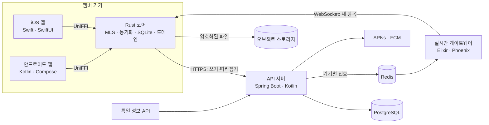

# 그날어때 개발 착수 문서

2026-10-25 · v3.2 · 네이버 클라우드(국내) 확정과 단계별 비용, 첨부(개인 일정·약속·채팅), TimeTree식 그룹 설정 반영. 앱은 Swift·Kotlin + Rust 코어, 서버는 Spring API + Elixir 게이트웨이, 채팅과 MLS 종단간 암호화

이 문서는 제품과 파트 공통 사항을 다룹니다. 각 파트를 어떻게 만드는지는 `docs/parts/`의 파트 문서에 있습니다.

| 문서 | 다루는 것 |
| --- | --- |
| [공통 계약](parts/protocol.md) | 모든 파트가 지키는 규칙: 식별자, MLS 사용법, 엔트리 형식, 순서·동기화, 실시간 이벤트, 푸시 |
| [Rust 코어](parts/rust-core.md) | 암호화, MLS, 동기화, 로컬 저장소, 도메인 로직, 앱에 노출하는 API |
| [iOS 앱](parts/ios.md) | Swift UI, 위젯, 알림 확장, OS 연동 |
| [안드로이드 앱](parts/android.md) | Kotlin UI, 위젯, FCM, OS 연동 |
| [API 서버](parts/api-server.md) | Spring Boot(Kotlin): 계정, 그룹, 전달 서비스, 저장, 푸시 |
| [실시간 게이트웨이](parts/gateway.md) | Elixir(Phoenix): 연결 유지와 즉시 전달 |
| [인프라](parts/infra.md) | 클라우드 구성, 호스팅 위치, 데이터 저장소, 배포, CI, 관측, 확장 조건 |

## 0. 한 장 요약

**그날어때**는 내 일정을 가장 편하게 넣고 보는 캘린더 앱입니다. 그룹 캘린더는 멤버들의 일정을 합쳐서 보여 주고, 그룹에서 날짜를 잡으면 수락한 사람들의 캘린더에 약속이 들어갑니다. 그룹마다 채팅방이 있고, 날짜 잡기와 투표는 채팅 안에 카드로 뜹니다. 일정·채팅·투표는 모두 종단간 암호화되어 운영자를 포함해 멤버가 아닌 누구도 볼 수 없습니다.

| 결정 | 선택 | 이유 |
| --- | --- | --- |
| 보안 | MLS(RFC 9420) 종단간 암호화. 채팅과 캘린더가 같은 그룹 암호화를 씀 | 멤버가 바뀔 때마다 키가 바뀌고, 기기 하나가 털려도 지난 대화가 열리지 않음. 텔레그램은 그룹 대화를 종단간 암호화하지 않음 |
| 일정의 원본 | 기기(Rust 코어의 SQLite) + 암호화 백업 | 캘린더 앱이 설치를 요구할 단독 가치 |
| 약속 흐름 | 날짜 잡기 → 수락/다음에 → 수락 즉시 캘린더에 추가. 시간·활동은 투표(기본) 또는 독재. 날이 지나면 끝 | 단톡방보다 빠르게 끝나야 함 |
| 채팅 | 그룹 채팅 + 같은 그룹 멤버끼리 1:1. 서버는 30일 우편함, 기록은 기기와 백업에 | 서버에 기록을 쌓으려면 지난 키를 서버에 백업해야 해서 복잡해지고 보안이 약해짐 |
| 앱 | Swift·Kotlin 네이티브 UI + Rust 공유 코어(UniFFI). KMP는 쓰지 않음 | 두 앱이 같은 결과를 내야 하는 로직을 한 구현으로. 위젯·알림 확장은 네이티브 |
| 서버 | Spring Boot(Kotlin) API + Elixir(Phoenix) 실시간 게이트웨이 + PostgreSQL + Redis + 오브젝트 스토리지 | 쓰기는 API, 연결 유지는 게이트웨이로 분리 |
| 나중에 | Kafka, ScyllaDB | 도입 조건이 오면([인프라](parts/infra.md) 6장) |

전제:
- 멤버는 모두 앱을 설치합니다(커뮤니티 앱).
- 한 사람이 여러 그룹에 속하고, 캘린더는 하나입니다.
- MVP에서는 계정당 활성 기기가 1대입니다. 새 기기로 옮기면 이전 기기는 해제됩니다.

## 1. 제품 정의

### 사용자와 장면

- **친구 그룹(3~10명):** "다음 달에 언제 볼까?"가 단톡방에서 며칠 끌리다 흐지부지되는 문제.
- **아르바이트생·학생:** 주마다 바뀌는 근무표·시간표를 캘린더에 넣기 귀찮아 캘린더가 비어 있는 문제. 캘린더가 비면 그룹 캘린더도 비어 보입니다. 그래서 캘린더 입력 UX가 공유 기능의 정확도를 결정합니다.
- **여러 그룹:** 친구, 가족, 동아리, 알바 동료. 그룹마다 무엇을 공유할지 따로 정합니다. 한 그룹에서 잡힌 약속은 내 캘린더에 들어가므로 다른 그룹에는 자동으로 일정이 있는 시간이 됩니다.

### 단독 가치와 네트워크 가치

- 혼자 써도 되는 가치: 입력 추천, 교대 템플릿, 캘린더 여러 개, 생일 알림, 연휴·연차 제안, 기기 캘린더 미러, 홈 화면 위젯. 이것이 설치의 명분입니다.
- 같이 쓸 때의 가치: 멤버 일정을 합친 그룹 캘린더, 날 하나 탭해서 잡는 약속, 투표 또는 주도자 결정, 활동 추천, 수락 즉시 캘린더 반영, 약속 카드가 뜨는 채팅.

### 검증할 가설

친구 그룹은 단톡방의 "언제 돼?" 대신 그날어때 그룹 캘린더에서 비어 있는 시간을 보고 날짜를 잡는다. 단, 각자의 캘린더가 이 앱에 들어 있을 때.

### 성공 지표와 중단 기준

숫자는 초기값이며 알파에서 조정합니다. 측정은 서버가 보는 메타데이터와 기기가 보내는 퍼널 마커로만 하고, 내용은 쓰지 않습니다.

| 지표 | 정의 | 게이트 기준 |
| --- | --- | --- |
| 캘린더 활성 | 첫 7일 중 4일 이상 앱을 연 사용자 비율 | 50% 이상 |
| 추천 입력 비율 | 추천 칩을 탭해 만든 일정 ÷ 전체 일정 | 30% 이상 |
| 초대 전환 | 초대 코드 사용 → 활성 멤버 → 첫 가용 시간 공유 | 50% 이상 |
| 수락률 | 날짜 잡기 중 날이 지나기 전에 1명 이상 수락한 비율 | 60% 이상 |
| 첫 수락 속도 | 신청 → 첫 수락의 중위 시간 | 24시간 이내 |
| 성사율 | 날이 지난 약속 중 참가자 2명 이상이었던 비율 | 50% 이상 |
| 채팅 사용 그룹 | 주간 활성 그룹 중 채팅 메시지가 있는 그룹 비율 | 40% 이상 |
| 재사용 | 약속 뒤 60일 안에 두 번째 날짜 잡기가 있는 그룹 | 30% 이상 |

중단 기준: 그룹 알파에서 초대 전환이 25% 미만이고 온보딩을 두 번 고친 뒤에도 같으면, 그룹 기능을 보류하고 캘린더 단독 제품으로 재평가합니다.

### 경쟁 위치

- 공유 캘린더는 TimeTree가, 빈 시간 찾기는 When2meet류가, 채팅은 카카오톡이 차지하고 있습니다.
- 이 셋을 함께 하면서 운영자도 내용을 못 보는 조합은 비어 있습니다.
- 채팅만으로는 카카오톡을 이길 수 없습니다. 날짜 잡기·투표·약속이 채팅 안에 카드로 뜨고, 수락이 곧 캘린더 일정이 되는 연결이 차별점입니다.

## 2. 범위

| 구분 | 항목 |
| --- | --- |
| MVP 포함 | 캘린더: 월·주·목록 뷰, 빠른 입력, 캘린더 여러 개(색), 반복 일정, 알림, 교대 템플릿, 기기 캘린더 읽기 미러, 공휴일·연휴 표시와 연차 제안, 홈 화면 위젯 |
| MVP 포함 | 입력 추천: 요일·시간·내 기록·생일·연휴를 보고 순위를 매긴 추천 칩(기기 안 규칙), 사람·생일 등록(연락처 가져오기는 선택) |
| MVP 포함 | 계정: 카카오 로그인, Sign in with Apple, 게스트, 앱 내 계정 삭제, 복구 코드, 암호화 백업, 기기 변경 |
| MVP 포함 | 그룹: 여러 그룹(1인당 20개), 그룹당 20명, 카카오톡 초대 링크, TimeTree식 그룹 설정(이름·커버·색, 날짜 잡기 기본값, 그룹 프로필, 공유·알림·표시) |
| MVP 포함 | 그룹 캘린더: 멤버 일정을 합친 캘린더. 날짜 칸의 1시간 띠, 날을 탭하면 30분 단위 0–24시 멤버별 테이블, 공휴일, 잡힌 약속, 생일 아이콘(공개한 멤버만) |
| MVP 포함 | 날짜 잡기: 날 선택 → 결정 방식 선택 → 수락/다음에 → 수락한 사람 캘린더에 즉시 추가. 날이 지나면 수락 없는 신청은 사라짐 |
| MVP 포함 | 결정 방식: 투표(기본. 추천 3개 + 멤버 누구나 추가 + 항상 맨 아래 "아무거나") 또는 독재(주도자가 정함, 주도자는 멤버 누구에게나 넘길 수 있음) |
| MVP 포함 | 추천: 시간 3개(09:00–21:00 안에서 참가자가 내내 비어 있는 인원수 순), 활동 3개(시간·그룹 취향·신선도·인원), 활동을 고르면 카카오맵 검색 링크 |
| MVP 포함 (M3) | 채팅: 그룹 채팅, 같은 그룹 멤버끼리 1:1, 텍스트·사진·파일, 답장, 날짜 잡기 카드, 기기 안 검색, 신고·차단, iOS 민감 이미지 가림 |
| MVP 포함 (M3) | 첨부: 개인 일정·약속·채팅에 사진과 파일(파일당 100MB, 일정·약속당 10개), 그룹별 사진·파일 모아보기 |
| MVP 제외 | 공개·오픈 채팅, 낯선 사람에게 말 걸기 |
| MVP 제외 | 읽음 표시, 입력 중 표시, 메시지 수정·모두에게서 삭제(미결정) |
| MVP 제외 | 음성·영상 통화, 다기기 동시 사용 |
| MVP 제외 | 장소 랭킹과 장소 DB, 위치 수집, 날씨 |
| MVP 제외 | 근무표 짜기(사장·알바 모드), 기기 캘린더로 쓰기(양방향 동기화) |
| MVP 제외 | 머신러닝, 인스타그램 연동 |

## 3. 설계 원칙

1. **서버는 암호문만 봅니다.** 일정, 비어 있는 시간, 채팅, 신청·응답·투표는 그룹 멤버의 기기에서만 복호화됩니다.
2. **같은 결과는 한 구현에서 나옵니다.** 상태 계산, 투표 집계, 추천은 Rust 코어 하나에 있고, 두 앱은 그 결과를 그립니다.
3. **그룹 상태는 로그의 함수입니다.** 서버가 매긴 순서대로 로그를 같은 함수에 넣으면 모든 기기가 같은 상태를 냅니다.
4. **DB가 원본이고 실시간 경로는 잃어도 됩니다.** 기기는 그룹별 순번(seq)으로 빠진 것을 따라잡습니다. 게이트웨이와 푸시는 빨리 알려 주는 수단일 뿐입니다.
5. **그룹 캘린더는 판정하지 않습니다.** 일정이 없는 시간이 비어 있는 시간이고, 색은 비어 있는 인원수입니다. 자기 일정을 어떻게 넣을지는 사용자의 일입니다.
6. **추천은 제안입니다.** 입력 추천은 탭하지 않으면 저장되지 않고, 시간·활동 추천은 투표의 선택지일 뿐입니다.
7. **수집하지 않은 것은 유출되지 않습니다.** 서버가 보는 메타데이터는 6장의 표에 전부 적습니다.
8. **캘린더가 먼저입니다.** 공유 기능의 정확도는 캘린더에 들어 있는 데이터의 양이 정합니다.

## 4. 개발 파트와 아키텍처



| 파트 | 기술 | 맡는 일 |
| --- | --- | --- |
| Rust 코어 | Rust, mls-rs, rusqlite, tokio, UniFFI | 암호화와 MLS, 서버와의 동기화, 로컬 저장소, 도메인 로직 전부(캘린더, 추천, 합치기, 날짜 잡기, 투표, 채팅), 알림 복호화 |
| iOS 앱 | Swift, SwiftUI, WidgetKit, 알림 확장 | 화면, OS 연동(캘린더·연락처·키체인·알림·위젯·로그인·공유) |
| 안드로이드 앱 | Kotlin, Jetpack Compose, Glance, FCM | iOS와 같은 역할 |
| API 서버 | Spring Boot(Kotlin), JDK 21, PostgreSQL, Redis | 계정·기기·세션, 그룹·초대·멤버, MLS 전달 서비스(순서와 커밋 선점), 상태 블롭, 우편함, 미디어·백업 URL, 푸시, 신고·차단, 공휴일 |
| 실시간 게이트웨이 | Elixir, Phoenix Channels, Redix | 접속 중인 기기와 연결 유지, 새 항목을 즉시 전달 |
| 인프라 | Docker, Terraform, 관리형 PostgreSQL·Redis·오브젝트 스토리지, GitHub Actions | 클라우드 구성, 환경, 배포, CI, 관측, 확장 조건 |

메시지 하나가 가는 길:
1. 보내는 기기의 Rust 코어가 MLS로 암호화해 API에 올립니다.
2. API가 PostgreSQL에 저장하고 그룹 순번(seq)을 매깁니다.
3. API가 받을 기기마다 Redis에 신호를 냅니다.
4. 게이트웨이는 접속 중인 기기에 바로 밀어 주고, API는 접속하지 않은 기기에 APNs/FCM으로 보냅니다.
5. 받은 기기의 Rust 코어가 복호화해 저장하고, 앱이 화면을 갱신합니다.

자세한 순서는 [공통 계약](parts/protocol.md) 6장에 있습니다.

## 5. 제품 사양

모든 파트가 같은 규칙을 구현합니다. 규칙의 코드는 [Rust 코어](parts/rust-core.md)에, 화면은 앱 파트 문서에 있습니다.

### 5.1 캘린더

- **뷰:** 월, 주, 목록. 캘린더별 색과 표시/숨김.
- **빠른 입력:** 날짜 탭 → 추천 칩 또는 시간 범위 드래그 → 제목. 반복은 "매주 화·목" 같은 프리셋.
- **교대 템플릿:** "오픈 07–13", "마감 17–23" 같은 템플릿을 만들고 달력 날짜를 탭해서 찍습니다. 결과는 일반 일정입니다.
- **사람·생일:** 친구·가족을 이름과 생일로 등록합니다. 연락처에서 가져오기는 선택입니다. 음력 생일은 매년 양력으로 변환합니다. 그룹 멤버가 생일을 공개하면 자동으로 들어옵니다.
- **공휴일·연휴·연차 제안:** 공휴일과 대체공휴일을 표시하고, 공휴일 사이에 낀 평일 하루를 쉬면 4일 이상 연휴가 되는 경우 "연차 1일로 4일 연휴"를 제안합니다.
- **기기 캘린더 미러:** 기기 캘린더를 읽기만 합니다. 제목은 기기 밖으로 나가지 않습니다.
- **소프트 캘린더:** 내 화면에는 보이지만 그룹에는 비어 있는 시간으로 보이는 캘린더. 예: 헬스장, 혼자 하는 공부.
- **알림:** 기기에서 예약하는 로컬 알림. 그룹 약속도 내 캘린더의 일정이므로 같은 알림을 씁니다.
- **위젯:** 오늘 일정과 다음 약속.

### 5.2 입력 추천

날짜를 탭하면 빠른 입력 시트 위에 추천 칩 다섯 개가 뜹니다. 평일이면 "회사 업무 09–18", "회식 19–22"가, 친구 생일이 가까우면 "민수 생일 약속"이, 연휴 앞이면 "연휴 여행"이 먼저 옵니다. 모든 계산은 기기에서 하고 아무것도 서버로 가지 않습니다.

| 후보 출처 | 예 |
| --- | --- |
| 기본 사전 | 회사 업무, 회식, 수업, 알바(템플릿), 운동, 약속, 데이트, 가족 모임, 병원, 생일 |
| 내 기록 | 같은 요일·시간대에 자주 쓴 제목 |
| 사람·생일 | 7일 안의 생일 → "OO 생일 약속" |
| 공휴일·연휴 | "연휴 여행", "대체공휴일 나들이" |

$$
\text{suggestScore} = 0.4 \cdot \text{contextFit} + 0.3 \cdot \text{personalFreq} + 0.2 \cdot \text{upcoming} + 0.1 \cdot \text{recency}
$$

- contextFit: 요일·시간대 적합도(평일 낮에 회사 업무 1, 주말에 0)
- personalFreq: 같은 요일·시간대에 그 제목을 쓴 횟수를 0~1로 정규화
- upcoming: 7일 안의 생일·연휴에 묶인 항목이면 1, 가까울수록 높음
- recency: 최근 30일 안에 쓴 제목이면 1

규칙:
- 같은 날 이미 있는 일정과 겹치는 칩은 뺍니다.
- 같은 제목을 같은 요일에 세 번 넣으면 "매주 반복으로 바꿀까요?"를 한 번 묻습니다.
- 탭하지 않은 추천은 저장되지 않고 그룹에 일정으로 보이지 않습니다.
- 가중치는 추천 입력 비율을 보고 손으로 조정합니다.

### 5.3 그룹 캘린더

그룹 캘린더는 멤버 일정을 합친 캘린더이고, 조정 기능은 날짜 잡기 하나뿐입니다.

- **공유 설정:** 그룹마다 기간(오늘부터 8주, 2~13주), 포함할 캘린더, 일시중지, 생일 공개를 정합니다(5.6 그룹 설정). 공유되는 것은 30분 단위로 일정이 있는지 없는지뿐입니다.
- **날짜 칸의 1시간 띠:** 0시부터 24시까지 24칸. 칸의 값은 그 한 시간 내내 일정이 없는 멤버 수입니다. 30분만 비어 있으면 그 칸에 들어가지 않습니다.
- **날 테이블:** 날을 탭하면 30분 단위 0–24시 테이블이 열립니다. 맨 위는 합친 줄, 아래는 멤버마다 한 줄입니다. 일정이 있는 부분은 비어 있고 없는 부분이 색으로 채워집니다. 시간 범위를 드래그하면 그 시간 내내 비어 있는 사람이 표시됩니다.
- **색:** 그룹 색의 명도 단계로 칠합니다. 0명은 비워 두고, 1명은 가장 연하게, 전원은 가장 진하게.
- **판정 없음:** "몇 시간 이상 비어야 빈 시간" 같은 기준이 없습니다. 새벽 3시에 일정이 없으면 새벽 3시도 비어 있는 시간입니다.
- **공유하지 않은 멤버:** 불참으로 보입니다. 비어 있는 것으로 치지 않습니다.
- **그 밖에 보이는 것:** 공휴일, 잡힌 약속(참가자 이름과 함께), 생일 아이콘(공개한 멤버만).

### 5.4 날짜 잡기

1. **신청:** 날을 탭하면 그날의 30분 테이블이 열립니다. 결정 방식(투표 / 독재)을 고르고 신청합니다. 처음 선택값은 그룹 설정의 기본 결정 방식(처음값 투표)입니다. 독재면 시간 범위와 활동을 함께 정할 수 있습니다. 신청은 멤버 전원에게 가고, 그룹 채팅에 카드로 뜹니다.
2. **주도자:** 신청한 사람이 주도자입니다. 결정 방식을 바꾸고, 독재면 시간·활동을 정하고, 투표면 투표를 열고 닫고, 약속을 취소합니다. 주도자 권한은 다른 활성 멤버 누구에게나 넘길 수 있고, 넘기면 이전 주도자는 일반 참가자가 됩니다.
3. **가안:** 신청하는 순간 신청자의 캘린더에 가안으로 들어가고, 첫 수락이 오면 확정 일정이 됩니다.
4. **응답:** 수락 / 다음에. 이름과 함께 멤버 모두에게 보입니다. 멤버마다 마지막 응답이 유효합니다. 수락 뒤 다음에는 빠지는 것이고, 다음에 뒤 수락은 늦참입니다.
5. **수락의 효과:** 수락한 사람의 캘린더에 "그룹명 · 활동" 일정이 들어갑니다. 시간이 미정이면 종일로 들어가고, 정해지면 그 시간으로 바뀝니다. 그룹 캘린더에는 약속 자체가 참가자 이름과 함께 보입니다. 시간이 정해진 약속과 가안은 모든 그룹에 일정이 있는 시간으로 보이고, 시간이 미정인 약속은 하루를 다 막지 않도록 비어 있는 시간으로 둡니다.
6. **독재:** 주도자가 시간·활동을 정하고 바꿉니다. 바뀌면 참가자 전원의 일정이 함께 바뀌고 알림이 갑니다. 겹치는 시간을 고르면 "지영은 이 시간에 일정이 있어요"가 뜹니다.
7. **끝:** 신청한 날이 한국 시간으로 지나면 끝입니다. 수락이 없던 신청은 신청자의 가안까지 모든 기기에서 사라집니다. 수락이 있던 약속은 참가자 캘린더에 지난 일정으로 남습니다. 주도자는 그 전에 취소할 수 있고, 취소하면 참가자 캘린더에서도 빠집니다.

**투표**
- **선택지:** 추천 3개, 멤버가 추가한 것, 맨 아래 항상 "아무거나". 추천 3개는 주도자가 투표를 여는 순간 주도자 기기가 계산해 고정하므로 모든 기기가 같은 목록을 봅니다. 선택지 추가는 참가 여부와 상관없이 활성 멤버 누구나 할 수 있습니다. 그룹 설정에서 "주도자만"으로 바꿀 수 있고, 이 값은 신청할 때 약속에 고정됩니다.
- **표:** 참가자(수락한 사람과 주도자)마다 한 표, 마지막 표가 유효합니다. 늦참자도 닫히기 전까지 투표할 수 있습니다.
- **닫힘:** 현재 참가자 전원이 투표했을 때, 주도자가 닫을 때, 또는 약속 날 00:00. 시각은 서버가 엔트리를 받은 시각 기준입니다.
- **집계:** 가장 많은 표를 받은 선택지. "아무거나"는 어느 선택지에도 더해지지 않습니다. 표가 모두 아무거나거나 아무도 투표하지 않았으면 추천 1번. 동점이면 목록에서 먼저 나오는 것(추천이 먼저, 그다음 추가된 순).
- **다시 열기:** 주도자가 다시 열면 추천 3개를 그 시점 기준으로 다시 계산하고 표는 초기화합니다.
- **결과:** 시간 투표 결과는 참가자 전원의 일정 시간으로, 활동 투표 결과는 일정 제목으로 들어갑니다.

**시간 추천 3개:** 참가자들의 그날 일정에서 09:00 이후 시작해 21:00까지 끝나는 정시 시작 범위를 놓고, 그 범위 내내 일정이 없는 참가자 수가 많은 순, 같으면 이른 순으로 서로 겹치지 않게 3개를 고릅니다. 길이는 활동이 정해졌으면 그 활동의 기본 길이, 아니면 2시간입니다. 09:00–21:00은 추천의 설정값이고 그룹 설정에서 바꿀 수 있습니다. 그 밖의 시간은 멤버가 선택지로 추가하면 됩니다.

**활동 추천 3개:** 장소가 아니라 카테고리로 추천합니다. 장소 랭킹에 필요한 영업시간·평점·이동 시간은 공개 API에 없고, 위치를 수집하면 위치정보법 신고 대상이 되기 때문입니다. 활동이 정해지면 참가자가 동네 이름을 넣어 카카오맵 검색(`https://map.kakao.com/link/search/<동네 카테고리>`)으로 넘어갑니다.

- 사전은 20개 안팎입니다. 식사, 술, 카페, 보드게임 카페, 영화, 노래방, 볼링, 전시·공연, 산책·공원, 등산, 쇼핑, 방탈출, 스포츠 관람, 집 모임, 드라이브, 당일 여행 등. 항목마다 적합 시간대, 기본 길이, 실내·야외, 인원 범위, 비용 등급이 있습니다.

$$
\text{activityScore} = 0.35 \cdot \text{timeFit} + 0.35 \cdot \text{taste}_{group} + 0.2 \cdot \text{novelty} + 0.1 \cdot \text{sizeFit},
\qquad
\text{taste}_{group} = 0.6 \cdot \text{mean}(\text{taste}_i) + 0.4 \cdot \min(\text{taste}_i)
$$

- timeFit: 시작 시각·길이가 카테고리 적합 범위에 들면 1. 시간이 미정이면 요일 적합도만
- taste_group: 참가자 취향 태그 일치의 평균과 최솟값 가중합. `min` 항이 한 명이 정말 싫어하는 것을 1위에서 밀어냅니다. 태그가 없는 참가자는 평균에서 뺍니다.
- novelty: 그룹이 최근 90일 안에 한 활동이면 0, 처음이면 1
- sizeFit: 인원이 카테고리 범위 안이면 1

### 5.5 채팅 (M3)

- **방:** 그룹마다 채팅방 1개. 1:1은 같은 그룹 멤버끼리만 시작하고 한 쌍에 하나입니다. 한 번 시작한 1:1은 그룹을 나가도 남습니다.
- **메시지:** 텍스트, 사진·파일(5.7), 답장, 날짜 잡기 카드. 날짜 잡기·투표는 채팅과 같은 순서의 로그에 있어서 타임라인에 카드로 뜨고, 카드에서 바로 수락/다음에와 투표를 합니다.
- **기록:**
  - 들어온 시점부터 봅니다. 새 멤버는 이전 대화를 볼 수 없습니다(MLS의 성질).
  - 서버는 아직 받지 못한 기기를 위해 30일만 보관합니다.
  - 30일 넘게 접속하지 않은 기기는 그동안의 메시지를 받지 못하고 그룹에 자동으로 다시 들어옵니다.
- **기기 변경:** 복구 코드로 백업을 복원하면 텍스트 기록이 돌아옵니다. 사진·파일은 백업에 들어가지 않고, 서버 보관 기간 안이면 다시 받습니다(5.7).
- **검색:** 기기 안에서만 합니다. 서버는 내용을 모릅니다.
- **알림:** 내용이 보이는 알림. 방마다 채팅·약속 알림을 따로 끌 수 있습니다(5.6).
- **신고:** 신고자가 고른 메시지를 신고자 기기가 복호화해 운영자에게 보냅니다. 운영자가 볼 수 있는 내용은 이것뿐입니다.
- **차단:** 1:1에서는 서버가 상대 메시지를 받지 않고, 그룹 채팅에서는 내 화면에서 가립니다.
- **민감 이미지:** iOS에서 사용자가 기기 설정의 민감 콘텐츠 경고를 켰으면 받은 사진을 가립니다.

### 5.6 그룹 설정 (M2)

TimeTree의 캘린더별 설정처럼 그룹마다 따로 정합니다. 그룹 화면 오른쪽 위에서 엽니다.

| 구분 | 항목 | 누가 바꾸고 어디에 두나 |
| --- | --- | --- |
| 그룹 공통 | 이름, 커버 이미지, 그룹 색(12색 중 하나) | 방장이 바꾸고, 모든 멤버에게 같게 보입니다. 그룹 메타 상태 블롭(종단간 암호화) |
| 그룹 공통 | 날짜 잡기 기본값: 결정 방식(처음값 투표), 시간 추천 범위(처음값 09–21), 투표 선택지 추가(처음값 활성 멤버 누구나, 또는 주도자만) | 같음. 이미 신청된 약속에는 영향이 없고 다음 신청부터 적용 |
| 나에게만 | 그룹 프로필: 이 그룹에서 쓸 이름과 사진(처음값은 계정 프로필) | 내가 바꾸고 이 그룹 멤버에게만 보입니다. 멤버 프로필 상태 블롭 |
| 나에게만 | 공유: 포함할 캘린더, 기간(2~13주, 처음값 8주), 일시중지, 생일·취향 공개 | 기기. 5.3 |
| 나에게만 | 알림: 채팅과 약속(신청·응답·투표·변경·첨부)을 따로 켜고 끔, 전체 끄기(1시간·오늘·계속) | 서버에는 종류별 켜짐 여부와 끄기 기한만 |
| 나에게만 | 표시: 이 그룹 약속이 내 캘린더에 들어갈 때의 색(처음값 그룹 색), 그룹 목록 맨 위 고정 | 기기 |
| 관리 | 멤버 목록, 초대 링크, 나가기. 방장은 내보내기, 방장 넘기기, 그룹 삭제 | 서버(멤버십) |

- **그룹 색이 정하는 것:** 그룹 화면의 머리글과 강조색, 그룹 캘린더의 비어 있는 인원수 단계(그룹 색의 명도 5단계), 내 캘린더에서 그 그룹 약속의 색.
- **커버 이미지:** 3:1로 잘라 기기에서 1MB 이하로 줄여 올립니다. 그룹 캘린더 위의 머리글로 보이고, 스크롤하면 접힙니다.
- **1:1:** 그룹 설정이 없고 알림만 바꿉니다.

### 5.7 첨부 (M3)

개인 일정, 약속, 채팅에 사진과 파일을 붙입니다. 모두 기기에서 암호화하고, 서버는 크기·시각·범위만 압니다.

| 붙이는 곳 | 보는 사람 | 서버 보관 | 기기를 바꾸면 |
| --- | --- | --- | --- |
| 개인 일정 | 나만 | 내가 지울 때까지(계정당 1GB) | 백업에 키가 있어 다시 받음 |
| 약속 | 그 그룹 멤버(날이 지나지 않은 약속은 나중에 들어온 멤버도) | 1년 | 1년 안이면 다시 받음 |
| 채팅 | 그 방 멤버 | 30일 | 30일 안이면 다시 받음 |

- **형식:** 사진(JPEG·PNG·HEIC·GIF·WebP)은 긴 변 2048px로 줄여 보내고, "원본"을 고르면 그대로 보냅니다. 파일은 형식 제한 없이 파일당 100MB까지입니다.
- **개수:** 일정·약속 하나에 10개까지.
- **빼기:** 올린 사람만 뺄 수 있고, 빼면 서버의 암호문도 지웁니다. 채팅 메시지 삭제는 아직 MVP 밖입니다(2장).
- **그룹 캘린더:** 개인 일정의 첨부는 그룹에 보이지 않습니다. 그룹이 보는 것은 여전히 비어 있는지 여부뿐입니다.
- **받기:** 사진은 8KB 이하 썸네일이 메시지 안에 있어 바로 보이고, 원본은 받는 즉시 내려받습니다. 파일은 탭할 때 받고, 와이파이에서는 25MB 이하를 자동으로 받습니다.
- **모아보기:** 그룹마다 오간 사진·파일을 한 화면에서 봅니다(TimeTree의 앨범). 기기에 받아 둔 것만 보입니다.

TimeTree는 일정 첨부를 유료 기능으로 두고 일정당 3개·10MB, 1년 보관입니다. 그날어때는 첨부를 무료 기본 기능으로 두되, 개인 첨부에 계정당 한도를 둡니다.

## 6. 보안·개인정보 모델

목표는 **운영자도 내용을 읽을 수 없는** 상태입니다. 구현 세부는 [공통 계약](parts/protocol.md)과 [Rust 코어](parts/rust-core.md)에 있습니다.

### 키

| 키 | 어디서 | 용도 |
| --- | --- | --- |
| 기기 서명 키(Ed25519) | 기기에서 생성, 공개키만 서버에 | MLS 자격 증명, 기기 등록 증명 |
| MLS 그룹 비밀(epoch마다) | MLS가 관리 | 채팅·날짜 잡기 메시지 암호화 |
| 상태 키(epoch마다) | MLS exporter로 유도 | 가용 시간·그룹 이름 같은 덮어쓰는 데이터 암호화 |
| 계정 마스터 키(AMK) | 기기에서 생성 | 백업 암호화 |
| 복구 키 | 복구 코드(12단어) + Argon2id | AMK 래핑. 서버에는 salt와 래핑된 AMK만 |
| 미디어 키 | 파일마다 무작위 | 사진·파일 암호화. 키는 MLS 메시지 안에 |

### 서버가 보는 것

이 표가 개인정보 처리방침의 수집 항목입니다.

| 항목 | 이유 |
| --- | --- |
| 계정 식별자(카카오·애플 `sub`), 닉네임 | 로그인, 멤버 목록 |
| 기기 공개 서명키, 플랫폼, 푸시 토큰 | 기기 등록, 푸시 |
| 그룹 멤버십, 역할, 상태, 1:1 상대, 차단 관계, 알림 설정(전체 끄기 기한, 채팅·약속 켜짐 여부) | 전달 대상 결정, 차단 |
| 초대 코드 생성·사용 기록 | 남용 방지, 전환율 |
| 로그 항목의 작성자, 시각, 크기, epoch, 커밋 여부 | 순서, 전달, 용량 제한 |
| 알림을 보내는 메시지의 종류(채팅·약속) | 종류별 알림 끄기 |
| MLS 커밋의 공개 부분(누가 추가·제거됐는지) | 멤버십은 서버가 이미 아는 정보 |
| 첨부·커버·프로필 사진·백업의 크기, 시각, 범위(채팅·약속·개인 일정) | 용량 제한, 보관 기간 정리 |
| 퍼널 마커(신청·첫 수락·성사·불발·취소·채팅 사용일) | 1장 지표. 날짜·시간·활동·참가자·내용은 없음 |
| 신고자가 제출한 메시지 | 신고 처리 |
| 접속 IP와 로그인 시각, 요청 로그 | 통신비밀보호법상 보관(접속 기록 3개월), 장애 대응 |

### 한계

MVP가 막지 못하는 것을 그대로 적습니다.

- **키 검증 없음:** 서버가 "이 사람의 새 기기"라며 가짜 기기를 끼워 넣으면 중간자가 가능합니다. 안전 번호 비교는 2단계이고, 그때까지는 "운영자가 적극적으로 공격하지 않는다"는 가정이 들어갑니다.
- **메타데이터:** 누가 어느 그룹에 있고 언제 무엇을 보냈는지(크기·시각)는 서버가 압니다.
- **기록 유실:** 복구 코드와 기기를 함께 잃으면 기록도 잃습니다.
- **회수 불가:** 나간 멤버가 이미 받은 과거 데이터는 회수할 수 없습니다.
- **감사 미확인:** mls-rs의 제3자 보안 감사는 확인되지 않았습니다. 공개 베타 전에 MLS 통합부 외부 리뷰를 받습니다.

### 하지 않을 것

- 서버에서 복호화하거나 평문을 받는 경로 만들기(신고 제외)
- 일정·채팅·사람·생일을 어떤 서버로도 보내기(크래시 리포트·분석 SDK 포함)
- 위치 수집, 인스타그램 스크래핑
- 직접 만든 암호 알고리즘
- 개인정보를 애플리케이션 로그에 출력하기

## 7. 법·규제·스토어 체크리스트

출시 전 변호사 검토 대상입니다.

- [ ] 개인정보 처리방침: 6장 "서버가 보는 것" 표를 수집 항목으로, 보존 기간과 처리 위탁(클라우드, APNs·FCM)을 명시
- [ ] 부가통신사업 신고(채팅 제공)와 소규모 면제 기준 확인
- [ ] 불법촬영물 유통방지 의무: 대상(매출 10억 원 이상 또는 일평균 이용자 10만 명 이상)과 비공개 그룹 대화에 적용되는지 확인
- [ ] 통신비밀보호법: 로그 기록과 접속 IP를 3개월 이상 보관(시행령 제41조)하고, 법원 허가를 받은 제공 요청에 협조(법 제15조의2). 서버 위치와 상관없이 운영사에 적용됨. 부가통신사업자에 그대로 적용되는지, 3개월 뒤 삭제로 충분한지 확인
- [ ] 서버를 국외에 두면 국외 이전 사항(국가, 받는 자, 항목, 목적, 보유 기간)을 처리방침에 공개(개인정보 보호법 제28조의8)
- [ ] 관리자 접근 기록: 1년 이상, 정보주체 5만 명 이상이면 2년 이상 보관하고 점검(개인정보의 안전성 확보조치 기준 제8조)
- [ ] ISMS 인증: 직전 3개월 일평균 이용자 100만 명 이상 또는 정보통신서비스 매출 100억 원 이상이면 의무(정보통신망법 제47조). [인프라](parts/infra.md) 7장의 규모 추정이 이 기준에 닿음
- [ ] 수사기관 요청 대응 원칙: 운영자가 제공할 수 있는 것은 메타데이터뿐임을 정책에 명시
- [ ] App Store 심사 지침 1.2(사용자 생성 콘텐츠): 필터링, 신고, 차단, 연락처 공개. 무작위·익명 채팅을 하지 않음
- [ ] App Store 심사 지침 4.8: Sign in with Apple 병행
- [ ] App Store 심사 지침 5.1.1(v): 앱 내 계정 삭제
- [ ] App Store 암호화 수출 항목(`ITSAppUsesNonExemptEncryption`)과 연간 자가분류 보고 대상 여부
- [ ] Google Play 사용자 생성 콘텐츠 정책, 정확한 알람 권한(`USE_EXACT_ALARM`) 정책 확인
- [ ] 연락처 접근: 선택 기능, 권한 문구에 용도 명시. 가져온 제3자 이름·생일은 기기와 암호화 백업에만 있음을 처리방침에 명시
- [ ] 그룹에 생일·취향 공개는 그룹별 명시적 동의
- [ ] 만 14세 미만 가입 차단: 자기 확인 체크박스와 시각만 저장
- [ ] 2단계에서 장소 기능을 넣을 때: GPS를 쓰면 위치기반서비스사업 신고 대상. 소상공인·1인 창조기업은 개시 후 1개월 이내 신고 특례(위치정보법 제9조의2)
- [ ] 상표·스토어 중복 확인: "그날어때"

## 8. 마일스톤과 게이트

날짜는 정하지 않고 단계와 통과 조건만 정합니다. 각 단계는 앞 게이트를 통과해야 시작합니다. 파트별 완료 조건은 파트 문서의 마지막 장에 있습니다.

| 단계 | Rust 코어 | iOS · 안드로이드 | API 서버 | 게이트웨이 | 인프라 |
| --- | --- | --- | --- | --- | --- |
| M0 코어 | 암호화, MLS 래퍼, 로컬 저장소, 도메인 로직, 동기화, FFI | 코어를 불러 화면 하나 띄우기 | 인증 스텁, 기기, 키 패키지, 그룹, 로그(커밋 선점), 상태 | 연결, 인증, 기기별 전달 | 로컬 compose, CI |
| M1 캘린더 알파 | 캘린더, 추천, 백업·복구 | 캘린더 화면, 위젯, 기기 캘린더 미러, 로컬 알림, 복구 코드 | 카카오·애플 로그인, 복구, 백업 URL | (변경 없음) | 알파 서버(무료 Micro 한 대) |
| M2 그룹 알파 | 그룹, 합치기, 날짜 잡기, 투표, 추천, 그룹 설정 | 그룹 캘린더, 날짜 잡기, 투표, 초대, 그룹 설정 | 초대, 멤버, 푸시와 종류별 알림 설정, 커버·프로필 사진, 퍼널 | 그룹 변경 즉시 전달 | 알파 서버 증설(2 vCPU·4GB), 스테이징(Micro), 푸시 키, 모니터링 |
| M3 채팅 알파 | 채팅, 첨부, 검색, 알림 복호화 | 채팅 화면, 일정·약속 첨부, 모아보기, 알림 확장(iOS)·핸들러(안드로이드), 신고·차단 | 범위별 첨부, 신고, 차단, 1:1 | 부하 시험 | 버킷별 수명 규칙 |
| M4 공개 베타 | 외부 리뷰 반영 | 스토어 제출 | 운영 정책 | 운영 확장 | 관리형 DB로 운영 환경 |

| 단계 | 게이트 |
| --- | --- |
| M0 | 헤드리스 종단 시험: Rust 클라이언트 3개가 로컬 API·게이트웨이를 통해 그룹을 만들고, 엔트리를 주고받고, 강퇴와 재가입을 거친 뒤 모두 같은 상태를 계산. 모든 파트 CI 녹색 |
| M1 | 내부 테스터 10명 2주: 캘린더 활성 50% 이상, 추천 입력 비율 30% 이상, 크래시 없는 세션 99.5% 이상, 기기 캘린더 가져오기 성공 90% 이상, 복구 코드로 새 기기 복원 100% |
| M2 | 실제 친구 그룹 5개: 초대 전환 50% 이상, 수락률 60% 이상, 성사율 50% 이상, 첫 수락 중위 24시간 이내, 그룹 상태 불일치 신고 0건 |
| M3 | 메시지 전달 성공률 99.9% 이상(기기 측 측정), 접속 중 전달 지연 p95 1초 이내, 알림 복호화 성공 99% 이상, 신고·차단 동작, 7장의 채팅 관련 법 검토 완료 |
| M4 | 7장 체크리스트 완료, MLS 통합부 외부 리뷰, 삭제·복구·기기 변경·키 갱신 종단 시험, 스토어 심사 통과 |

M1에서 캘린더 활성이 25% 미만이면 캘린더 UX를 다시 설계하기 전에는 M2에 들어가지 않습니다.

**2단계 후보** (베타 이후, 우선순위 미정)

- 안전 번호 비교(키 검증), 다기기 동시 사용
- 서버의 MLS 커밋 검증(mls-rs 외부 관찰자 기능)
- 읽음 표시, 입력 중 표시, 메시지 수정·삭제
- iCloud Keychain·Google Block Store로 복구 코드 없는 복원
- 그룹 공유 일정(TimeTree형)
- 날씨, 장소 랭킹
- 근무표 모드, 인스타그램 공유 시트, 해외 멤버의 시간대

## 9. 개발 방식

이 프로젝트는 Claude가 개발합니다. 사람이 해야 하는 일과 환경의 한계를 미리 적습니다.

### 저장소 구조

```
geunal-eottae/
  core/                # Rust workspace: crypto, mls, store, domain, sync, ffi
  apps/
    ios/               # Xcode project, Swift packages, widget and notification extension targets
    android/           # Gradle project, app + widget modules
  server/
    api/               # Spring Boot (Kotlin), Flyway migrations
    gateway/           # Elixir/Phoenix release
  infra/
    docker-compose.yml # postgres, redis, seaweedfs (S3), api, gateway for local runs
    alpha/             # compose for the single alpha VM: api, gateway, postgres, valkey, caddy
    terraform/         # NCP resources (VPC, servers, object storage buckets, later managed DB and load balancers)
  docs/
    kickoff.md         # this document
    parts/             # one document per development part
    adr/               # architecture decision records
  .github/workflows/   # one workflow per part
```

### 이 환경에서 되는 것과 안 되는 것

- **되는 것:** Rust, Spring(Kotlin), Elixir는 리눅스 개발 환경에서 빌드·테스트합니다. 안드로이드는 SDK를 설치해 빌드·단위 테스트를 합니다.
- **안 되는 것:** iOS 빌드는 macOS와 Xcode가 필요해서, Swift 코드는 GitHub Actions의 macOS 러너에서 빌드·테스트합니다. CI가 iOS의 유일한 검증 수단입니다.
- **사람이 해야 하는 것:** 실기기 테스트와 스토어 제출, 서명.

### 준비해 주셔야 할 것

| 항목 | 쓰는 곳 | 필요 시점 |
| --- | --- | --- |
| GitHub Actions macOS 러너 사용(유료 분) | iOS 빌드·테스트 | M0 |
| Apple Developer Program 계정 | 서명, APNs 키, Sign in with Apple, TestFlight | M1 |
| Google Play Console 계정, Firebase 프로젝트 | 배포, FCM | M1 |
| 카카오 개발자 앱 | 카카오 로그인, 카카오톡 공유 | M1 |
| 네이버 클라우드 계정(결제 수단 등록, 그린루키·신규 가입 크레딧 신청) | 알파·스테이징·운영. 무료 기간과 크레딧 기한이 신청 시점부터 흐르므로 배포 직전에 신청 | M1 직전 |
| 도메인 | API, 게이트웨이, 초대 링크(Universal Links·App Links) | M1 |
| 공공데이터포털 인증키 | 특일 정보 API | M1 |

### 진행 규칙

- 파트 단위로 PR을 나누고, 커밋은 Conventional Commits 형식으로 남깁니다.
- 파트 CI가 녹색이어야 머지합니다.
- 공통 계약을 바꾸는 PR은 계약 문서와 테스트 벡터를 먼저 바꿉니다.

## 10. 미결정 사항

- [ ] 그룹 공통 설정(이름·커버·색·날짜 잡기 기본값)을 방장만 바꿀지, 멤버 누구나 바꿀지(현재: 방장)
- [ ] 개인 일정 첨부 한도(현재 계정당 1GB)와 넘을 때의 처리
- [ ] MLS 구현체 최종 선택: mls-rs vs OpenMLS(M0에서 비교 후 결정, 권고: mls-rs로 시작)
- [ ] 채팅: 읽음 표시, 입력 중 표시, 메시지 수정·모두에게서 삭제를 언제 넣을지
- [ ] 지난 약속을 그룹 캘린더에 얼마나 오래 보일지
- [ ] 음력 변환 방식(Rust 라이브러리 또는 표 내장)
- [ ] 활동 카테고리 사전 초안과 취향 태그 수집 방식
- [ ] 수익 모델과 공개 베타 서버비(월 약 41만~75만 원, [인프라](parts/infra.md) 2장)를 낼 방법
- [ ] 크래시 리포트 도구 사용 여부와 스크러빙 규칙

이번에 권고대로 정한 것: 응답은 이름과 함께 모두 공개, 신청은 멤버 전원에게, 복구 코드는 첫 그룹 참여 전까지 유예하고 배너로 알림, 게스트 허용, 초대 코드로 들어오면 초대한 멤버가 승인한 것으로 보고 온라인인 멤버 기기가 자동으로 추가, 그룹 20개·그룹당 20명, 공유 기간 기본 8주, 백업은 최근 3개.

직접 정한 것:
- 서버는 Supabase 같은 BaaS 없이 네이버 클라우드 한국 리전 위에 직접 구축합니다. 알파는 VM 한 대에 Docker Compose로 돌리고, 공개 베타부터 관리형 DB로 옮깁니다. 네이버 클라우드에는 관리형 컨테이너 실행 서비스가 없어 VM에서 Docker로 실행하고, 쿠버네티스(NKS)는 서버 종류가 늘 때 검토합니다([인프라](parts/infra.md) 2장).
- 첨부는 개인 일정·약속·채팅에 모두 넣습니다. 채팅·약속 사진·파일은 백업에 넣지 않고 서버 보관 기간 안에 다시 받으며, 개인 일정 첨부는 키만 백업합니다(5.7).
- 그룹 설정은 TimeTree처럼 그룹마다 따로 둡니다(5.6).

## 부록 A. 변경 요약

### v1 → v2.3 핵심

| 항목 | v1 | v2.3 |
| --- | --- | --- |
| 제품 중심 | 약속 도구 | 캘린더 앱, 공유는 기능 |
| 보안 | 서버 봉투 암호화 + 서버 계산 | 종단간 암호화, 계산은 기기 |
| 그룹 캘린더 | 후보 날짜 점수 | 멤버 일정을 합쳐 보여 줌, 판정 없음 |
| 약속 | 후보 투표 + 결선 | 날짜 잡기 + 투표·독재 |
| 장소·위치 | 장소 랭킹, 법정동 코드 저장 | 활동 카테고리 + 지도 검색 링크, 위치 수집 없음 |
| 스택 | Expo, Fastify, PostGIS, Redis, KMS | Expo, Fastify, PostgreSQL 하나 |

### v2.3 → v3

| 항목 | v2.3 | v3 | 이유 |
| --- | --- | --- | --- |
| 앱 | Expo(React Native, TypeScript) | Swift·Kotlin 네이티브 + Rust 코어(UniFFI) | 위젯·알림 확장, 두 앱의 같은 결과 |
| 그룹 암호화 | 자체 그룹 키를 기기마다 봉인 | MLS(RFC 9420), 상태 키는 exporter | 채팅이 들어오면서 전방 비밀성과 침해 후 회복이 필요 |
| 서버 | Fastify(Node.js) | Spring Boot(Kotlin) API + Elixir 게이트웨이 | 채팅의 실시간 전달 |
| 저장 | 그룹 로그에 모든 것 | 로그(30일 우편함) + 상태 블롭(덮어쓰기) + 오브젝트 스토리지 | 가용 시간은 메시지가 아니라 상태 |
| 채팅 | 범위 밖(카카오톡) | 그룹 채팅 + 1:1, 날짜 잡기 카드 | 사양 |
| 문서 | 한 파일 | 개요 + 공통 계약 + 파트 문서 6개 | 파트별 개발 |

### v3 → v3.1

| 항목 | v3 | v3.1 | 이유 |
| --- | --- | --- | --- |
| 서버 구축 방식 | 관리형 서비스 + 컨테이너 | BaaS 없이 직접 구축을 명시. Terraform, 계정 분리, 사설망, 감사 기록 추가 | 실제 운영 방식으로 진행 |
| 접속 로그 | 통신비밀보호법 검토 후 결정 | 3개월 보관 뒤 삭제 | 시행령 제41조 확인 |
| 호스팅 위치 | 국내 리전 전제 | 전제 유지, 해외 후보 5곳 검토 기록 | 해외로 옮겨도 한국 법의 의무는 그대로이고 지연만 늘어남 |
| 법 체크리스트 | 통신비밀보호법 범위 확인 | 국외 이전, 관리자 접근 기록, ISMS 추가 | 운영 규모 대비 |

### v3.1 → v3.2

| 항목 | v3.1 | v3.2 | 이유 |
| --- | --- | --- | --- |
| 클라우드 | 미정(국내 전제) | 네이버 클라우드 한국 리전. 알파는 VM 한 대, 공개 베타부터 관리형 DB | 무료 서버와 학생 크레딧으로 알파 비용을 해결 |
| 컨테이너 실행 | 관리형 컨테이너 서비스 권고 | VM에서 Docker | 네이버 클라우드에 관리형 컨테이너 실행 서비스가 없음 |
| 첨부 | 채팅만 사진·파일 | 개인 일정·약속·채팅, 모아보기 | 사양 |
| 그룹 설정 | 공유 설정, 알림 끄기 | TimeTree식 그룹 설정(공통·나에게만) | 사양 |
| 알림 | 방마다 전체 끄기 | 채팅·약속을 따로 | 서버가 알림 메시지의 종류(채팅·약속)를 알게 됨 |

## 부록 B. 검증 기록

작성 시점에 실행해 확인한 것입니다. 저장소에 아직 코드는 없습니다.

- **Rust 코어 시험 크레이트**(mls-rs 0.56, RustCrypto, ciborium, rusqlite 번들 SQLite 3.50.2, UniFFI 0.31)의 테스트 5개 통과:
  - 엔트리 CBOR 왕복
  - 합치기·띠·시간 추천(규칙 예시 그대로)
  - 투표 집계 규칙
  - 상태 키 일치와 AAD 바인딩
  - 한국어 검색(trigram)과 로컬 스키마
- **크기:**
  - "토요일 7시 어때?" 엔트리: CBOR 62바이트, MLS 메시지 254바이트
  - 8주 가용 시간 블롭: 376바이트
- **MLS 10명 그룹:**
  - 9명 추가 커밋 2.7KB, 환영 메시지 3.1KB, 강퇴 커밋 1.2KB
  - 강퇴된 사람과 새 멤버는 각각 이후·이전 메시지를 읽지 못함
  - 11개 클라이언트 전체 실행의 최대 메모리 10.7MB(리눅스)
- **MLS 헤더:** 파이썬 20줄짜리 파서로 mls-rs가 만든 커밋(공개 메시지)과 일반 메시지(비공개 메시지)에서 그룹 ID와 epoch를 정확히 읽음. API의 Kotlin 파서가 같은 방식을 씁니다.
- **API 서버 스키마**(PostgreSQL 16, 확장 없음):
  - 같은 epoch 커밋 둘 중 하나만 수락
  - 상태 덮어쓰기가 epoch를 되돌리지 않음
  - 1:1 중복 거부, 계정당 활성 기기 1대
  - 계정 삭제 시 작성 항목 삭제, 파티션 통째 삭제
- **Swift·Kotlin 바인딩:** 코어 API를 UniFFI로 생성해 Swift는 `async throws`, Kotlin은 `suspend fun`으로 나오는 것을 확인.
- **실행하지 않은 것:**
  - iOS·안드로이드 빌드
  - Spring·Elixir 서버 코드(아직 없음)
  - 부하 시험

## 출처

- [RFC 9420 — The Messaging Layer Security (MLS) Protocol](https://www.rfc-editor.org/rfc/rfc9420)
- [mls-rs](https://docs.rs/crate/mls-rs/0.56.0)
- [Telegram FAQ — 비밀 대화와 클라우드 대화의 암호화 범위](https://telegram.org/faq)
- [App Store 심사 지침 1.2, 4.8, 5.1.1](https://developer.apple.com/app-store/review/guidelines/)
- [불법촬영물 유통방지 의무 대상 기준 (뉴스토마토)](https://newstomato.com/ReadNews.aspx?no=985589)
- [카카오맵 Web API 가이드 — 링크 URL](https://apis.map.kakao.com/web/guide/)
- [카카오 로컬 API 개발 가이드 — 응답 필드에 영업시간·평점 없음](https://developers.kakao.com/docs/latest/ko/local/dev-guide)
- [통신비밀보호법 제2조·제15조의2 (2026-10-02 시행)](https://www.nepla.ai/law/%ED%86%B5%EC%8B%A0%EB%B9%84%EB%B0%80%EB%B3%B4%ED%98%B8%EB%B2%95)
- [통신비밀보호법 시행령 제41조 (2026-10-02 시행)](https://www.nepla.ai/law/%ED%86%B5%EC%8B%A0%EB%B9%84%EB%B0%80%EB%B3%B4%ED%98%B8%EB%B2%95%20%EC%8B%9C%ED%96%89%EB%A0%B9)
- [ISMS 인증 의무 대상 정리 (알체라)](https://www.alchera.ai/resource/blog/isms-certification-mandatory-subject)
- [네이버 클라우드 크레딧·무료 이용 안내 (그린루키, 신규 가입, Micro 서버)](https://www.ncloud.com/main/creditEvent)
- [Cloud DB for PostgreSQL 요금 예시 (고가용성은 2대 과금)](https://www.ncloud.com/product/database/cloudDbPostgresql)
- [Cloud DB for PostgreSQL 릴리스 노트 (16·17 지원)](https://guide.ncloud-docs.com/docs/clouddbforpostgresql-releasenote)
- [네이버 클라우드 Terraform 제공자](https://registry.terraform.io/providers/NaverCloudPlatform/ncloud/latest)
- [TimeTree 공유 캘린더 기능](https://support.timetreeapp.com/hc/en-us/articles/900004492623-How-to-use-shared-calendar-app)
- [TimeTree 일정 파일 첨부](https://support.timetreeapp.com/hc/en-us/articles/9149287774105-How-to-attach-files-to-events)
- [위치정보의 보호 및 이용 등에 관한 법률 (2025-10-01 시행)](https://www.nepla.ai/law/%EC%9C%84%EC%B9%98%EC%A0%95%EB%B3%B4%EC%9D%98%20%EB%B3%B4%ED%98%B8%20%EB%B0%8F%20%EC%9D%B4%EC%9A%A9%20%EB%93%B1%EC%97%90%20%EA%B4%80%ED%95%9C%20%EB%B2%95%EB%A5%A0)
