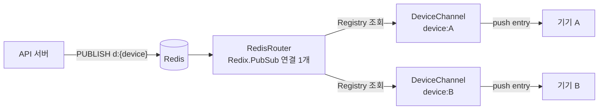

# 실시간 게이트웨이

접속 중인 기기와 WebSocket 연결을 유지하고, API가 보낸 신호를 그 기기에 바로 밀어 줍니다. 아무것도 저장하지 않고 내용도 해석하지 않습니다. 게이트웨이가 멈춰도 기기는 API로 따라잡으므로 메시지가 사라지지 않습니다([공통 계약](protocol.md) 6장).

## 1. 맡는 일과 맡지 않는 일

| 맡는 일 | 맡지 않는 일 |
| --- | --- |
| 액세스 JWT 검증, 자기 기기 토픽만 허용 | 쓰기(모두 API) |
| Redis `d:{device_id}` 구독과 이벤트 전달 | 멤버십 판단(API가 받을 기기를 정해서 보냄) |
| 하트비트, 연결 수명, 해제(`revoke`) | 저장, 재전송 보장 |
| 느린 기기 끊기(다시 붙어서 따라잡게) | 푸시(API가 함) |

## 2. 기술

| 영역 | 선택 |
| --- | --- |
| 언어·런타임 | Elixir 최신 안정판, Erlang/OTP |
| 웹 | Phoenix(Channels만. HTML·LiveView 없음), Bandit |
| Redis | Redix(`Redix.PubSub`) |
| JWT | `jose`로 ES256 검증, API의 JWKS를 받아 캐시 |
| 관측 | Telemetry, Prometheus 지표 노출 |
| 배포 | `mix release`를 Docker 이미지로 |

## 3. 구조

```
server/gateway/
  lib/gateway/application.ex        # supervision tree: JWKS cache, Redis router, endpoint
  lib/gateway/jwks.ex               # fetches the API's JWKS, refreshes on unknown kid
  lib/gateway/redis_router.ex       # one Redix.PubSub connection; SUBSCRIBE d:{device} per joined channel; forwards via Registry
  lib/gateway_web/endpoint.ex
  lib/gateway_web/device_socket.ex  # verifies the token on connect, assigns user_id and device_id
  lib/gateway_web/device_channel.ex # joins only "device:" <> own device_id; pushes entry/state/membership/welcome; handles revoke
  config/runtime.exs                # API JWKS URL, Redis URL, limits from environment
  test/
```

## 4. 연결 수명

1. 기기가 `wss://rt.<도메인>/socket/websocket?vsn=2.0.0&token=...`로 붙습니다. `DeviceSocket.connect/3`가 서명과 만료를 확인하고 `user_id`, `device_id`를 붙입니다.
2. 기기가 `device:{device_id}`에 join합니다. 다른 기기의 토픽이면 거절합니다.
3. join이 되면 `RedisRouter`에 등록하고, Redis `d:{device_id}`를 구독합니다. 채널 프로세스가 끝나면 구독을 풉니다.
4. 하트비트는 30초 간격, 60초 동안 없으면 끊습니다(Phoenix 기본값).
5. 연결은 최대 24시간 유지합니다. 그 뒤에는 서버가 닫고, 기기는 새 토큰으로 다시 붙습니다. 토큰을 연결 중에 다시 확인하지 않아도 되도록 수명을 제한합니다.
6. `revoke` 이벤트를 받으면 연결을 바로 닫습니다(기기 해제, 계정 삭제).

## 5. 전달 경로



- **노드 독립:** 노드마다 Redis 연결 하나로, 자기 노드에 붙은 기기의 채널만 구독합니다. 그래서 노드끼리 Erlang 분산 연결이 필요 없고, 모든 메시지가 모든 노드로 가지도 않습니다.
- **이벤트 형식:** [공통 계약](protocol.md) 7장 그대로 넘깁니다(`entry`, `state`, `membership`, `welcome`, `revoke`). 게이트웨이는 JSON의 `t` 필드만 보고 이벤트 이름을 정합니다.
- **느린 기기:** 채널 프로세스의 메시지함이 1,000개를 넘으면 연결을 닫습니다. 기기는 다시 붙어서 API로 따라잡습니다. 메모리를 지키는 것이 메시지를 끝까지 밀어 주는 것보다 중요합니다.

## 6. 확장과 배포

- **로드 밸런서:** WebSocket을 지원하고 유휴 제한 시간이 120초 이상이어야 합니다. 같은 노드로 붙일(sticky) 필요는 없습니다.
- **노드 늘리기:** 노드를 더하면 그만큼 연결을 더 받습니다. 공유 상태는 Redis 하나뿐입니다.
- **배포:**
  - 새 노드를 먼저 띄운 뒤, 이전 노드는 새 연결을 받지 않고 기존 연결을 60초에 걸쳐 무작위 간격으로 닫습니다.
  - 기기들이 한꺼번에 다시 붙지 않게 하려는 것입니다.
- **용량 목표:** 노드 하나에 동시 연결 5만, 전달 지연 p99 200ms. 규모 추정(일 사용자 100만, 하루 30분 사용)에서 피크 동시 접속이 약 6만이므로 노드 3대로 여유를 둡니다.

## 7. 보안

- 기기는 자기 기기 토픽에만 들어갈 수 있습니다.
- 기기가 보내는 이벤트는 하트비트 말고 받지 않습니다. 프레임 최대 크기는 16KB입니다.
- IP당 접속 시도에 제한을 둡니다(분당 30회).
- TLS는 로드 밸런서에서 끝냅니다. 게이트웨이는 내부망에서만 Redis와 API JWKS에 접근합니다.
- 로그에 페이로드를 남기지 않습니다.

## 8. 관측

지표:
- 동시 연결 수, 초당 join, 초당 전달 수
- Redis 수신에서 기기 전송까지의 지연
- 채널 메시지함 크기 분포
- 느린 기기 강제 종료 수, JWT 검증 실패 수

## 9. 테스트

- **채널(`Phoenix.ChannelTest`):**
  - 자기 기기 토픽만 들어가는지
  - 만료되거나 서명이 틀린 토큰을 거절하는지
  - `revoke`를 받으면 연결을 닫는지
- **Redis 통합:** CI의 Redis 서비스 컨테이너에서 PUBLISH부터 기기 수신까지, 구독 해제 뒤에는 받지 않는지 확인합니다.
- **느린 기기:** 메시지함이 넘치면 끊는지 확인합니다.
- **부하:** 스테이징에서 가상 기기 5만 개를 붙이고, API가 초당 1,000개의 신호를 낼 때의 지연을 잽니다.

## 10. 완료 조건

| 단계 | 완료 조건 |
| --- | --- |
| M0 | 연결·인증·기기 토픽·Redis 전달. 헤드리스 종단 시험에서 Rust 클라이언트가 이벤트를 받음 |
| M2 | 그룹 변경(`state`, `membership`) 즉시 전달, 스테이징 배포 |
| M3 | 부하 목표(노드당 5만 연결, p99 200ms) 달성, 배포 시 순차 종료 확인 |
| M4 | 운영 노드 3대, 경보 설정 |
