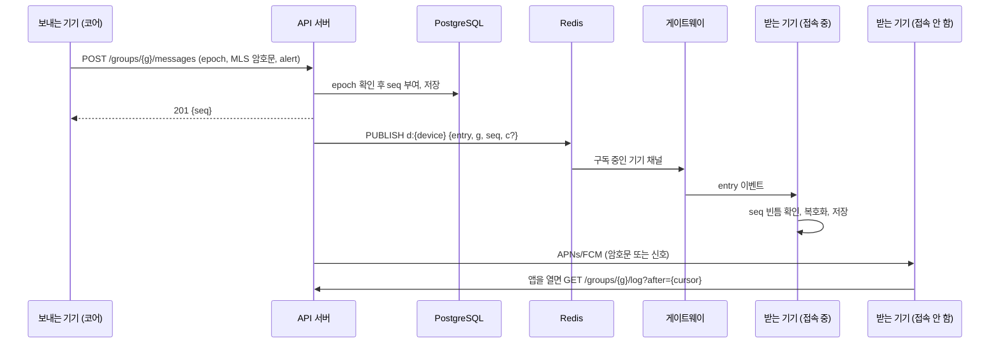

# 공통 계약

모든 파트가 지키는 규칙입니다. 이 문서를 바꾸면 관련 파트의 테스트 벡터도 같은 PR에서 바꿉니다. 제품 규칙은 [개요](../kickoff.md) 5장에 있습니다.

## 1. 식별자

| 이름 | 형식 | 만드는 곳 | 비고 |
| --- | --- | --- | --- |
| `user_id` | UUID | API | 계정 |
| `device_id` | UUID | API | MVP는 계정당 활성 기기 1대 |
| `group_id` | UUID | API | 그룹(`circle`)과 1:1(`dm`) 모두. MLS 그룹 ID도 이 16바이트를 그대로 씀 |
| `seq` | 64비트 정수 | API | 그룹 안 순번. 커밋과 메시지가 한 줄로 이어짐 |
| `epoch` | 64비트 정수 | MLS | 커밋이 수락될 때마다 1씩 증가 |
| `appt`, 메시지 `id` | UUIDv7 | 기기 | 약속과 메시지의 ID. 시간순 정렬 가능 |

## 2. MLS 사용법

- **암호 조합:** `MLS_128_DHKEMX25519_CHACHA20POLY1305_SHA256_Ed25519`(0x0003).
- **자격 증명:** Basic credential. 내용은 `"{user_id}:{device_id}"` ASCII 문자열입니다.
- **추가 전 확인:** 다른 기기를 그룹에 넣는 기기는, 키 패키지의 자격 증명과 서명 공개키가 서버의 기기 목록(`GET /users/{id}/devices`)과 일치하는지 확인합니다. 서버가 가짜 기기를 끼워 넣는 공격은 이 확인으로 막지 못하며, [개요](../kickoff.md) 6장의 한계에 적혀 있습니다.
- **메시지 형식:** 커밋은 공개 메시지(PublicMessage), 채팅·날짜 잡기는 비공개 메시지(PrivateMessage)로 보냅니다. 멤버십은 서버가 이미 아는 정보라서 커밋을 숨길 이유가 없고, 공개해 두면 2단계에서 서버가 커밋을 검증할 수 있습니다.
- **그룹 생성:** 만든 사람의 기기가 `group_id` 16바이트를 MLS 그룹 ID로 그룹을 만듭니다.
- **멤버 추가:**
  1. 초대 코드로 들어온 사람은 `pending`이 됩니다.
  2. 온라인인 활성 멤버 기기 하나가 그 사람 기기의 키 패키지를 하나 가져와 Add 커밋과 Welcome을 만들어 함께 올립니다.
  3. 서버가 커밋을 수락하면 그 멤버는 `active`가 됩니다.
  4. 커밋한 기기는 이어서 새 멤버용 번들(5장)을 올립니다.
- **멤버 제거:** 탈퇴·강퇴·기기 해제가 일어나면 서버가 멤버 상태를 바꾸고 `membership` 이벤트를 보냅니다. 이를 먼저 처리한 활성 멤버 기기가 Remove 커밋을 올리고, 중복 커밋은 서버의 선점 규칙(6장)이 막습니다.
- **자기 갱신:** 각 기기는 마지막으로 자기 leaf를 갱신한 지 7일이 지나면 빈 커밋으로 갱신합니다. 기기가 털렸다가 회복된 뒤에도 이후 메시지가 다시 안전해집니다.
- **외부 가입(같은 사람의 새 기기):**
  - 커밋한 기기는 새 epoch의 GroupInfo를 커밋과 함께 올립니다.
  - 기기를 바꾼 사람이나 30일 넘게 따라잡지 못한 기기는, 이 GroupInfo로 외부 커밋을 만들어 스스로 다시 들어옵니다. 이전 leaf 제거와 새 leaf 추가가 커밋 하나에 들어갑니다.
  - 서버는 작성자가 그 그룹의 활성 멤버이고 현재 기기일 때만 외부 커밋을 받습니다.
- **충돌:** 커밋이 409를 받으면 동기화한 뒤 대기 중 커밋을 버리고, 아직 필요하면 새 epoch에서 다시 만듭니다.
- **MLS 상태는 백업하지 않습니다.** 복원한 상태로 메시지를 보내면 같은 키와 논스를 다시 쓸 위험이 있습니다. 새 기기는 외부 가입으로 새 leaf를 얻습니다.

## 3. 서버에 저장되는 것의 종류

| 종류 | 무엇 | 암호화 | 서버 보관 |
| --- | --- | --- | --- |
| 로그(우편함) | 커밋, 애플리케이션 메시지(채팅·날짜 잡기·투표) | MLS | 그룹 순번대로 30일 |
| Welcome | 새 기기 하나에 보내는 초대 | MLS | 가져가면 삭제 |
| GroupInfo | 외부 가입용 공개 그룹 정보 | 서명만 | 그룹마다 최신 1개 |
| 상태 블롭(state blob) | 가용 시간, 그룹 메타, 멤버 프로필, 새 멤버용 번들 | 상태 키 + XChaCha20-Poly1305 | (그룹, 종류, 주인)마다 최신 1개 |
| 미디어 | 채팅·약속·개인 일정의 사진·파일, 그룹 커버, 프로필 사진 | 파일마다 무작위 키, 청크 AEAD | 범위마다 다름(9장) |
| 백업 | 캘린더 + 채팅 텍스트 아카이브 | AMK, 청크 AEAD | 최근 3개 |

## 4. 엔트리

애플리케이션 메시지 하나에는 엔트리가 정확히 하나 들어갑니다. 엔트리는 CBOR로 인코딩한 `Envelope { v: 1, entry }`입니다.

```rust
// core/geunal-domain/src/entry.rs — every MLS application message in a group carries exactly one Entry, CBOR-encoded.
use serde::{Deserialize, Serialize};

#[derive(Serialize, Deserialize, Debug, Clone, Copy, PartialEq)]
#[serde(rename_all = "snake_case")]
pub enum Mode { Vote, Dictator }

#[derive(Serialize, Deserialize, Debug, Clone, Copy, PartialEq)]
#[serde(rename_all = "snake_case")]
pub enum Stage { Time, Activity }

#[derive(Serialize, Deserialize, Debug, Clone, PartialEq)]
#[serde(rename_all = "snake_case")]
pub enum Choice { Opt(String), Any }

// Times are minutes after 00:00 Asia/Seoul on `day`; an appointment never crosses midnight in the MVP.
#[derive(Serialize, Deserialize, Debug, Clone, PartialEq)]
#[serde(tag = "k", rename_all = "snake_case")]
pub enum Entry {
    Text { id: String, body: String, reply_to: Option<String> },
    // `appt` set: an attachment of that appointment, not a chat message. `name` is the file name shown for files.
    Media { id: String, object: String, key: Vec<u8>, size: u64, mime: String, sha256: Vec<u8>, thumb: Option<Vec<u8>>, name: Option<String>, appt: Option<String> },
    MediaRemove { id: String },
    // `leader_options` copies the group setting at request time so every device applies the same rule to this appointment.
    Request { appt: String, day: String, mode: Mode, start: Option<u16>, end: Option<u16>, activity: Option<String>, note: Option<String>, #[serde(default)] leader_options: bool },
    RequestUpdate { appt: String, mode: Option<Mode>, start: Option<u16>, end: Option<u16>, activity: Option<String>, note: Option<String> },
    LeadTransfer { appt: String, to: String },
    Response { appt: String, accept: bool },
    Poll { appt: String, stage: Stage, options: Vec<String> },
    PollOption { appt: String, stage: Stage, option: String },
    PollVote { appt: String, stage: Stage, choice: Choice },
    PollClose { appt: String, stage: Stage },
    Cancel { appt: String },
}

#[derive(Serialize, Deserialize, Debug, PartialEq)]
pub struct Envelope { pub v: u8, pub entry: Entry }

pub fn encode(entry: &Entry) -> Vec<u8> {
    let mut out = Vec::new();
    ciborium::into_writer(&Envelope { v: 1, entry: entry.clone() }, &mut out).expect("in-memory write");
    out
}

pub fn decode(bytes: &[u8]) -> Result<Entry, ciborium::de::Error<std::io::Error>> {
    ciborium::from_reader::<Envelope, _>(bytes).map(|e| e.entry)
}
```

규칙:
- **작성자:** MLS가 확인한 발신자 leaf의 자격 증명에서 `user_id`를 읽습니다. 엔트리 안에는 넣지 않으므로 위조할 수 없습니다.
- **주도자 전용:** `RequestUpdate`, `LeadTransfer`, `Poll`, `PollClose`, `Cancel`은 현재 주도자가 쓴 것만 유효합니다. 상태 함수가 검사하고, 아니면 무시합니다.
- **첨부 빼기:** `MediaRemove`는 그 `Media`를 쓴 사람이 쓴 것만, 그리고 `appt`가 있는 첨부에만 유효합니다. 채팅 메시지 삭제는 아직 없습니다.
- **약속 첨부 개수:** 약속마다 빠지지 않은 첨부 중 로그 순서로 앞의 3개만 유효합니다. 기기도 3개가 차 있으면 올리지 않습니다.
- **그룹 설정은 신청에 담습니다:** 상태 블롭은 로그 밖에 있어서 기기마다 받은 시점이 다를 수 있습니다. 그래서 상태 함수는 `group_meta`를 읽지 않습니다. 선택지 추가 권한은 신청할 때 `Request.leader_options`로 복사하고, 참이면 `PollOption`은 주도자가 쓴 것만 유효합니다. 기본 결정 방식과 시간 추천 범위는 신청하는 기기의 화면 기본값일 뿐이고, 결과는 `Request.mode`와 `Poll.options`에 이미 들어 있습니다.
- **시각:** 모든 시각 판정(투표 마감, 약속 날 00:00)은 서버가 엔트리를 받은 시각(`received_at`)으로 합니다. 기기 시계는 화면 표시에만 씁니다.
- **모르는 종류:** 새 버전의 엔트리는 원문 그대로 저장하고 "업데이트가 필요한 메시지"로 보여 줍니다.
- **크기:** "토요일 7시 어때?" 엔트리는 CBOR로 62바이트이고, MLS 메시지로는 254바이트입니다. 엔트리 하나는 64KB를 넘지 않고, 큰 내용은 미디어로 보냅니다.

## 5. 상태 블롭

가용 시간처럼 최신값만 의미 있는 데이터는 로그가 아니라 상태 블롭으로 덮어씁니다. MLS 메시지는 한 번만 복호화할 수 있지만, 상태 블롭은 그 epoch의 멤버라면 누구나 몇 번이든 읽을 수 있습니다.

- **키:** `MLS-Exporter("geunal state v1", "", 32)`. epoch마다 바뀝니다.
- **AAD:** `state|{group_id}|{epoch}|{kind}|{owner_id}`. 서버가 블롭을 다른 자리로 옮기지 못하게 합니다.
- **형식:** 무작위 논스(24바이트) ‖ 암호문 ‖ 태그(16바이트).

| 종류(`kind`) | 주인 | 평문(CBOR) | 언제 씀 |
| --- | --- | --- | --- |
| `availability` | 멤버 | `{window_start, days, bits}`: 30분마다 1비트, 1은 일정 없음, MSB부터 | 캘린더가 바뀔 때, epoch가 바뀔 때 |
| `group_meta` | 그룹당 하나. 마지막으로 봉인한 멤버 | `{name, color, cover?, plan, changed_by, changed_at}`. `cover`는 `{object, key, sha256}`, `plan`은 날짜 잡기 기본값 `{mode: Mode, window: [from, to], options_by}`(`window`는 30분 칸 번호, `options_by`는 `anyone` 또는 `leader`) | 멤버 누구나 공통 설정을 바꿀 때. epoch를 바꾼 커밋을 한 기기가 다시 봉인 |
| `member_profile` | 멤버 | `{nickname?, avatar?, birthday_md?, lunar?, tags?}`. `avatar`는 `{object, key, sha256}` | 그룹 프로필이나 공개 설정을 바꿀 때, epoch가 바뀔 때 |
| `newcomer_bundle` | 추가 커밋을 한 기기의 주인 | 날이 지나지 않은 약속의 엔트리 목록 `[(author_id, received_at, Entry)]` | 멤버를 추가한 직후 |

**그룹 메타는 공용 자리입니다.** 멤버 누구나 바꿀 수 있어서 서버는 그룹마다 한 줄만 두고 버전을 셉니다.
- 쓰는 기기는 읽었던 버전(`base_version`)을 함께 보냅니다. 그사이 다른 멤버가 바꿨으면 409 `state_conflict`를 받고, 최신 블롭을 읽어 자기가 바꾼 항목만 다시 얹은 뒤 재시도합니다.
- AAD의 `owner_id`는 그 블롭을 봉인한 멤버입니다. 화면에 보이는 "마지막으로 바꾼 사람"은 평문의 `changed_by`이고, epoch 때문에 다시 봉인한 기기는 이 값을 그대로 둡니다.

epoch 규칙:
- 쓰는 쪽은 epoch가 바뀌면 자기 블롭을 새 키로 다시 봉인합니다.
- 읽는 쪽은 최근 30일(그룹당 최대 50개) epoch의 상태 키를 보관해서, 아직 다시 봉인되지 않은 블롭도 읽습니다. 키가 없는 블롭의 주인은 그룹 캘린더에서 불참으로 보입니다.

**새 멤버용 번들의 한계:** 번들은 그룹 키로만 봉인되므로, 번들 안 엔트리의 작성자 표시는 번들을 쓴 멤버를 믿어야 합니다. 친구 그룹이라는 전제에서 받아들이고, 2단계에서 원래 서명을 함께 넘기는 방식으로 바꿉니다.

**크기:** 8주 가용 시간 블롭은 376바이트입니다.

## 6. 순서와 동기화



- **순번:** 서버가 그룹마다 순번(`seq`)을 매기고, 기기는 순번 순서대로 처리합니다. 순서는 MLS 처리 → 엔트리 디코드 → 로컬 저장 → 상태 함수 재계산입니다.
- **커서:** 기기는 그룹마다 마지막으로 처리한 순번을 갖고, `GET /groups/{id}/log?after={cursor}`로 따라잡습니다.
- **커밋 선점:** 서버는 현재 epoch에 대한 커밋 하나만 받습니다. 같은 epoch의 두 번째 커밋은 409 `epoch_conflict`입니다.
- **오래된 메시지 거절:** 서버는 현재 epoch가 아닌 메시지를 409 `stale_epoch`로 거절합니다. 보낸 기기는 대기 중인 커밋을 처리하고 새 epoch로 다시 암호화해 보냅니다. 그래서 받는 쪽은 지난 epoch의 비밀을 보관할 필요가 없습니다.
- **빈틈:** 게이트웨이나 푸시로 받은 순번이 커서 + 1보다 크면, 사이의 항목을 API에서 가져온 뒤 처리합니다.
- **30일 초과:** 커서가 우편함 보관 기간보다 오래되면 API가 410 `cursor_expired`를 줍니다. 기기는 그 그룹의 MLS 상태를 버리고 외부 가입(2장)으로 다시 들어옵니다. 로컬에 저장된 평문 기록은 그대로 남습니다.

## 7. 실시간 채널

게이트웨이는 Phoenix Channels(V2 JSON 직렬화)를 씁니다.

- **연결:** `wss://rt.<도메인>/socket/websocket?vsn=2.0.0&token=<access JWT>`
- **토픽:** `device:{device_id}` 하나. 자기 기기 토픽만 들어갈 수 있습니다.
- **기기 → 서버:** 하트비트 말고는 없습니다. 쓰기는 모두 API로 합니다.
- **하트비트:** 30초. 끊기면 지수 백오프(1초부터 최대 60초)로 다시 붙고, 붙으면 커서로 따라잡습니다.

| 서버 → 기기 이벤트 | 페이로드 | 기기가 할 일 |
| --- | --- | --- |
| `entry` | `{g, s, kind, c?}`: 그룹, 순번, `commit`/`app`, 암호문(4KB 이하일 때만) | `c`가 있으면 바로 처리, 없거나 빈틈이 있으면 API에서 가져오기 |
| `state` | `{g, kind, owner, epoch}` | 해당 상태 블롭 가져오기 |
| `membership` | `{g}` | 멤버 목록 다시 가져오기, 필요하면 Remove 커밋 |
| `welcome` | `{}` | `GET /me/welcomes` |
| `revoke` | `{}` | 연결 종료, 로그아웃 |

API가 게이트웨이에 신호를 보낼 때는 Redis 채널 `d:{device_id}`에 같은 JSON을 `{"t": "entry", ...}` 형태로 PUBLISH합니다. 게이트웨이는 자기에게 붙은 기기의 채널만 구독합니다.

## 8. 푸시

- **보내는 대상:** 메시지를 올릴 때 기기가 `alert` 값을 정합니다.

  | `alert` | 쓰는 엔트리 |
  | --- | --- |
  | `"all"` | 채팅, 날짜 잡기 신청, 투표 열기·닫기, 취소 |
  | `["user_id", ...]` | 수락·다음에(주도자에게), 시간·활동 변경과 약속 첨부(참가자에게) |
  | `"none"` | 투표, 선택지 추가, 첨부 빼기 |

- **종류(`cat`):** `alert`가 `none`이 아니면 기기가 `chat`(텍스트, 사진·파일) 또는 `plan`(날짜 잡기 신청·응답·변경·취소, 투표 열기·닫기, 약속 첨부)을 함께 보냅니다. 종류별 알림 끄기를 위해 서버가 아는 유일한 내용 정보입니다.
- **빼는 대상:** 서버는 보낸 사람 자신, 전체 알림을 끈(`muted_until`) 멤버, 그 종류를 끈(`notify_chat`, `notify_plan`) 멤버를 뺍니다.
- **페이로드:** `{"g": group_id, "s": seq, "c": base64 암호문}`. `c`는 암호문이 3KB 이하일 때만 넣습니다.
- **iOS:** `aps.alert`에 "새 메시지" 같은 자리표시 문구와 `mutable-content: 1`을 넣습니다. 알림 확장이 복호화해서 문구를 바꿉니다.
- **안드로이드:** 우선순위 높은 데이터 전용 메시지로 보내고, 앱의 핸들러가 알림을 만듭니다.
- **`c`가 없을 때:** 알림 확장이나 핸들러가 API에서 그 항목을 가져와 복호화합니다(30초 안).

## 9. 미디어

1. 보내는 기기가 파일마다 무작위 32바이트 키를 만들고, 64KiB 청크로 나눠 STREAM 구성(RustCrypto `aead::stream`, XChaCha20-Poly1305, BE32)으로 암호화합니다.
2. 범위에 맞는 엔드포인트에서 업로드 URL과 `object` 키를 받아 암호문을 올립니다. 서버는 파일 형식을 모르고 크기와 범위만 압니다.
3. 키는 아래 표의 자리에 둡니다. `Media` 엔트리에는 `object`, 키, 크기, MIME, 암호문 SHA-256, 썸네일(8KB 이하), 파일 이름을 넣습니다.
4. 받는 기기는 `GET /media/{object}`로 다운로드 URL을 받아 내려받고, SHA-256을 확인한 뒤 복호화합니다.
5. 지우기는 올린 사람만 합니다(`DELETE /media/{object}`). 보관 기간이 지나면 서버가 지우고, 버킷 수명 규칙이 한 번 더 지웁니다.

| 범위(`scope`) | 올리기 | 키가 있는 곳 | 크기 | 서버 보관 |
| --- | --- | --- | --- | --- |
| `chat` | `POST /groups/{id}/media` | `Media` 엔트리 | 10MB 이하 | 30일 |
| `appt` | `POST /groups/{id}/media` | `Media` 엔트리(`appt` 있음) | 10MB 이하 | 1년 |
| `personal` | `POST /me/attachments` | 내 로컬 저장소와 백업 | 10MB 이하 | 1년 |
| `cover` | `PUT /groups/{id}/cover`(멤버 누구나) | `group_meta` | 1MB 이하 | 새 커버를 올리면 이전 것은 7일 뒤 |
| `avatar` | `PUT /groups/{id}/members/me/avatar` | `member_profile` | 256KB 이하 | 새 사진을 올리면 이전 것은 7일 뒤 |

- **TimeTree와 같은 제한:** 파일당 10MB, 일정·약속 하나에 3개, 형식은 PDF·JPEG·PNG·HEIC·GIF·TXT·DOCX·XLSX·PPTX. 서버는 형식을 모르므로 크기만 검사하고, 형식과 개수는 기기가 검사합니다(약속 첨부 개수는 4장 규칙으로도 막음).
- 커버와 프로필 사진은 자리마다 하나만 남깁니다. 이전 것을 7일 남기는 이유는, 새 블롭이 올라오기 전까지 다른 기기가 이전 블롭을 읽기 때문입니다.

## 10. 백업

- **내용:** 캘린더 테이블, 사람·생일, 설정, 채팅 텍스트 기록을 CBOR 아카이브로 묶습니다. 사진·파일 자체와 MLS 상태는 넣지 않습니다. 개인 일정 첨부의 키와 `object` 키는 넣어서, 복원한 기기가 서버 보관본을 다시 받습니다.
- **암호화:** AMK로, 미디어와 같은 청크 방식을 씁니다.
- **올리기:** `POST /me/backups`로 업로드 URL을 받아 올리고 완료를 알립니다. 서버는 최근 3개만 남깁니다.
- **복원:** 로그인 → 복구 코드 → `GET /me/recovery`(salt, 래핑된 AMK) → Argon2id → AMK → `GET /me/backups/latest` → 복호화 → 로컬 저장소 채우기 → 그룹마다 외부 가입.

## 11. API 오류 규약

모든 오류 본문은 `{"error": "<code>", "message": "..."}` 형식입니다.

| HTTP | `error` | 기기가 할 일 |
| --- | --- | --- |
| 400 | `invalid_request` | 요청 형식이 틀렸음(필드 누락, MLS 헤더와 요청 불일치). 고치기 전에는 재시도하지 않음 |
| 401 | `token_expired` | 리프레시 토큰으로 갱신 후 재시도 |
| 403 | `not_member`, `not_owner`, `blocked`, `device_revoked` | 화면에 알리고 중단. `device_revoked`면 로그아웃 |
| 404 | `not_found` | 중단 |
| 409 | `epoch_conflict` | 동기화 후 커밋을 다시 만들어 재시도 |
| 409 | `stale_epoch` | 대기 커밋 처리 후 다시 암호화해 재시도 |
| 409 | `state_conflict` | 그룹 메타를 다시 읽고 내 변경을 얹어 재시도 |
| 410 | `cursor_expired` | 외부 가입으로 다시 들어오기 |
| 413 | `too_large` | 미디어로 보내기 |
| 429 | `rate_limited` | `Retry-After`만큼 기다린 뒤 재시도 |
| 500 | `internal` | 지수 백오프로 재시도 |

바이트 값(암호문, 키, MLS 메시지)은 JSON에서 표준 base64(패딩 있음) 문자열입니다. 요청·응답 본문의 모양은 `server/api/openapi.yaml`에 있습니다.

## 12. 테스트 벡터

| 벡터 | 만드는 곳 | 검증하는 곳 |
| --- | --- | --- |
| MLS 헤더(커밋·메시지의 그룹 ID, epoch, 형식) | Rust 코어 | API 서버의 Kotlin 헤더 파서 |
| 엔트리 CBOR | Rust 코어 | Rust 코어(버전 간 호환) |
| 상태 블롭 AAD와 형식 | Rust 코어 | Rust 코어 |
| 실시간 이벤트 JSON | API 서버 | 게이트웨이, Rust 코어 |
| 푸시 페이로드 | API 서버 | Rust 코어(`decrypt_push`) |

벡터는 `core/vectors/*.json`에 두고, 다른 파트의 CI가 같은 파일을 읽습니다.
