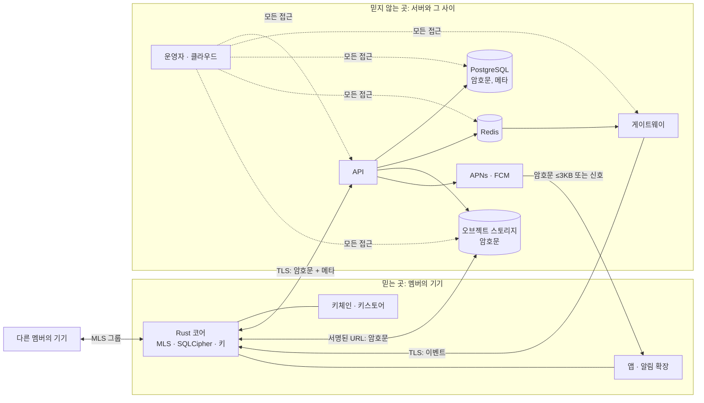

# 위협 모델

[개요](../kickoff.md) 6장의 보안·개인정보 모델을 공격자 관점에서 다시 씁니다. 공격자마다 무엇을 할 수 있고, 무엇을 노리고, 설계의 어느 부분이 막고, 무엇이 남고, 그것을 어떤 테스트가 확인하는지 적습니다. 설계 자체는 바꾸지 않습니다. 설계가 가정하는 것을 드러내고, 그 가정이 깨질 때 어디까지 번지는지 보는 것이 목적입니다. 남는 위험은 [개요](../kickoff.md) 6장 "한계"와 보안 안내 페이지(M4)에 그대로 적습니다.

## 1. 지키는 것과 지키지 않는 것

| 자산 | 어디에 있나 | 보호 수준 |
| --- | --- | --- |
| 일정 내용, 사람·생일, 채팅, 날짜 잡기·투표, 첨부 | 멤버 기기의 SQLCipher. 서버에는 MLS·AEAD 암호문만 | **기밀성과 무결성을 멤버 기기 밖에서 보장**합니다. 운영자도 읽지 못합니다 |
| 가용 시간(30분 비트맵), 그룹 이름·색·커버, 그룹 프로필 | 상태 블롭(상태 키로 봉인) | 같음. 다만 블롭의 크기·시각·주인은 서버가 압니다 |
| 키: 기기 서명 키, MLS 그룹 비밀, 상태 키, AMK, 미디어 키, 복구 키 | 기기의 키체인·키스토어(`SecretStore`), MLS 상태, 메시지 안 | 기기를 떠나지 않습니다. 복구 키는 12단어에서 유도하고 서버에는 래핑된 AMK, 게스트 복귀용 복구 ID와 복구 공개키만 둡니다([공통 계약](../parts/protocol.md) 10장) |
| 메타데이터: 누가 어느 그룹에 있고, 누가 언제 얼마나 보냈는지, 알림 종류(`cat`), 접속 IP | 서버 | **보호하지 않습니다.** [개요](../kickoff.md) 6장 "서버가 보는 것" 표가 전부이고, 그 표가 개인정보 처리방침입니다 |
| 서비스 가용성 | 서버 | 공격자가 서버를 멈추거나 메시지를 버릴 수 있음을 **받아들입니다.** 기기는 순번 빈틈을 알아채지만 서버가 아예 안 주는 것은 알 수 없습니다 |

지키지 않기로 한 것은 공격이 아니라 비용으로 다룹니다. 운영자가 메타데이터를 가진다는 사실이 처리방침과 보안 안내 페이지에 적혀 있으면, 그 사실 자체는 결함이 아닙니다.

## 2. 신뢰 경계

- **경계 1: 기기 ↔ 서버.** 서버로 나가는 것은 암호문과 [개요](../kickoff.md) 6장 표의 메타데이터뿐입니다. 서버에서 들어오는 것은 모두 검증 대상입니다(MLS 서명, AEAD 태그, SHA-256, 순번).
- **경계 2: 기기 ↔ 다른 멤버.** 같은 그룹의 멤버는 그룹 안의 모든 내용을 봅니다. 이것은 설계입니다. 멤버가 할 수 없어야 하는 것은 **남을 사칭하는 것**과 **주도자·업로더 전용 규칙을 깨는 것**입니다.
- **경계 3: 기기 안.** 앱, 알림 확장(iOS), 위젯이 같은 저장소와 키체인을 씁니다. 기기가 공격자 손에 있으면 이 경계는 OS가 지킵니다.
- **경계 4: 개발·배포 경로.** 저장소, CI, 의존성, 컨테이너 이미지. 여기가 뚫리면 위 셋이 모두 무의미하므로 [의존성 취약점 검사](dependencies.md)와 CI 규칙([QA](../qa.md) 5장)으로 다룹니다.

## 3. 공격자

각 공격자마다 "할 수 있는 것 → 노리는 것 → 막는 것 → 남는 것 → 확인"으로 적습니다. "확인" 열의 테스트 이름은 각 파트 문서 테스트 장의 것이거나, 이 문서가 새로 요구하는 것입니다(이름 앞에 ＋).

### 3.1 운영자

클라우드 콘솔, DB, 로그, 배포 키를 가진 사람. 호기심이 많은 운영자, 계정이 털린 운영자, 법적 요청을 받은 운영자를 한 묶음으로 봅니다. 능력은 3.2 서버 침해와 같고, 다른 점은 **합법적으로 오래 접근할 수 있다**는 것입니다.

| | |
| --- | --- |
| 할 수 있는 것 | 모든 저장 데이터와 로그 읽기, 서버 코드 바꾸기, 가짜 응답 보내기, 데이터 지우기 |
| 노리는 것 | 특정 사용자의 일정·대화. 누가 누구와 언제 만나는지 |
| 막는 것 | 서버에 복호화 경로가 없음([개요](../kickoff.md) 6장 "하지 않을 것"). MLS 메시지·상태 블롭·미디어·백업이 모두 기기 키로 암호화. 로그에 본문·암호문·토큰 금지([API](../parts/api-server.md) 10장). 신고 경로만 평문을 받고, 그것도 신고자가 신고 검토 공개키로 봉인해 운영자 개인키(오프라인)로만 열림 |
| 남는 것 | **(a) 적극적 중간자.** 서버가 "이 사람의 새 기기"라며 자기 키 패키지를 끼워 넣으면, 다음 Add 커밋부터 그룹 내용을 읽습니다. 추가하는 기기는 키 패키지를 서버의 기기 목록과 대조하지만, 그 목록도 서버가 줍니다([공통 계약](../parts/protocol.md) 2장). 안전 번호 비교(2단계) 전까지 "운영자가 적극적으로 공격하지 않는다"는 가정이 들어갑니다. 멤버 목록 화면에 **기기 변경이 눈에 보이게** 하면 사람이 알아챌 가능성은 생깁니다. **(b) 메타데이터.** 그룹 구성, 메시지 시각·크기, `cat`(채팅인지 약속인지), 접속 IP. 메시지 크기는 CBOR 길이가 그대로 드러나서 "수락"과 긴 채팅이 구분됩니다. **(c) 가용성.** 메시지를 버리거나 순번을 안 주면 기기는 모릅니다. **(d) 법적 요청.** 제공할 수 있는 것은 메타데이터뿐이고, 이 사실을 정책에 명시합니다([개요](../kickoff.md) 7장) |
| 확인 | API 테스트 ＋`stores a message's ciphertext byte for byte and never parses past the MLS header`. ＋`logs no request body, ciphertext or token at any level`(로그 출력에 정규식 검사). 코어 `adds a device with a welcome and rejects a commit for an epoch the server has passed`. 상태 블롭 AAD에 `group_id`·`epoch`·`kind`·`owner_id`가 들어가 서버가 블롭을 다른 자리로 옮기면 열리지 않음: ＋`refuses a state blob served under another group, epoch, kind or owner` |

**검토할 결정(코어·앱):** 멤버의 기기가 바뀌었을 때(새 `device_id`가 그룹에 들어옴) 그룹 화면에 "OO님이 새 기기에서 들어왔어요"를 표시할지. 안전 번호 비교의 전 단계로, 운영자의 적극적 공격을 사람이 알아챌 유일한 수단입니다. 비용은 문구 하나와 멤버십 이벤트 처리입니다.

### 3.2 서버 침해

API·게이트웨이 호스트의 원격 코드 실행, DB 덤프 유출, 오브젝트 스토리지 버킷 노출, Redis 접근, 비밀값(JWT 서명 키, DB 자격 증명) 탈취. 운영자보다 짧게 접근하지만 운영자가 모르는 채로 지나갈 수 있습니다.

| 침해된 것 | 공격자가 얻는 것 | 막는 것 | 남는 것 |
| --- | --- | --- | --- |
| PostgreSQL 덤프 | 30일치 로그 암호문, 상태 블롭 암호문, GroupInfo(서명만), 멤버십·기기 공개키·푸시 토큰, 리프레시 토큰의 SHA-256, 래핑된 AMK, 복구 ID와 복구 공개키, 신고 봉인문 | MLS·AEAD. 리프레시 토큰은 해시만, 게스트 복귀는 공개키로 확인하는 서명이라 덤프로 로그인하지 못함. 래핑 키·복구 ID·복구 서명 키는 모두 복구 코드(12단어, BIP39 128비트)에서 64MiB Argon2id를 거쳐 유도해서, 단어 일부가 드러나도 남은 후보마다 Argon2id가 듦 | 메타데이터 전부. **복구 코드가 약하면**(사람이 고른 단어, 사진으로 찍어 클라우드에 올림) 백업이 열림. 그래서 복구 코드는 코어가 무작위로 만들고 사용자가 고르지 못하게 합니다 |
| 오브젝트 스토리지 | 미디어·백업·커버·프로필 사진 암호문, 크기, 시각 | 파일마다 무작위 키, 청크 AEAD(STREAM)로 잘라 붙이기·순서 바꾸기 탐지. 받는 기기가 SHA-256을 확인 | 크기와 시각. 백업 크기로 사용량이 드러남 |
| Redis | 전달 중인 이벤트(`entry`의 암호문 ≤4KB, `state`·`membership` 신호) | 암호문. Redis는 사설망에서만 | 실시간 메타데이터. 가짜 이벤트를 PUBLISH하면 기기가 API에서 가져오려 하지만, API가 거절하므로 내용은 못 넣음 |
| JWT 서명 키(ES256) | 어떤 기기든 사칭해 API를 부름 | 토큰이 15분. 키는 Secret Manager, 분기마다 `kid`로 겹쳐 교체([인프라](../parts/infra.md) 10장) | **운영자의 적극적 공격과 같은 능력**(3.1 a): 가짜 기기 등록, 우편함 읽기(암호문), 멤버 강퇴, 그룹 삭제. 내용은 여전히 못 읽음. 키 교체와 리프레시 토큰 전체 무효화가 복구 절차 |
| API 호스트 RCE | 위 전부 + 코드 바꿔 평문을 받도록 앱을 유도? | 앱은 서버가 평문을 요구하는 경로가 없음. 서버가 보내는 것은 모두 기기가 검증 | 가용성과 메타데이터. 서버 이미지는 Trivy로 검사하고 비루트로 실행 |
| 게이트웨이 호스트 | 접속 기기 목록, 이벤트 암호문 | 게이트웨이는 쓰기 경로가 없음(하트비트만 받음) | 접속 패턴 |
| CI·배포 키 | 악성 이미지 배포, 저장소 변조 | GitHub Actions를 SHA로 고정, `persist-credentials: false`, 배포 키는 최소 권한 Sub Account, 분기 교체. 룰셋이 `main` 강제 푸시 금지 | **공급망.** 앱 바이너리를 바꿀 수 있는 것은 스토어 서명 키(사용자 보관)뿐이므로 서버 침해로 앱이 바뀌지는 않음. 서버 쪽은 [의존성 취약점 검사](dependencies.md) |

확인:
- API ＋`hashes refresh tokens before storing them and never returns the hash`.
- 코어 ＋`recovery words come from the CSPRNG with 128 bits of entropy and cannot be supplied by the caller`.
- 코어 `rejects media whose ciphertext hash does not match the entry`, ＋`rejects a media chunk replayed from another position`(STREAM 순서).
- 게이트웨이 `자기 기기 토픽만 들어가는지`, `만료되거나 서명이 틀린 토큰을 거절하는지`.
- 인프라: `make scan-api`, `make scan-gateway`, 비루트 실행은 Dockerfile 리뷰 항목.

### 3.3 분실·도난 기기

세 경우로 나눕니다. **(가) 잠긴 채로 분실**, **(나) 잠금 해제 상태로 도난**(또는 잠금 코드를 아는 사람), **(다) 기기 + 복구 코드 함께 분실**.

| | (가) 잠김 | (나) 열림 | (다) 기기 + 복구 코드 |
| --- | --- | --- | --- |
| 공격자가 얻는 것 | 디스크의 SQLCipher 파일(암호문). 키는 첫 잠금 해제 뒤 접근 가능 등급(`AfterFirstUnlockThisDeviceOnly`)이라 **재부팅 전까지는 OS 안에서 읽을 수 있음** | 앱이 보여 주는 모든 평문, 알림, 새 메시지 수신(강퇴·해제 전까지) | (나) + 백업 복원으로 다른 기기에서도 기록 |
| 막는 것 | SQLCipher 키·서명 키·AMK는 키체인·키스토어에만([Rust 코어](../parts/rust-core.md) 4장). 안드로이드는 키스토어 AES 키로 감싸고 `allowBackup` 제외([안드로이드](../parts/android.md) 2장). iOS는 `ThisDeviceOnly`로 iCloud 제외 | **사용자가 다른 기기에서 로그인**하면 서버가 이전 기기를 해제하고 `revoke`를 보냄([API](../parts/api-server.md) 4장). 서버는 그 기기에 더 전달하지 않고 403 `device_revoked`. 멤버십 변경을 본 다른 멤버 기기가 Remove 커밋을 올려 epoch가 바뀜 → 이후 메시지는 못 풂. 7일 자기 갱신(PCS) | 없음. 기기와 복구 코드를 함께 잃는 것은 "기록 유실"로 받아들임([개요](../kickoff.md) 6장) |
| 남는 것 | OS 취약점으로 잠긴 기기에서 키체인을 읽으면 전부 열림. 재부팅된 기기는 첫 잠금 해제까지 안전. **이 등급은 알림 확장이 잠긴 상태에서 복호화하기 위한 선택**이고, 더 높은 등급은 알림 문구를 포기해야 함 | 해제 전까지 공격자가 보는 새 메시지. **이미 받은 평문은 모두 로컬에 있으므로 과거 기록은 회수 불가.** 공격자가 다른 멤버를 강퇴하거나 그룹 메타를 바꿀 수 있음(멤버 권한). 알림 센터에 복호화된 문구가 남음 | 기록 전부 |
| 사용자가 할 일 | 새 기기에서 로그인(= 이전 기기 해제). 앱의 "기기 해제" 메뉴를 따로 둘지 검토할 결정 | 같음, 빨리 | 없음 |

확인:
- 게이트웨이 `revoke를 받으면 연결을 닫는지`.
- API ＋`a new device registration revokes the previous device, stops delivery to it and answers device_revoked`.
- 코어 ＋`a revoked device stops syncing and asks the app to log out`. `re-seals own availability after every epoch change`(해제된 기기가 옛 상태 키로 새 블롭을 못 읽는지의 반대 방향).
- 종단(M4) 기기 변경 시나리오([QA](../qa.md) 3.2).
- 실기기(사용자): 잠긴 상태에서 알림 문구가 뜨는지, 로그아웃 뒤 로컬 데이터가 지워지는지.

**검토할 결정(앱):** 로그아웃·기기 해제 때 로컬 저장소와 키체인을 지우는 것, 알림 센터의 복호화된 문구를 로그아웃 때 모두 지우는 것(iOS `removeAllDeliveredNotifications`).

### 3.4 악의적 멤버

그룹에 정당하게 들어온 사람이 규칙을 깨려 합니다. 네 가지로 나눕니다: **현재 멤버**, **나간·강퇴된 멤버**, **초대 코드를 얻은 외부인**, **차단된 1:1 상대**.

| 노리는 것 | 막는 것 | 남는 것 | 확인 |
| --- | --- | --- | --- |
| 다른 멤버 사칭(남의 이름으로 메시지·수락·투표) | 작성자는 MLS 발신자 leaf의 자격 증명에서 읽고 엔트리 안에는 넣지 않음([공통 계약](../parts/protocol.md) 4장) | **새 멤버용 번들** 안의 엔트리는 번들을 쓴 멤버의 말을 믿어야 함. 번들을 쓰는 멤버가 과거 수락·투표를 조작할 수 있음. 친구 그룹 전제로 받아들이고 2단계에서 원래 서명을 함께 넘김 | 코어 ＋`derives the author from the MLS sender and ignores any author field inside an entry`. 번들 한계는 보안 안내 페이지에 기록 |
| 주도자가 아닌데 약속 변경·투표 열기·취소 | 상태 함수가 주도자 전용 엔트리를 작성자로 검사하고 무시 | 없음(모든 기기가 같은 함수) | `ignores request updates, polls and cancels not written by the current leader`, `ignores options added by non-leaders when the request copied leader_options` |
| 남의 첨부 빼기 | `MediaRemove`는 그 `Media`의 작성자만 | 없음 | `ignores a media_remove written by someone other than the uploader` |
| **숨은 멤버 넣기**: 자기 두 번째 계정이나 외부인의 키 패키지를 Add 커밋에 넣음 | 서버는 커밋을 수락할 때 `pending`인 멤버를 `active`로 바꾸므로 **서버 멤버 목록에 없는 사람은 `active`가 되지 않음.** 하지만 MLS 트리에 leaf를 넣는 것 자체는 MVP의 서버가 검증하지 않음(커밋 검증은 2단계) | **받는 기기가 커밋 뒤 MLS 로스터와 서버 멤버 목록을 대조하지 않으면, 숨은 leaf가 그룹 비밀을 받습니다.** mls-rs의 `IdentityProvider`로 자격 증명 `"{user_id}:{device_id}"`가 서버 기기 목록에 있는지 확인하면 막힘. 이것은 3.1(a)와 같은 검사이고, 공격자가 운영자가 아니라 멤버라는 점만 다름 | ＋코어 `rejects a commit whose new leaf is not an active member's current device`(M2). 아래 검토할 결정 |
| 나간·강퇴된 멤버가 이후 내용 읽기 | Remove 커밋으로 epoch 변경. 서버는 `not_member`로 우편함을 막음. 상태 블롭은 새 epoch 키로 다시 봉인 | **다시 봉인되기 전의 블롭**은 옛 키로 열리지만 그 내용은 이미 봤던 것. 과거 데이터는 회수 불가. Remove 커밋을 올리는 기기가 오래 없으면(모두 오프라인) 그동안 올라온 메시지를 옛 멤버가 읽음 → **서버가 `not_member`로 막는 것이 실질 방어**이고, 이것은 서버를 믿는 부분 | API ＋`a removed member gets not_member on the log and on state blobs`. 코어 `rejoins by external commit after cursor_expired and keeps local history` |
| 초대 코드 유출(카카오톡 단톡방에 퍼짐) | IP당 시간당 10회 레이트 리밋([API](../parts/api-server.md) 9장). 그룹당 20명 상한. 들어오면 모든 멤버에게 보임 | **코드 하나로 아무나 들어옵니다.** 초대한 멤버가 승인한 것으로 보고 온라인 기기가 자동 추가하기 때문([개요](../kickoff.md) 10장). 코드 만료·회수·사용 횟수 제한이 문서에 없음 | 아래 검토할 결정. API ＋`an invite code stops working after it expires or is revoked` |
| 스팸·괴롭힘(메시지 폭주, 불쾌한 커버·이름) | 메시지 사용자당 그룹마다 분당 60개. 신고·차단(M3). 방장 강퇴 | 커버·이름은 그룹 메타(3.5). 미디어 업로드 하루 200MB | 레이트 리밋 테스트, 신고 봉인 테스트(M3) |
| 악성 첨부(이미지 디코더 공격, 위장 파일) | 형식 9개와 10MB를 기기가 검사. 썸네일 8KB. 서버는 형식을 모름 | **디코더는 OS 것을 쓰므로 OS 취약점에 노출**됩니다. 파일은 미리보기 없이 저장만 하고 열기는 OS 뷰어에 맡김. 민감 이미지 가림(iOS Sensitive Content Analysis) | `refuses files over 10 MB and types outside the nine allowed formats before upload`. ＋`treats a Media entry whose mime does not match the magic bytes as a file, not an image` |
| 차단된 상대가 1:1로 계속 보내기 | 서버가 403 `blocked`. 그룹 안에서는 기기가 숨김 | 그룹 메시지는 서버가 거르지 않음(같은 그룹이면 봄) | API `차단하면 메시지가 거절되는지`. 코어 `hides group messages from a blocked member on this device only` |

**검토할 결정:**
- **(코어, M2)** 커밋을 처리할 때 새 leaf의 자격 증명을 서버 기기 목록과 대조하고, 모르는 leaf가 있으면 그 커밋을 거부하고 그룹을 "확인 필요"로 표시할지. 운영자와 멤버 둘 다에 대한 유일한 MVP 방어입니다. 비용은 커밋마다 `GET /groups/{id}/members` 한 번(캐시 가능).
- **(백엔드·기획, M2)** 초대 코드에 만료(예: 7일)와 사용 횟수(예: 20회, 그룹 정원)와 회수를 둘지. 서버가 코드 생성·사용 기록을 이미 남기므로 추가 비용은 작습니다.
- **(백엔드, M2)** 상태 블롭 쓰기에 레이트 리밋이 없습니다. 사용자당 그룹마다 분당 N회를 둘지(3.5 참고).

### 3.5 누구나 쓰는 그룹 메타

그룹 이름·커버·색·날짜 잡기 기본값은 멤버 누구나 바꿉니다([개요](../kickoff.md) 5.6). 서버는 그룹당 한 자리를 두고 버전을 비교합니다([공통 계약](../parts/protocol.md) 5장). 이것은 기능이고, 여기서는 그것이 남용될 때를 봅니다.

| 남용 | 막는 것 | 남는 것 | 확인 |
| --- | --- | --- | --- |
| 변경 전쟁(두 멤버가 계속 되돌림) | 버전 비교로 덮어쓰기 유실은 없음. "마지막으로 바꾼 사람"이 보임 | 막을 수단이 없음. 사회적으로 해결(친구 그룹). 초당 수십 번 쓰면 다른 기기의 재시도 폭주 → 레이트 리밋 필요(3.4 결정) | API `두 멤버가 같은 버전에서 동시에 쓰면 하나만 저장되고 다른 하나는 409`. 코어 `re-applies only my changed fields after a state_conflict on group_meta` |
| **"바꾼 사람" 위조**: 평문의 `changed_by`에 남의 ID를 넣음 | AAD의 `owner_id`(봉인한 멤버)는 서버가 인증한 작성자이므로 위조 불가 | **`changed_by`는 평문 안의 자기 주장**입니다. epoch 때문에 다시 봉인한 기기는 `changed_by`를 그대로 두는 규칙이라, `owner_id ≠ changed_by`가 정상일 수 있어 위조와 구분이 안 됨. 받아들이고 보안 안내 페이지에 적음. 2단계에서 원래 서명을 넘길 때 같이 고침 | 코어 `keeps changed_by when re-sealing group_meta after an epoch change`. ＋`shows the sealer when changed_by names someone who is not a member`(최소 검사) |
| 날짜 잡기 기본값 조작(선택지 추가를 주도자만으로, 시간 범위 축소) | 상태 함수는 `group_meta`를 읽지 않고, 신청할 때 `Request`에 복사된 값만 씀. 이미 신청된 약속에는 영향 없음 | 다음 신청의 기본값이 바뀌는 것뿐이고 신청자가 화면에서 바꿀 수 있음 | `ignores options added by non-leaders when the request copied leader_options` |
| 불쾌한 이름·커버 | 멤버 누구나 되돌릴 수 있음. 신고(M3). 방장 강퇴 | 운영자는 내용을 못 보므로 신고자가 봉인해 보내야 함. 커버는 1MB 이미지로 디코더 노출(3.4) | 신고 봉인 테스트(M3) |
| 오래된 epoch로 덮어쓰기(강퇴된 멤버가 옛 키로 봉인한 블롭 올리기) | 서버가 `epoch <= EXCLUDED.epoch`일 때만 저장. 강퇴되면 `not_member` | 없음 | API `오래된 epoch로는 덮어쓰지 못하는지` |
| 서버가 블롭을 다른 그룹·종류·주인 자리에 옮김 | AAD `state|{group_id}|{epoch}|{kind}|{owner_id}` | 없음 | ＋`refuses a state blob served under another group, epoch, kind or owner`(3.1과 같은 테스트) |
| 블롭 삭제·되돌리기(서버가 옛 버전을 다시 줌) | 없음. 서버는 최신값 하나만 두고 기기는 버전을 비교하지 않음 | **서버가 옛 블롭을 돌려주면 기기는 그대로 믿습니다.** 가용 시간이 옛것으로 보여 잘못된 날을 잡게 할 수 있음. 내용은 못 바꾸므로 메타데이터 공격이 아니라 가용성·정확성 공격. 받아들이되, 기기가 자기 블롭의 마지막 버전을 기억하고 서버가 더 낮은 버전을 주면 다시 올리게 하면 자기 블롭은 지킴 | ＋코어 `re-uploads its own blob when the server returns an older version`(검토할 결정) |

## 4. 가로지르는 것

- **푸시 경로.** APNs·FCM에는 암호문(≤3KB)이나 신호만 갑니다. `cat`(`chat`/`plan`)은 종류별 알림 끄기를 위해 서버가 아는 유일한 내용 정보이고 6장 표에 있습니다. 알림 확장이 복호화한 문구는 알림 센터에 평문으로 남습니다(3.3).
- **로그.** 본문·암호문·토큰·개인정보 금지([API](../parts/api-server.md) 10장, [인프라](../parts/infra.md) 8장). 접속 IP는 접속 로그에만, 3개월. CI에 로그 정규식 검사를 두는 것은 3.1의 테스트로 요구했습니다.
- **크래시 리포트.** 외부 SDK 없이 스토어 기본 보고만([개요](../kickoff.md) 10장). 크래시 덤프에 평문이 들어가는 것을 막을 수 없으므로, 코어는 로그 메시지에 일정 제목·본문을 넣지 않습니다(디버그 빌드도 ID만).
- **시각.** 모든 시각 판정은 서버 수신 시각입니다. 서버가 시각을 조작하면 투표 마감이 바뀌지만 내용은 아닙니다. 기기 시계를 믿지 않으므로 멤버는 시각을 조작할 수 없습니다.
- **공급망.** [의존성 취약점 검사](dependencies.md). 암호 구현은 mls-rs(감사 미확인)와 RustCrypto이고 직접 만든 알고리즘은 없습니다. mls-rs 통합부는 M4 전 외부 리뷰 대상입니다.

## 5. 확인 매핑

이 문서가 새로 요구하는 테스트(＋)와 그 단계입니다. 파트가 테스트를 쓸 때 이 표의 이름을 쓰고, QA가 게이트에서 대조합니다.

| 테스트 | 파트 | 단계 | 위협 |
| --- | --- | --- | --- |
| `stores a message's ciphertext byte for byte and never parses past the MLS header` | API | M0 | 3.1 |
| `logs no request body, ciphertext or token at any level` | API, 게이트웨이 | M0 | 3.1, 4 |
| `refuses a state blob served under another group, epoch, kind or owner` | 코어 | M0 | 3.1, 3.5 |
| `derives the author from the MLS sender and ignores any author field inside an entry` | 코어 | M0 | 3.4 |
| `hashes refresh tokens before storing them and never returns the hash` | API | M1 | 3.2 |
| `recovery words come from the CSPRNG with 128 bits of entropy and cannot be supplied by the caller` | 코어 | M1 | 3.2 |
| `a new device registration revokes the previous device, stops delivery to it and answers device_revoked` | API | M1 | 3.3 |
| `a revoked device stops syncing and asks the app to log out` | 코어 | M1 | 3.3 |
| `rejects a commit whose new leaf is not an active member's current device` | 코어 | M2 | 3.1, 3.4 |
| `a removed member gets not_member on the log and on state blobs` | API | M2 | 3.4 |
| `an invite code stops working after it expires or is revoked` | API | M2 | 3.4(결정 뒤) |
| `shows the sealer when changed_by names someone who is not a member` | 코어 | M2 | 3.5 |
| `re-uploads its own blob when the server returns an older version` | 코어 | M2 | 3.5(결정 뒤) |
| `rejects a media chunk replayed from another position` | 코어 | M3 | 3.2 |
| `treats a Media entry whose mime does not match the magic bytes as a file, not an image` | 코어 | M3 | 3.4 |

## 6. 단계별 보안 할 일과 이 문서의 관계

[직군별 할 일](../plan.md)의 보안 줄을 이 문서의 절로 연결합니다.

| 단계 | 할 일 | 절 |
| --- | --- | --- |
| M0 | 위협 모델, 의존성 취약점 검사 | 이 문서, [의존성 취약점 검사](dependencies.md) |
| M1 | 백업 암호 구조 검토, 키체인·키스토어 설정, 로그 점검 | 3.2(복구 코드), 3.3(가), 4 |
| M2 | 초대 코드 남용, 그룹 메타 남용 | 3.4(초대 코드, 숨은 멤버), 3.5 |
| M3 | 신고 경로, 첨부 암호화, 의존성 점검, 외부 리뷰어 섭외 | 3.1(신고 봉인), 3.4(악성 첨부), 3.2(미디어) |
| M4 | 외부 리뷰 반영, 출시 전 점검, 보안 안내 페이지 | 1장 표와 3장의 "남는 것"이 안내 페이지의 내용 |

문서를 고칠 때: 설계가 바뀌어 "막는 것"이나 "남는 것"이 바뀌면 이 문서와 [개요](../kickoff.md) 6장 "한계"를 같은 PR에서 고칩니다.
